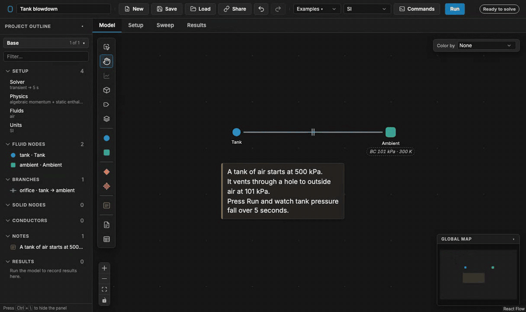

# OpenFLUME


[](https://github.com/OpenFLUME/OpenFLUME/actions/workflows/ci.yml)
[](https://github.com/OpenFLUME/OpenFLUME/actions/workflows/deploy.yml)
[](LICENSE)
[](https://doi.org/10.5281/zenodo.22051608)
[](https://pypi.org/project/openflume/)
[](https://openflume.github.io/)

**OpenFLUME** (Open **FLU**id **M**odel **E**nvironment) is a finite-volume thermo-fluid network simulator that runs entirely in the browser. Inspired by NASA GFSSP and SINDA/FLUINT, it solves coupled mass, momentum, and energy equations on arbitrary pipe-and-node networks using a Newton–Raphson steady solver and a backward-Euler transient solver.

**[Try it in your browser →](https://openflume.github.io/OpenFLUME/)** — no install, no account, nothing leaves your machine. · **[Documentation →](https://openflume.github.io/)**

Open a working model with one click: [tank blowdown](https://openflume.github.io/OpenFLUME/#example=tank-blowdown) · [cryogenic line chilldown](https://openflume.github.io/OpenFLUME/#example=cryogenic-line-cooldown) · [LOX/RP-1 thruster startup](https://openflume.github.io/OpenFLUME/#example=lox-rp-1-thruster-transient-startup) · [spacecraft radiator loop](https://openflume.github.io/OpenFLUME/#example=spacecraft-radiator-panel-ammonia-loop-heat-pipe) · [all examples](https://openflume.github.io/examples.html)



---

## What It Is

A local-first engineering tool for modeling 1-D fluid flow networks. It pairs a visual node-and-branch editor with a self-contained TypeScript solver library. The solver runs in a browser worker; an optional local companion server serves the app and discovers component files.

It is a lumped-parameter code. With `momentumFlux` and `kineticEnergy` enabled, it extends the network model with quasi-1-D compressible-flow effects, supporting subsonic and seeded supersonic solutions as well as friction-, heat-, and area-driven choking. Shock capture, Rankine–Hugoniot jumps, and acoustic wave propagation are out of scope. See [Limitations](#limitations) below.

## Capabilities

| Area                        | Summary                                                                                                                                                                                                                                                                                     |
| --------------------------- | ------------------------------------------------------------------------------------------------------------------------------------------------------------------------------------------------------------------------------------------------------------------------------------------- |
| **Solvers**                 | Newton–Raphson steady-state solver with convergence aids for difficult cases. Backward-Euler transient solver with fixed or adaptive time steps.                                                                                                                                            |
| **Components**              | 19 branch types: `areaChange`, `bend`, `capillaryChannel`, `cavitatingVenturi`, `checkValve`, `customResistance`, `dpTable`, `dynamicCheckValve`, `flowSource`, `heatedPipe`, `orifice`, `pipe`, `pump`, `rectChannel`, `regulator`, `reliefValve`, `resistance`, `userComponent`, `valve`. |
| **Fluids**                  | Incompressible, ideal gas, compressible liquid, and real fluid via CoolProp with a generated 124-fluid HEOS catalogue.                                                                                                                                                                      |
| **Conjugate heat transfer** | Coupled fluid–solid thermal modeling with conduction, convection, and radiation, plus a sourced catalogue of temperature-dependent material properties.                                                                                                                                     |
| **Compressible flow**       | Opt-in quasi-1-D compressible flow for every fluid model, with stagnation-enthalpy transport and per-branch Mach-number calculations.                                                                                                                                                       |
| **Two-phase**               | Transient homogeneous-equilibrium model (HEM) for real fluids, with Miropolskii film boiling for conjugate heat transfer.                                                                                                                                                                   |
| **Reacting flows**          | Transient multi-species flow with node-level Arrhenius kinetics and CEA-coupled combustion junctions.                                                                                                                                                                                       |
| **Microfluidics**           | Rectangular microchannels with the exact laminar duct law, and capillary channels: Washburn filling with displaced-gas resistance, capillary pumps, stop/burst and trigger valves, and air-trap detection, with an event log.                                                               |
| **Transient momentum**      | Optional fluid inertia `(L/A)·dṁ/dt` on pipe branches and trapped-gas cushions `P·V_gⁿ = const` on internal nodes.                                                                                                                                                                          |
| **Workflow**                | Visual network editing with subnetworks and notes, selection repeat and pipe splitting for line discretization, parameter sweeps, named variants, convergence diagnostics, provenance-tracked run history, `.fn` text files, and 14 built-in examples.                                      |
| **Extensibility**           | Custom pressure-drop tables, resistance models, embedded user components, stateful lifecycle registers, stop conditions, and transient PID control.                                                                                                                                         |

## Quick Start

Requires Node.js 22 (see `.nvmrc`) and npm ≥ 10.8.

```bash
git clone https://github.com/OpenFLUME/OpenFLUME.git
cd OpenFLUME
npm install
npm run dev      # opens http://localhost:5173
```

Then run something immediately:

1. Open the **Examples ▾** dropdown in the toolbar.
2. Select **"Sanity: orifice hand-calc"** and click **Run**. It converges to a closed-form result you can check by hand.
3. Select **"Tank blowdown"** — a transient ideal-gas tank venting through an orifice — and click **Run** to see time-history charts.

The [user's manual](docs/user-manual.md) walks through this in detail, and OpenFLUME is also usable as a library; see [§5.5 Using the Core as a Library](docs/user-manual.md#55-using-the-core-as-a-library).

> **Note:** the package is not yet published to npm, so library imports resolve from the source tree (`../src/core`) rather than a package specifier.

### From Python

The core is also available as a Python package that bundles its own Node.js runtime, so no JavaScript tooling is needed:

```bash
pip install openflume
```

```python
import openflume as of

result = of.load("feed_system.fn").solve()   # a model saved from the web app
print(result.converged, result.node("tank")["pressure"])
```

See [Python package](docs/python.md) for the API, parallel sweeps, and the trust model.

### Running tests

```bash
npm test          # fast pull-request tests
npm run check     # typecheck + fast tests + production build
npm run test:all  # all Vitest files (expensive opt-in blocks still skipped)
npm run test:e2e  # full end-to-end suite against a production preview build
```

See [CONTRIBUTING.md](CONTRIBUTING.md) for the full test tiers and the pull-request gate.

## Documentation

The documentation is published at **[openflume.github.io](https://openflume.github.io/)**, with a [getting-started guide](https://openflume.github.io/guides/getting-started.html), tutorials, an [examples gallery](https://openflume.github.io/examples.html), [notes for GFSSP and SINDA/FLUINT users](https://openflume.github.io/guides/from-gfssp.html), and [teaching labs](https://openflume.github.io/teach/). The site is built from this repository's `docs/` folder (`cd site && npm ci && npm run dev`).

The **[user manual](docs/user-manual.md)** provides the complete reference for network definitions, units and sign conventions, data structures and fields, component equations, solution methods, the interface, fourteen worked examples, and verification results.

| Document                                             | Covers                                                                            |
| ---------------------------------------------------- | --------------------------------------------------------------------------------- |
| [User's manual](docs/user-manual.md)                 | Everything. Start here.                                                           |
| [Architecture](docs/architecture.md)                 | System structure, worker-based solving, testing strategy, and simulation variants |
| [Combustion](docs/combustion.md)                     | CEA-coupled reacting junctions and species transport                              |
| [Python package](docs/python.md)                     | `pip install openflume`: Python API, CLI, sweeps, numpy/pandas output             |
| [User code](docs/usercode.md)                        | Embedded components, registers, logic, controllers                                |
| [Parameter bindings](docs/parameter-bindings.md)     | Formula-bound fields and convection correlations                                  |
| [Fluid catalogue](docs/fluid-catalogue.md)           | The 124-fluid HEOS catalogue                                                      |
| [Solid properties](docs/solid-properties-results.md) | Material catalogue and validity ranges                                            |
| [Solver convergence](docs/solver-convergence.md)     | Diagnosing a solve that will not converge                                         |

The full index is in [docs/README.md](docs/README.md).

## Verification

Verification evidence is split into three deliberately distinct classes, and every case is labeled with which one it belongs to:

1. **Analytic verification** — closed-form comparison, where a discrepancy is a code defect.
2. **Code-to-code benchmarking** — agreement with GFSSP or SINDA/FLUINT, which inherits the other code's assumptions.
3. **Validation against experiment** — comparison to digitized published test data.

Seven validation reports are regenerated from live solves, not transcribed:

| Report                                                                           | Contents                                                                                               |
| -------------------------------------------------------------------------------- | ------------------------------------------------------------------------------------------------------ |
| [Incompressible hydraulics](docs/validation/incompressible-hydraulics-report.md) | Hagen–Poiseuille, Darcy–Weisbach, parallel splits, Hardy-Cross loops, pump operating point             |
| [Compressible flow](docs/validation/compressible-report.md)                      | Case-for-case recreation of the NASA GFSSP TFAWS-2007 verification paper                               |
| [Thermal network](docs/validation/thermal-network-report.md)                     | Composite walls, radiation–convection equilibrium, lumped cooldown, ε–NTU exchangers                   |
| [Fluid transient](docs/validation/fluid-transient-report.md)                     | Rigid-column surge, gas-spring oscillation, polytropic compression                                     |
| [Tank transient](docs/validation/tank-transient-report.md)                       | Choked blowdown, dt convergence, two-tank equalization, fill heating                                   |
| [Combustion](docs/validation/combustion-report.md)                               | CEA identities, frozen c, injector and chamber balances, quasi-1-D nozzle, regen wall stack            |
| [Microfluidics](docs/validation/microfluidics-report.md)                         | Rectangular-duct and capillary closures; six published microfluidic networks rebuilt from their papers |

Experimental validation currently uses digitized NBS Report 9264 cryogenic chilldown data, with per-corpus trust levels stated explicitly — calibration-grade runs are separated from diagnostic-only runs that may not be quoted as agreement. The digitized Hord cavitation series (`validation/data/digitized/choked_flow_cavitation/`) and NASA tank-pressurization tests (`validation/data/digitized/tank_pressurization/`) are archived for future validation; no test, script, or report compares against them yet. See [§8 Verification and Validation](docs/user-manual.md#8-verification-and-validation) for the full record, tolerances, and the correlation status table.

Continuous integration reruns the complete scientific validation suite weekly.

## How This Was Built

OpenFLUME was written by one engineer with heavy AI assistance, over a short calendar period. That is unusual for a code of this kind, and it is precisely why the verification record above is structured the way it is: when generating plausible-looking code is cheap, evidence is the only thing that distinguishes a correct solver from a convincing one.

The project is built so that you do not have to take any of it on trust:

- Every validation report is regenerated from live solves by a script in [`scripts/`](scripts/), not written by hand.
- Every numerical claim states its reference, tolerance, units, and assumptions.
- Benchmarks run against published NASA GFSSP and SINDA/FLUINT cases and against digitized experimental data with cited provenance.
- Correlations that are not validated are labeled as not validated. See [§8.5 Correlation Status](docs/user-manual.md#85-correlation-status).
- The full validation suite runs in CI weekly, not just at release.

Check it rather than trust it. If you find a case where OpenFLUME disagrees with a reference you trust, please [open an issue](https://github.com/OpenFLUME/OpenFLUME/issues/new/choose) — a well-documented disagreement, with its reference and tolerance, is the single most useful contribution this project can receive.

## Limitations

The main scope limitations are:

- **No shock capture** — no Rankine–Hugoniot jump condition, so shock position, over-expanded operation, and supersonic → subsonic transitions are out of scope. Thrust is not computed.
- **No acoustic wave propagation** — lumped fluid inertia captures bulk surge, but there is no method-of-characteristics water-hammer solution.
- **Cavitation only at the venturi closure** — no general cavitation-inception check on pumps, valves, or low-pressure nodes.
- **Turbomachinery is a pump curve** — no compressor or turbine maps, and no shaft-work term in the energy equation.
- **No general junction mixing** — outside a declared CEA reacting junction, unlike fluids may not meet at a node; couple them through a solid wall.
- **Two-phase is HEM** — accurate for dispersed, high-mixing, or low-quality flows; under-predicts pressure drop at high void fraction. Lockhart–Martinelli multipliers are not yet implemented.
- **User code is trusted, not sandboxed** — embedded components execute with `new Function`. This is not a security boundary. See [SECURITY.md](SECURITY.md).
- **Steady closed ideal-gas loops** are singular without a pressure anchor; use a small leak or run in transient mode.

The authoritative, fully-qualified list is [§1.7 Scope Boundaries](docs/user-manual.md#17-scope-boundaries) in the user's manual.

## Roadmap

- [x] Multi-fluid networks (isolated continua, mixed EOS classes) with per-branch fluid context for user components
- [x] Kinetic-energy (stagnation-enthalpy) term in the energy balance, any EOS, steady or transient
- [x] Compressible duct flow: Fanno/Rayleigh choking and quasi-1-D converging–diverging nozzles
- [x] Reacting flows: transient species transport with stiff chemistry, and CEA-coupled reacting junctions
- [ ] Steady species transport and shifting-equilibrium downstream combustion
- [ ] Lockhart–Martinelli separated-flow pressure-drop multipliers
- [ ] Shock capture (Rankine–Hugoniot jump, over-expanded and separated nozzles, thrust)
- [ ] Distributed acoustic wave propagation (method of characteristics) for water hammer
- [ ] Cavitation-inception warnings on pumps, valves, and low-pressure liquid nodes
- [ ] Higher-order stiff chemistry integrator (Rosenbrock or BDF2+) to replace node-local BDF1

## Contributing

Contributions are welcome, particularly validation cases and disagreements with published references. Please read [CONTRIBUTING.md](CONTRIBUTING.md) before opening a pull request — numerical claims must state their reference, tolerance, and units, and contributions must not include export-controlled material.

Project policies: [Code of Conduct](CODE_OF_CONDUCT.md) · [Security](SECURITY.md) · [Changelog](CHANGELOG.md)

## How to Cite

If this software contributes to your research, please cite it. See [CITATION.cff](CITATION.cff) for current metadata, or use:

> Rising, J. (2026). OpenFLUME: Open FLUid Model Environment (v0.3.1). Zenodo. [https://doi.org/10.5281/zenodo.22051608](https://doi.org/10.5281/zenodo.22051608)

## License

[MIT](LICENSE)
