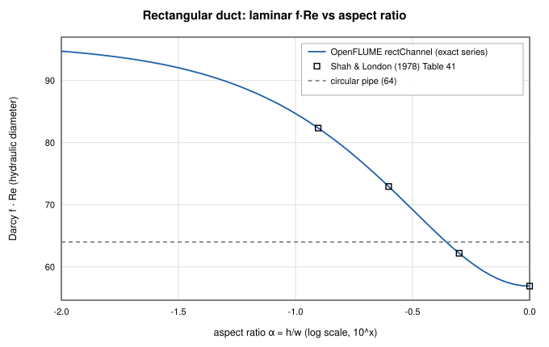
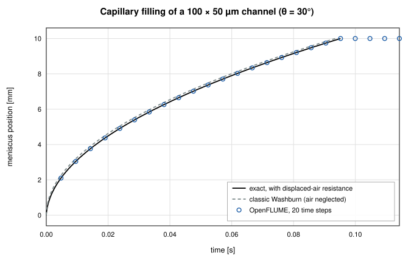
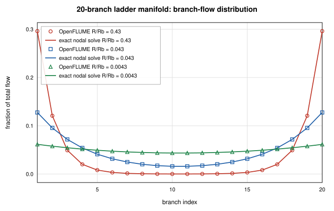
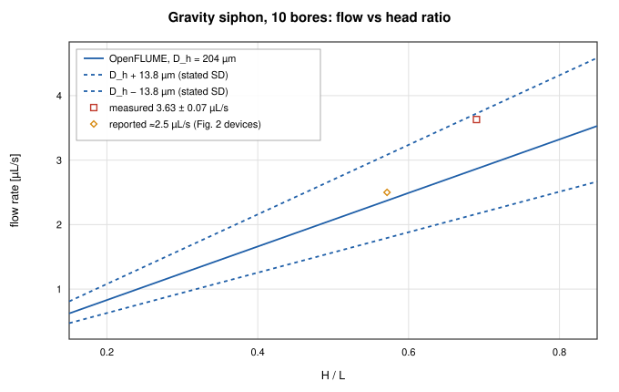
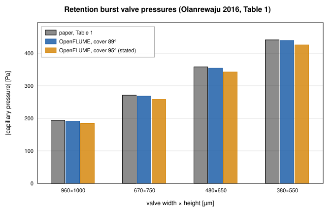
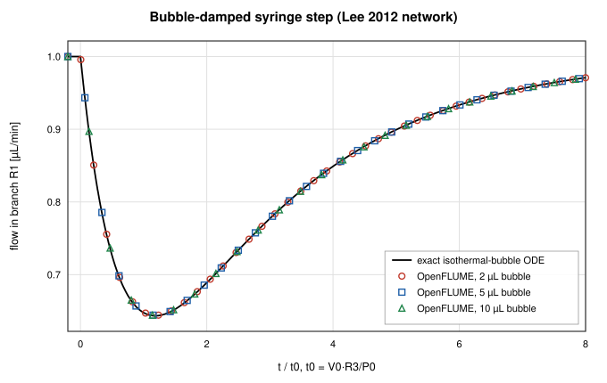

# Six published microfluidic networks, rebuilt and checked

_John Rising · 2026-11-17_

OpenFLUME was built for rocket feed systems and cryogenic lines, but a microfluidic chip is the same kind of network: nodes, branches, mass balance, and a pressure–flow law per branch. Only the regime differs. Flows run from nanolitres to microlitres per minute through rectangular channels tens of micrometres deep, often driven by capillarity alone.

Version 0.3.0 added two components for that regime. I checked them against exact solutions (Part A of the [microfluidics validation report](../validation/microfluidics-report.md)), then rebuilt six published networks from the parameters printed in their open-access papers (Part B). `scripts/microfluidics-validation-report.ts` regenerates every number below from live solves, and `src/validation/__tests__/microfluidics.test.ts` gates the published cases in CI.

## The two new components

**`rectChannel`** uses the exact fully developed laminar resistance of a rectangular duct at any aspect ratio, the Fourier-series solution `R = 12μL / (a³bF)` summed to machine precision. Above Re 2300 it blends to Swamee–Jain on the hydraulic diameter ([user manual §4.3.18](../user-manual.md#_4-3-18-rectangular-channel)).

**`capillaryChannel`** is a rectangular channel holding liquid over length `s` and gas over the rest. Its pressure–flow law combines the liquid and displaced-gas resistances, Young–Laplace pressure with per-wall contact angles, and hydrostatics. It supports stop (burst) valves using the Cho et al. (2007) burst pressure, trigger valves, hydrophobic-entrance pinning, and air-trap detection, with an event log ([§4.3.19](../user-manual.md#_4-3-19-capillary-channel)). Each meniscus is integrated across the step against a Thevenin equivalent of the rest of the network, so reservoir-driven (Washburn) and syringe-driven filling are exact at any step size.

## Part A: the closed forms

Any disagreement in these analytic checks would be a code defect.

**Rectangular-duct friction constant.** Against Shah & London's tabulated f·Re, the worst error over aspect ratios 1, 0.5, 0.25, and 0.125 is 0.002 %. A circular pipe sized to the hydraulic diameter of a 100 × 50 µm channel would predict 32 % less flow than the rectangle carries.

**Washburn filling with air resistance.** A 100 × 50 µm channel, 10 mm long, θ = 30°, fills in 0.0952 s. Including the displaced air's viscosity changes the exact front law; OpenFLUME follows it to 1.49e-8 of the fill time at 5, 50, or 500 steps per fill. The in-step integration handles even the stiff early phase, where velocity goes as 1/s.

**Jurin rise.** A vertical 500 µm square channel settles monotonically at 50.969 mm against an equilibrium height of 50.969 mm (error 8.17e-16).

**Syringe and resistance-coupled filling** match their exact laws to 2.40e-14 and 1.08e-13.

## Part B: six published networks

Each case is compared against the paper's own kind of result: a measurement with its error bar, the authors' model value, or a statement in the text. `src/validation/microfluidics.ts` cites where each parameter appears in its source.

### B1. Serial-dilution cell (Vasilakis et al. 2019)

Two syringe inlets at 0.4 µL/min feed five rectangular channels, 64 µm deep. OpenFLUME gives inlet pressures of 85.1 and 85.0 Pa (authors' COMSOL: 85.2 Pa) and a dilution ratio of 0.670 (design: 0.67).

The measured ratios were 0.65 ± 0.02 at 0.2 µL/min and 0.70 ± 0.01 at 0.4 µL/min. Both meet the design within the glucose meter's ±10 % accuracy, the authors' standard, but the 0.4 µL/min point sits about 3σ above the design by its own standard deviation. OpenFLUME reproduces the design, as the authors' optimization did, and doesn't account for that offset.

### B2. Hydrodynamic bead trap (Tan & Takeuchi 2007)

A trap constriction sits in parallel with a bypass loop, and a bead is trapped only if Q₁/Q₂ > 1. OpenFLUME gives 0.755 for device A (paper: 0.76, no bead trapped) and 3.949 for device B (paper: 3.95, every bead trapped). Like the paper's model, it treats the constriction as a fully developed duct although it is shorter than it is wide (L₁ < W₁), so entrance losses are ignored.

### B3. Parallel manifold (Guermonprez et al. 2015)

A 20-branch ladder has its inlet and outlet at opposite corners; only the ratio of manifold-segment to branch resistance matters.

| R/R_b  | first two + last two branches | spread  | Paper        |
| ------ | ----------------------------- | ------- | ------------ |
| 0.43   | 83.4 %                        | 29.60 % | ≈ 85 %       |
| 0.043  | 44.6 %                        | 11.16 % | ≈ 46 %       |
| 0.0043 | 23.8 %                        | 1.79 %  | spread ≤ 2 % |

Every branch flow matches an independent dense nodal solve to 2.16e-15. The 1–2 point gap to the paper is within its resolution: it quotes two significant figures and doesn't say how it counts the manifold's end segments.

### B4. Gravity-driven siphon (Reis et al. 2021)

Ten parallel bores have a mean hydraulic diameter of 204 ± 13.8 µm. At H/L = 0.69, OpenFLUME predicts 2.87 µL/s against a measured 3.63 ± 0.07 µL/s.

Flow goes as D⁴, so the stated ±6.8 % diameter spread becomes a ±27 % flow band, 2.17–3.72 µL/s. The measurement falls inside it, and a mean diameter of 216 µm, within one standard deviation, reproduces it. Since the solver equals Hagen–Poiseuille to 2.51e-13, the residual comes from the geometry input; I'd call the result consistent within the stated uncertainty rather than in agreement. At the second point (H = 40 mm, L = 70 mm), OpenFLUME gives 2.37 µL/s against ≈ 2.5 µL/s.

### B5. Capillaric-circuit valves (Olanrewaju et al. 2016)

These are retention burst valves in PDMS with a hydrophobic cover. Per-wall Young–Laplace with the paper's receding angles reproduces Table 1 to 0.4–1.3 % for four valves, and the capillary pump to 1.4 %, with a cover angle of 89°. The paper's valve section states 95°, which under-predicts every valve by 3–6 %; the 89° comes from its Conclusions and reproduces its own table. The report shows both.

The circuit's drainage sequence isn't modeled: it needs receding-meniscus draining of reservoirs, which OpenFLUME doesn't yet represent, and the paper omits the connector lengths.

### B6. Bubble-damped syringe network (Lee et al. 2012)

Two syringe pumps, each holding an air bubble of 2, 5, or 10 µL, feed a resistive junction, and one pump's flow steps from 1 to 2.5 µL/min. Against an independent integration of the network's exact ODE, OpenFLUME matches to 9.47e-4 at tolerance 1e-9 and 9.68e-4 at the UI default of 1e-6. The remainder is backward-Euler error, first order: 1.93e-3, 9.68e-4, and 2.43e-4 at 100, 200, and 800 steps per time constant. The paper's central finding also holds: responses for different bubble sizes collapse when time is scaled by `V₀R₃/P₀`, with the 2 µL and 10 µL curves coinciding to 1.71e-12.

This case exposed a solver defect. Before the fix, the 5 µL case erred by up to 1.2 % at tol 1e-9 and 37 % at the UI default, where the syringe step never reached the branch. The Newton stopping test compared an absolute tolerance against mass-balance rows in kg/s, so with imbalances near 1e-13 kg/s every step "converged" at its warm start. Since 0.3.0, mass-flow rows below 1e-3 kg/s are weighted by the network's flow scale, and the solver is bit-for-bit unchanged above that. Of the 14 shipped examples, only the Entrapped-air line changes, by 1e-7 relative, during its at-rest phase. `flowScaledTolerance.test.ts` fails on the old solver.

The bug lived in the general Newton loop, not the new component. Unit tests of the component wouldn't have caught it; the change of regime did.

## A circuit you can run

The [Capillary circuit (stop + trigger valve)](https://openflume.github.io/OpenFLUME/#example=capillary-circuit-stop-plus-trigger-valve) example is pumpless. A sample wicks into a short channel A and a longer delay channel B, which rejoin at junction J and feed a capillary pump vented to atmosphere ([§7.14](../user-manual.md#_7-14-capillary-circuit-stop-trigger-valve)). Click **Run** and the event log shows:

| t [s]  | event      | channel | node   |
| ------ | ---------- | ------- | ------ |
| 0.0000 | pinned     | A       | inlet  |
| 0.0262 | nodeWetted | B1      | bend   |
| 0.0542 | pinned     | A       | J      |
| 0.0984 | nodeWetted | B2      | J      |
| 0.0984 | triggered  | A       | J      |
| 0.1441 | nodeWetted | out     | pumpIn |

A's stop valve holds at J until B's liquid arrives and triggers it. The pin at A's entrance in the first step is physical: B's faster front pushes air into J, and for one step that back-pressure exceeds A's weak capillary pull.

## Limits

- **No receding-meniscus draining**, so the full drainage sequence of a retention-burst-valve circuit is out of reach.
- **No entrance effects** for constrictions shorter than they are wide.
- The usual scope boundaries apply ([§1.7](../user-manual.md#_1-7-scope-boundaries)); in particular, unlike fluids may not mix at a junction.

If you have a published microfluidic network with printed parameters and a measured or modeled result, I would like to add it. Please [open an issue](https://github.com/OpenFLUME/OpenFLUME/issues/new/choose) with the reference.
