# Recreating NASA's GFSSP compressible-flow verification paper in a browser

_John Rising · 2026-11-04_

In 2007, Bandyopadhyay and Majumdar presented "Modeling of Compressible Flow with Friction and Heat Transfer using the Generalized Fluid System Simulation Program (GFSSP)" at the Thermal & Fluids Analysis Workshop (TFAWS 2007, MSFC-464, [NTRS 20070036728](https://ntrs.nasa.gov/citations/20070036728)). They showed that a network code, from a family of solvers that usually neglects inertia and kinetic energy, could reproduce friction choking, thermal choking, and nozzle flow.

When I added compressible duct flow to OpenFLUME, I used that paper as the test plan, with the same geometry, boundary conditions, fluid, and figures. The numbers below come from the [compressible-flow validation report](../validation/compressible-report.md), which `scripts/compressible-validation-report.ts` regenerates from live solves; `src/core/__tests__/compressibleDuctFlow.test.ts` gates it in CI.

## What is being solved

Two opt-in settings enable compressible flow ([user manual §4.1.4](../user-manual.md#_4-1-4-compressible-duct-flow-kineticenergy)):

- **`momentumFlux`** adds the convective-acceleration term `(ṁ/A)²(1/ρ_dn − 1/ρ_up)` to each branch's momentum equation, with each end of a tapered branch using its own area.
- **`kineticEnergy`** transports stagnation enthalpy, `h₀ = h + v²/2`, and evaluates friction and acceleration at the resulting static states. Friction uses the harmonic mean of the endpoint static densities, the correct integral weighting for accelerating flow.

With both on, a chain of `pipe` branches with constant `frictionFactor` (plus a linear taper via `diameterOut` for nozzles) closes the quasi-1-D equations. As in GFSSP, pressure is set at both ends and mass flow is a result.

The fluid is ideal-gas nitrogen (γ = 1.4, R = 296.8 J/kg·K). Every reference is analytic: a fourth-order Runge–Kutta integration of the generalized 1-D compressible-flow ODE (4000 sub-steps per station interval), cross-checked against the closed-form Fanno and Rayleigh relations to machine precision. The paper supplies the problem set and the agreement band, not the reference values.

## Cases 1–3: the constant-area pipe

The pipe is 6 in in diameter and 3207 in long, with the inlet at 50 psia and 80 °F. That length is the Fanno critical length for case 1, so the flow chokes exactly at the exit.

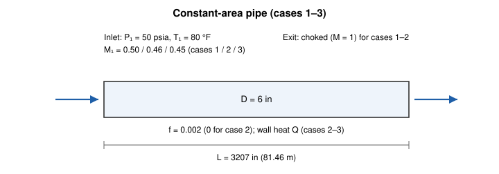

The grid has 21 nodes, cosine-clustered toward the inlet and the choked exit. As in the original study, clustering near the choke is what buys accuracy.

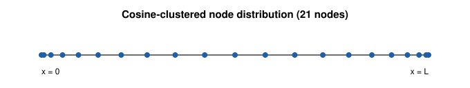

### Case 1: Fanno flow

With inlet Mach 0.5 and a Darcy friction factor of 0.002, the computed critical length is 3207 in, the paper's value.

| Grid         | ṁ error | max ΔP/P | max ΔM/M |
| ------------ | ------- | -------- | -------- |
| 21 uniform   | 0.05 %  | 0.2 %    | 0.3 %    |
| 21 clustered | 0.01 %  | 0.0 %    | 0.0 %    |
| 41 clustered | 0.00 %  | 0.0 %    | 0.0 %    |

The uniform grid converges, but its peak pressure deviation near the exit is an order of magnitude worse than the clustered grid's (0.2 % against 0.01 %), matching the paper's finding on non-uniform grids.

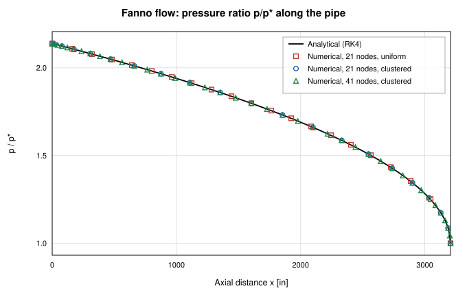

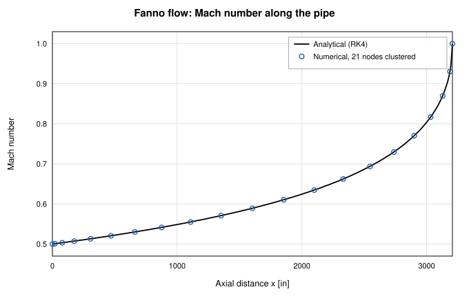

Mach number is derived from the solved state, so the computed mass flow shows up as a small offset even at the inlet: 0.01 % from the analytic choked value on the 21-node clustered grid.

### Case 2: Rayleigh flow

Same pipe, no friction, uniform wall heat flux, inlet Mach 0.46. The analytic choking heat rate is 2073 Btu/s against the paper's 2088 Btu/s; the report attributes the 0.7 % gap to the paper's imperial unit constants.

This was the worst case on the accurate scheme: up to 2.5 % on pressure and Mach number and 1.6 % on temperature over 18 stations. Static temperature rises with heating, then falls once the flow accelerates past the Rayleigh maximum at M = 1/√γ, and the solution follows that turn.

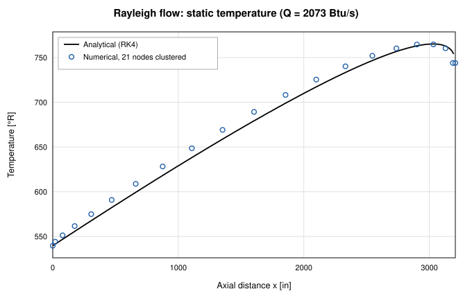

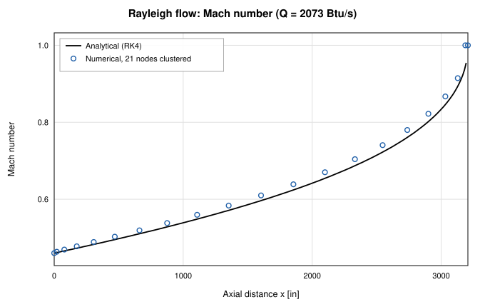

The station nearest the exit, at analytic M ≈ 0.95, is excluded: the node-lumped heat allocation chokes the discrete solution one node early there. The paper reports the same discrepancy and makes the same kind of exclusion. The report's rule drops the last station when analytic M > 0.95 for cases 1 and 3, and M > 0.92 for case 2.

### Case 3: combined friction and heat transfer

No standard table exists here, so the RK4 integration is the only reference. With inlet Mach 0.45, f = 0.002, and Q = 555 Btu/s spread uniformly, the thermodynamic profiles agree within 1.6 %, Mach number within 1.4 %, and mass flow within 0.18 %.

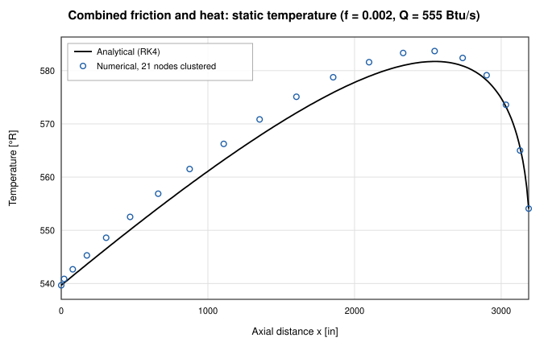

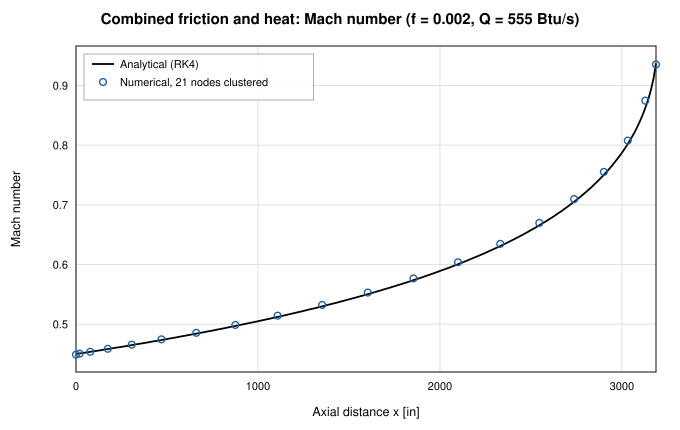

## Cases 4 and 5: the converging–diverging nozzle

Following the paper's (arbitrary) dimensions, the diameter tapers linearly from 8 in at the inlet to 6 in at the throat (x = 12 in), then out to 7.2 in at the exit (L = 30 in). Friction factor is a constant 0.05; case 5 adds a constant wall heat flux. As in the paper, exit pressure comes from the analytic solution for an inlet Mach of 0.25, which keeps the flow subsonic throughout.

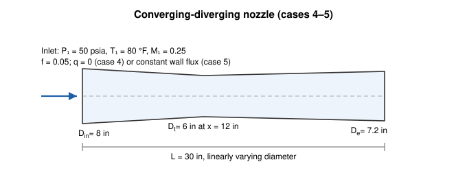

A 65-node grid clustered near the inlet and throat is grid-independent. Residual error sits at the throat's slope discontinuity, as in the paper, and stays below 0.1 %.

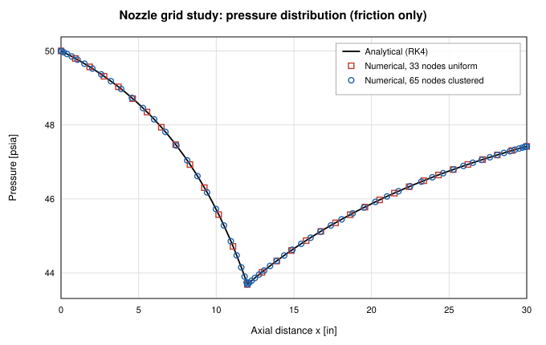

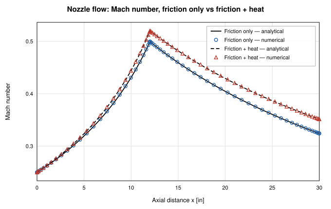

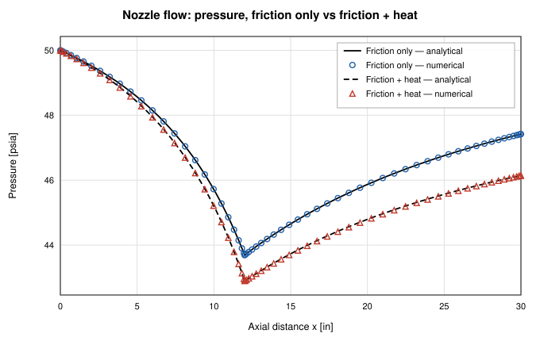

Mass-flow errors are 0.03 % (case 4) and 0.01 % (case 5), and Mach number tracks the analytic solution within 0.1 % in both.

## Results on the default scheme

All the numbers above use `momentumFluxScheme: "central"`, the exact endpoint (integral) form of the acceleration term. The default is `"upwind"`: GFSSP-style donor-cell momentum advection with a MUSCL/van Albada limited face density.

| Case                        | ṁ error | max ΔM/M |
| --------------------------- | ------- | -------- |
| 1 — Fanno                   | 2.05 %  | 2.2 %    |
| 2 — Rayleigh                | 3.48 %  | 4.0 %    |
| 3 — Combined                | 2.19 %  | 2.6 %    |
| 4 — Nozzle, friction        | 0.38 %  | 0.6 %    |
| 5 — Nozzle, friction + heat | 0.36 %  | 0.6 %    |

The paper reports agreement within 5 % for its Rayleigh case, and the default stays inside that on every case. The error concentrates at the choking cell, where the limiter falls back to first order; refining the Fanno grid from 21 to 41 nodes halves it. Robustness, below, is why the less accurate scheme is the default.

## What was hard

**Spurious transonic roots.** The central form's discrete equations admit non-physical roots: a station can dip onto the supersonic branch mid-convergent, a discrete expansion shock, and Newton will find it from a poor starting guess. Version 0.2.0 added the limited-upwind faces because entropy-violating states don't satisfy their discrete equations, so even a flat cold start converges to the physical branch ([user manual §1.7](../user-manual.md#_1-7-scope-boundaries)). The cost is the 2–6 % at the choke in the table above.

**Certifying the central root.** A second-law admissibility audit (`settings.transonicAdmissibility`) checks each converged central-scheme root, re-seeds when it fails, and reports warnings. The report's central-scheme figures show audit-certified roots.

**Seeding.** Under the central scheme, the near-choked cases need an initial mass-flow guess (`branches[].initialMdot`) and monotonically falling nodal pressure and temperature profiles, much as GFSSP needs initial guesses. Under upwind they converge from cold starts.

**Holding a near-sonic exit.** A segregated energy update can't hold states near M = 1. With `kineticEnergy` on, the solver puts node enthalpies into the Newton system alongside pressures and mass flows (the `[P, ṁ, h]` system), which lets it sit at a choked exit.

**Reporting what was solved.** Under `momentumFlux`, the _reported_ branch pressure drop used to be re-derived from a legacy constant-area central acceleration term, which disagreed with the upwind default, tapered branches, and junction-inlet exclusions. The solution was right; the displayed ΔP wasn't the one the solver converged. Since 0.2.0 it mirrors the converged momentum row exactly ([CHANGELOG](../../CHANGELOG.md)).

## What the agreement shows

Because every comparison is against an analytic reference, the user manual files this study under _analytic verification_ ([§8.2](../user-manual.md#_8-2-analytic-verification)) rather than code-to-code benchmarking. The paper contributes the cases, geometry, reporting format, and agreement band.

For ideal-gas flow with constant friction factor and uniform wall heat flux, OpenFLUME's quasi-1-D discretization converges to the analytic solution at the expected order, with its largest errors where the original study's were: the last node before a choked exit and the nozzle throat. On the default scheme its accuracy is in the same class as GFSSP's published results on the same problems.

It does not establish:

- **Point-by-point agreement with GFSSP.** I compared against the analytic solution, not digitized GFSSP output; hitting the same band against the same reference is weaker evidence than a direct match.
- **Real-fluid behavior.** That is a separate test (`realFluidTransonic.test.ts`), where a CoolProp nitrogen choked C-D nozzle matches an analytic ideal-gas twin on mass flow to 0.17 %.
- **Agreement with experiment.** This shows the equations are solved correctly, not that they describe particular hardware.
- **Flow through shocks.** There is no shock capture or Rankine–Hugoniot jump, so over-expanded and separated nozzle flow, shock position, and thrust are out of scope. Supersonic exhaust is reachable only by smooth expansion.
- **Friction or heat-transfer correlations.** Constant f was used to match the benchmark.

## Try it yourself

Rerun the report from a clone with `npx tsx scripts/compressible-validation-report.ts`. A choked nozzle also appears in the shipped [LOX/RP-1 thruster (combustor)](https://openflume.github.io/OpenFLUME/#example=lox-rp-1-thruster-combustor) example, checked in the [combustion report](../validation/combustion-report.md).

If you have a compressible-flow case where you expect OpenFLUME to fail, with a published reference and a tolerance, please [open an issue](https://github.com/OpenFLUME/OpenFLUME/issues/new/choose).
