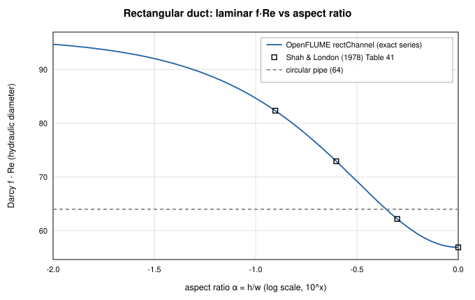
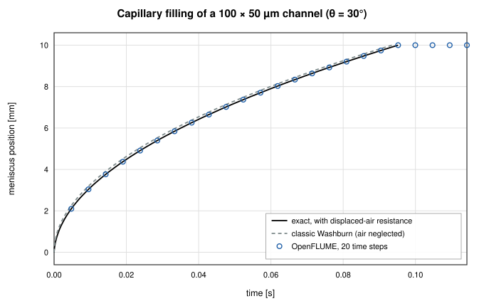
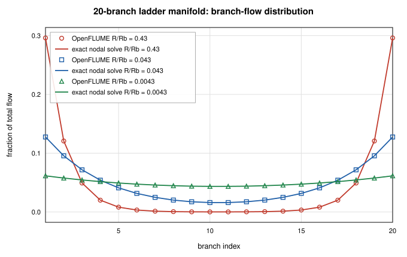
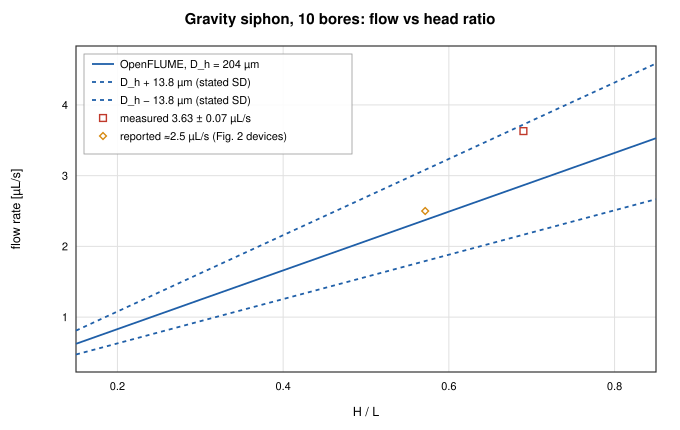
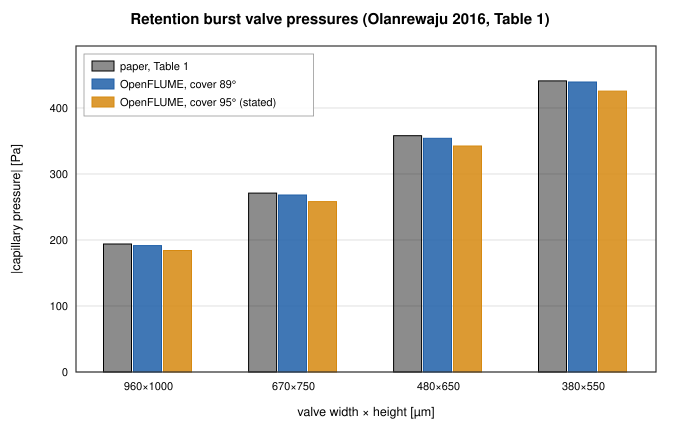
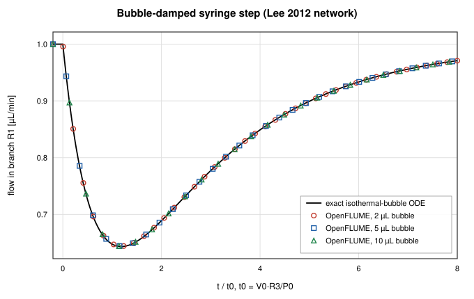

# Six published microfluidic networks, rebuilt and checked

_John Rising · 2026-12-01_

A thermo-fluid network solver built for rocket feed systems and cryogenic lines might seem an odd fit for microfluidics. The mathematics is the same, though: nodes, branches, mass balance, a pressure–flow law per branch. What changes is the regime. Flows run from nanolitres to microlitres per minute, channels are tens of micrometres deep and rectangular, not round, and the driving force is often capillarity, with no pump at all.

Version 0.3.0 added two components for that regime. This post walks through the generated [microfluidics validation report](../validation/microfluidics-report.md). Part A checks the components against exact solutions. Part B rebuilds six published microfluidic networks from the parameters printed in their open-access papers. All numbers below come from that report, which `scripts/microfluidics-validation-report.ts` regenerates from live solves. The published cases are gated in CI by `src/validation/__tests__/microfluidics.test.ts`.

## The two new components

**`rectChannel`** is a rectangular microchannel with the exact fully developed laminar resistance for any aspect ratio. That is the Fourier-series solution, `R = 12μL / (a³bF)`, summed to machine precision. Above Re 2300 it blends to Swamee–Jain on the hydraulic diameter ([user manual §4.3.18](../user-manual.md#_4-3-18-rectangular-channel)).

**`capillaryChannel`** is a partly filled rectangular channel: liquid over length `s`, gas over the rest. Its pressure–flow law includes the liquid and displaced-gas resistances, the Young–Laplace capillary pressure with per-wall contact angles, and hydrostatics. On top of that it supports stop (burst) valves using the Cho et al. (2007) burst pressure, trigger valves, hydrophobic-entrance pinning, and air-trap detection, with an event log ([§4.3.19](../user-manual.md#_4-3-19-capillary-channel)). Each meniscus is integrated across a step against a Thevenin equivalent of the surrounding network. That makes it exact for reservoir-driven (Washburn) and syringe-driven filling, whatever the step size.

## Part A: the closed forms

These are analytic checks, so any disagreement would be a code defect.

**Rectangular-duct friction constant.** Against Shah & London's tabulated f·Re, the worst error over aspect ratios 1, 0.5, 0.25, and 0.125 is 0.002 %. The report adds a practical note: a circular pipe sized to the hydraulic diameter of a 100 × 50 µm channel would predict 32 % less flow than the rectangle actually carries. That is why the dedicated component exists.

**Washburn filling with air resistance.** A 100 × 50 µm channel, 10 mm long, θ = 30°, fills in 0.0952 s. Including the displaced air's viscosity changes the exact front law, and OpenFLUME follows it to 1.49e-8 of the fill time, at 5, 50, or 500 steps per fill. The step count does not matter because the meniscus ODE is integrated within the step. Even the stiff early phase, where velocity goes as 1/s, costs no accuracy.

**Jurin rise.** A vertical 500 µm square channel settles at 50.969 mm, against an equilibrium height of 50.969 mm (error 8.17e-16), monotonically and without overshoot.

**Syringe and resistance-coupled filling.** These match their exact laws to 2.40e-14 and 1.08e-13 respectively.

## Part B: six published networks

Each case respects the paper's own result type: a measurement with its error bar, the authors' model value, or a statement in the text. `src/validation/microfluidics.ts` gives the location of every parameter in its source paper.

### B1. Serial-dilution cell (Vasilakis et al. 2019)

Five rectangular channels, 64 µm deep, are fed by two syringe inlets at 0.4 µL/min. OpenFLUME gives inlet pressures of 85.1 and 85.0 Pa, against the authors' COMSOL value of 85.2 Pa, and a dilution ratio of 0.670 against a design value of 0.67.

The measurements are where it gets interesting. The paper measured 0.65 ± 0.02 at 0.2 µL/min and 0.70 ± 0.01 at 0.4 µL/min. Both agree with the design within the glucose meter's ±10 % accuracy, which is the standard the authors used. By its own standard deviation, though, the 0.4 µL/min measurement sits about 3σ above the design. OpenFLUME reproduces the design, as the authors' own optimization did. It does not explain that offset.

### B2. Hydrodynamic bead trap (Tan & Takeuchi 2007)

A trap constriction sits in parallel with a bypass loop, and beads are trapped only if Q₁/Q₂ > 1. OpenFLUME gives 0.755 for device A (paper: 0.76, no bead trapped) and 3.949 for device B (paper: 3.95, every bead trapped). Both trapping outcomes are predicted correctly.

There is a caveat. Following the paper's model, the constriction is treated as a fully developed duct even though it is shorter than it is wide (L₁ < W₁), so entrance losses are ignored. The outcome is right, but the physics of that short constriction is simplified in both models.

### B3. Parallel manifold (Guermonprez et al. 2015)

A 20-branch ladder has its inlet and outlet at opposite corners. Only the ratio of manifold-segment resistance to branch resistance matters.

| R/R_b  | first two + last two branches | spread  | Paper        |
| ------ | ----------------------------- | ------- | ------------ |
| 0.43   | 83.4 %                        | 29.60 % | ≈ 85 %       |
| 0.043  | 44.6 %                        | 11.16 % | ≈ 46 %       |
| 0.0043 | 23.8 %                        | 1.79 %  | spread ≤ 2 % |

Every branch flow also matches an independent dense nodal solve to 2.16e-15. The remaining 1–2 point difference from the paper is within what the comparison can resolve: the paper quotes two significant figures and does not say how it counts the manifold's end segments.

### B4. Gravity-driven siphon (Reis et al. 2021)

This is the case that reads worst at first glance, so here it is in full. Ten parallel bores have a mean hydraulic diameter of 204 ± 13.8 µm. At H/L = 0.69, OpenFLUME predicts 2.87 µL/s. **The measurement is 3.63 ± 0.07 µL/s.**

Flow goes as D⁴, so the paper's stated ±6.8 % diameter spread becomes a ±27 % flow band: 2.17–3.72 µL/s. The measurement falls inside that band, and a mean diameter of 216 µm, within the stated standard deviation, reproduces it. The solver equals Hagen–Poiseuille to 2.51e-13, so the residual is in the input, not the solve. The fair summary is "consistent within the stated geometric uncertainty," not "agrees." For the second reported point (H = 40 mm, L = 70 mm), OpenFLUME gives 2.37 µL/s against ≈ 2.5 µL/s.

### B5. Capillaric-circuit valves (Olanrewaju et al. 2016)

These are retention burst valves in PDMS with a hydrophobic cover. Per-wall Young–Laplace with the paper's receding angles reproduces Table 1 to 0.4–1.3 % for four valves, and the capillary pump to 1.4 %, but only with a cover angle of 89°. The paper's valve section states 95°, and 95° under-predicts every valve by 3–6 %. The 89° value comes from the paper's Conclusions, and it is the one that reproduces the paper's own table. The report shows both.

The full circuit's drainage sequence is **not** modeled. It needs receding-meniscus draining of reservoirs, which OpenFLUME does not yet represent, and the paper omits the connector lengths.

### B6. Bubble-damped syringe network (Lee et al. 2012)

Two syringe pumps, each holding an air bubble of 2, 5, or 10 µL, feed a resistive junction. One pump's flow steps from 1 to 2.5 µL/min. The reference is the network's exact ODE, integrated independently. OpenFLUME matches it to 9.47e-4 at tolerance 1e-9, and to 9.68e-4 at the UI default of 1e-6. The remaining error is backward Euler: 1.93e-3, 9.68e-4, and 2.43e-4 at 100, 200, and 800 steps per time constant, which is first order as expected. The paper's central finding, that responses for different bubble sizes collapse when time is scaled by `V₀R₃/P₀`, is reproduced: the 2 µL and 10 µL responses coincide in scaled time to 1.71e-12.

This case also **found a solver defect.** Before the fix, the same 5 µL case had a maximum error of 1.2 % at tol 1e-9, and 37 % at the UI default. At the default, the syringe step never propagated to the branch at all. The cause was the Newton stopping test. It compared an absolute tolerance against mass-balance rows in kg/s, and at ~1e-13 kg/s imbalances every step "converged" at its warm start. Since 0.3.0, mass-flow rows below 1e-3 kg/s are weighted by the network's flow scale. Above that threshold the solver is unchanged, bit for bit. Of the 14 shipped examples, only the Entrapped-air line changes, by 1e-7 relative, during its at-rest phase. `flowScaledTolerance.test.ts` fails on the old solver.

To me, that is the strongest argument for rebuilding published cases instead of only writing unit tests. The defect sat in the general Newton loop, not the new component, and only the change of regime exposed it.

## A circuit you can run

The [Capillary circuit (stop + trigger valve)](https://openflume.github.io/OpenFLUME/#example=capillary-circuit-stop-plus-trigger-valve) example is a pumpless circuit. A sample wicks into a short channel A and a longer delay channel B, which rejoin at a junction J and then feed a capillary pump vented to atmosphere ([§7.14](../user-manual.md#_7-14-capillary-circuit-stop-trigger-valve)). Open it, click **Run**, and read the event log. The report records the sequence:

| t [s]  | event      | channel | node   |
| ------ | ---------- | ------- | ------ |
| 0.0000 | pinned     | A       | inlet  |
| 0.0262 | nodeWetted | B1      | bend   |
| 0.0542 | pinned     | A       | J      |
| 0.0984 | nodeWetted | B2      | J      |
| 0.0984 | triggered  | A       | J      |
| 0.1441 | nodeWetted | out     | pumpIn |

Channel A's stop valve holds at J until B's liquid arrives and triggers it, without bursting. The pin at A's own entrance in the first step is not an artifact. B's faster front pushes air into J, and for one step that gas back-pressure exceeds A's weak capillary pull. That is real behavior of a vented gas network.

## Limits

These are visible in the published cases above and documented in the report:

- **No receding-meniscus draining**, so the full drainage sequence of a retention-burst-valve circuit is out of reach.
- **No entrance effects** for constrictions shorter than they are wide.
- The usual OpenFLUME scope boundaries apply as well ([§1.7](../user-manual.md#_1-7-scope-boundaries)). In particular, unlike fluids may not mix at a junction.

If you work in microfluidics and have a published network with printed parameters and a measured or modeled result, I would like to add it. Please [open an issue](https://github.com/OpenFLUME/OpenFLUME/issues/new/choose) with the reference.
