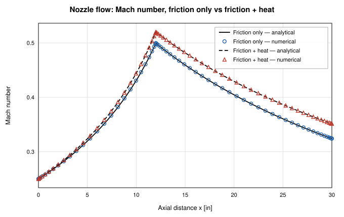

# OpenFLUME: an open-source alternative to NASA GFSSP

OpenFLUME is a GFSSP-style network solver you can open in a browser, read,
script, and share. It reproduces several published GFSSP results; for work
that needs GFSSP's features or heritage, GFSSP remains the right tool.

OpenFLUME is not affiliated with or endorsed by NASA. It is Alpha software
(version 0.3.1) with none of GFSSP's program heritage.

## About GFSSP

The Generalized Fluid System Simulation Program (GFSSP) is a general-purpose
fluid network code developed at NASA Marshall Space Flight Center. It is
distributed through NASA's software release process, which sets eligibility
and terms; check the NASA software catalog for the current version and
availability. GFSSP models a system as nodes and branches and solves coupled
mass, momentum, and energy conservation with conjugate heat transfer. NASA
has used it for propulsion feed systems, pressurization, cryogenic
transfer-line chilldown, and thermal management, and its formulation and
verification are documented in NASA technical memoranda and conference papers.
OpenFLUME's user manual cites the Version 6.0 TM (NASA/TM-2013-217492) and the
TFAWS-2007 compressible-flow paper (NTRS 20070036728) among others
(Appendix E of the [user's manual](../user-manual.md)).

## How OpenFLUME follows the GFSSP formulation

- **Node/branch finite volume.** Nodes are control volumes that store mass
  and energy. Each branch carries one mass-flow unknown, governed by a
  momentum relation between the endpoint pressures
  ([§1.2](../user-manual.md#_1-2-network-flow-analysis)). Volume and flow are
  staggered, as in GFSSP.
- **Simultaneous Newton–Raphson solution** of mass and momentum, with nodal
  enthalpy added to the coupled system for real fluids and compressible duct
  flow. As the solver source notes, solving the conservation equations
  simultaneously, as GFSSP does, keeps the system stable near choking
  ([§4.6.1](../user-manual.md#_4-6-1-steady-state)).
- **Upwinded enthalpy** in the energy equation, with internal-energy storage
  in transients ([§4.1.3](../user-manual.md#_4-1-3-fluid-energy)).
- **Opt-in compressible terms.** A convective-acceleration (momentum-flux)
  term and stagnation-enthalpy transport give quasi-1-D compressible duct
  flow. The default `momentumFluxScheme: "upwind"` uses GFSSP-style
  donor-cell momentum advection with a limited face density
  ([§4.1.2](../user-manual.md#_4-1-2-branch-momentum)).
- **Lumped fluid inertia and trapped-gas cushions** for rigid-column surge,
  the mechanism behind GFSSP's entrapped-air example.
- **Miropolskii film boiling** for chilldown, the correlation GFSSP uses
  ([§8.5](../user-manual.md#_8-5-correlation-status)).

OpenFLUME does not read GFSSP input files, and its closure details, solver
globalization (trust-region dogleg, pseudo-transient continuation), and
component set differ. Expect GFSSP-class answers on the benchmark cases below,
not identical ones.

## GFSSP results reproduced

### Compressible duct flow: the TFAWS-2007 study, case for case

The [compressible-flow report](../validation/compressible-report.md)
recreates Bandyopadhyay & Majumdar, "Modeling of Compressible Flow with
Friction and Heat Transfer using GFSSP" (TFAWS 2007): five cases, sixteen
figures. The references are RK4 integrations of the generalized 1-D
compressible-flow ODE, cross-checked against Fanno and Rayleigh closed forms.

| Case                                       | ṁ error, default `upwind` | max ΔM/M, default `upwind` | ṁ error, `central` |
| ------------------------------------------ | ------------------------- | -------------------------- | ------------------ |
| 1 — Fanno (21 clustered)                   | 2.05 %                    | 2.2 %                      | 0.01 %             |
| 2 — Rayleigh (21 clustered)                | 3.48 %                    | 4.0 %                      | 0.00 %             |
| 3 — Combined (21 clustered)                | 2.19 %                    | 2.6 %                      | 0.18 %             |
| 4 — Nozzle, friction (65 clustered)        | 0.38 %                    | 0.6 %                      | 0.03 %             |
| 5 — Nozzle, friction + heat (65 clustered) | 0.36 %                    | 0.6 %                      | 0.01 %             |

The original study gives 1.7–5 % for GFSSP's own first-order upwind
discretization. As in that study, the last station before a choked exit is
excluded from the profile statistics; the error is largest at the choking
cell. Shock capture remains out of scope.

_Mach number along the TFAWS-2007 nozzle, from the
[compressible-flow report](../validation/compressible-report.md)._

### GFSSP example problems

`src/ui/tests/gfssp-benchmarks.test.ts` gates three conjugate cases built in
`src/ui/examples.ts`; `src/ui/tests/leeMartin.test.ts` gates the entrapped-air
case. Tolerances are the test tolerances (manual
[§8.3](../user-manual.md#_8-3-code-to-code-benchmarks)):

| Benchmark                                        | Source                                     | What is checked                                                                                                                                                                  |
| ------------------------------------------------ | ------------------------------------------ | -------------------------------------------------------------------------------------------------------------------------------------------------------------------------------- |
| GFSSP Example 13, conduction rod with convection | NASA/TM-2011-216470 §6.13                  | Solid temperatures within 3.0 K of analytical; end conduction heat flows within 7 %; global energy balance within 0.5 %; transient end state matches a steady solve within 0.5 % |
| GFSSP-style N₂–N₂ counterflow HX                 | Majumdar & LeClair, JANNAF 2024            | Duty within 5 % of ε–NTU; outlets within 2.5 K; hot/cold duty balance within 1 %                                                                                                 |
| GFSSP Example 5, water-water counterflow HX      | GFSSP v5 manual                            | Hot outlet 295.67 ± 1.0 K; cold outlet 290.94 ± 0.5 K; duty ≈ 25.6 kW within 3 %; outlets move toward the published values as segments go 4 → 8 → 12                             |
| Lee & Martin entrapped air (GFSSP Figure 10)     | GFSSP manual; independent RK4 rigid column | First peak within 15 %; trace within 8 % of RK4 at a refined step                                                                                                                |

At the shipped twelve-pass discretization, Example 5 outlets are within
0.44 K (hot) and 0.19 K (cold) of the published GFSSP values
([§7.9](../user-manual.md#_7-9-water-water-counterflow-heat-exchanger)).

### NBS cryogenic chilldown

The chilldown dataset (`src/validation/nbsChilldown.ts`) takes NBS Report
9264 test data from Table 6 of the GFSSP Version 6 paper (AIAA 2015-3850),
which tabulates both measured and GFSSP-predicted chilldown times.
OpenFLUME's CI baseline is loose: chilldown time within a factor of 1.6 of
experiment, with mean absolute error under 25 % over the four-case slow
suite ([§8.4](../user-manual.md#_8-4-validation-against-experiment)). That is
well short of GFSSP-equivalent chilldown accuracy.

## When to use which

**Use GFSSP when:**

- you have access to it and your organization's processes already rely on
  its heritage;
- you need features OpenFLUME lacks (see limitations below), or a code
  with NASA program history behind it;
- you need to reproduce or extend an existing GFSSP model exactly.

**Consider OpenFLUME when:**

- you cannot get GFSSP, or need something running in minutes without
  installation;
- you want to read and audit the solver, closures, and tests (MIT license);
- you want to script studies from Python (`pip install openflume`) or keep
  models as plain-text `.fn` files under version control;
- you are teaching or reviewing a model;
- you want an independent cross-check of a GFSSP result.

For important work, use OpenFLUME for early sizing and as an independent
second solver, and the qualified tool your program requires for results of
record.

## Migrating a model

[Coming from GFSSP](../guides/from-gfssp.md) maps GFSSP concepts to
OpenFLUME's interface and file format. In brief: OpenFLUME models are SI
throughout, positive mass flow follows the declared `from → to` direction,
and every network needs at least one boundary node
([§1.4](../user-manual.md#_1-4-sign-conventions)).

## Limitations relative to GFSSP

From [§1.7 Scope Boundaries](../user-manual.md#_1-7-scope-boundaries):

- **No shock capture.** Quasi-1-D choking and seeded supersonic nozzles only.
  No thrust calculation.
- **No acoustic wave propagation / MOC water hammer.** Lumped inertia only.
- **Two-phase is HEM only.** No Lockhart–Martinelli yet.
- **Cavitation only at the cavitating-venturi closure.**
- **Turbomachinery is a pump curve.** No compressor or turbine maps.
- **No general junction mixing** of unlike fluids outside CEA reacting
  junctions.
- **Smaller, younger component library** (19 branch types plus user
  JavaScript components). User code is trusted, not sandboxed.
- **Steady closed ideal-gas loops** need a pressure anchor.
- **Alpha, single author, heavy AI assistance, no flight or program
  qualification.** Check results against the
  [verification record](../validation/index.md).

## Example links

These open a running model in the app:

- [Water-water counterflow heat exchanger](https://openflume.github.io/OpenFLUME/#example=water-water-counterflow-heat-exchanger) (GFSSP Example 5)
- [Entrapped-air line](https://openflume.github.io/OpenFLUME/#example=entrapped-air-line) (Lee & Martin, GFSSP Figure 10)
- [Cryogenic line cooldown](https://openflume.github.io/OpenFLUME/#example=cryogenic-line-cooldown) (NBS Report 9264, Figure 2)
- [Tank blowdown](https://openflume.github.io/OpenFLUME/#example=tank-blowdown) (transient ideal-gas tank through an orifice)
- [Sanity: orifice hand-calc](https://openflume.github.io/OpenFLUME/#example=sanity-orifice-hand-calc) (closed-form check)
