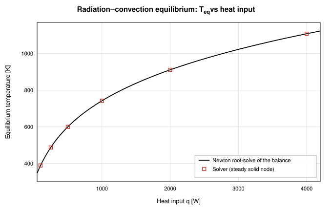

# OpenFLUME: an open-source alternative to SINDA/FLUINT

OpenFLUME is an open-source thermal and fluid network solver that overlaps
with SINDA/FLUINT, reproduces some of its sample results, and falls short of
it in several specific areas listed below.

OpenFLUME is not affiliated with C&R Technologies. It is Alpha software
(version 0.3.1).

## About SINDA/FLUINT

SINDA/FLUINT is a commercial thermal and fluid network analyzer developed and
sold by C&R Technologies. SINDA is the lumped-parameter thermal network
solver (conduction, convection, radiation between thermal nodes); FLUINT is
the coupled fluid network solver (lumps, paths, tanks, junctions, and
two-phase flow). Its lineage goes back to NASA-era thermal analyzer codes, and
it has a long record in spacecraft and aerospace thermal-control and
cryogenic analysis. C&R also sells Thermal Desktop, a CAD-based front end.
Check C&R for licensing, current features, and support.

## Where the two overlap

Like SINDA/FLUINT, OpenFLUME carries two coupled networks:

| Concept                      | SINDA/FLUINT (general)                    | OpenFLUME                                                                                                                                                                                         |
| ---------------------------- | ----------------------------------------- | ------------------------------------------------------------------------------------------------------------------------------------------------------------------------------------------------- |
| Thermal node                 | Diffusion, arithmetic, and boundary nodes | **Solid node** (lumped mass × specific heat) and **ambient node** (fixed-temperature reservoir). Transient solid nodes need positive mass, so capacitance-free arithmetic nodes are not available |
| Thermal conductor            | Linear and radiation conductors           | **Conduction, convection, radiation** conductors ([Appendix B](../user-manual.md))                                                                                                                |
| Fluid control volume         | Lumps (tanks, junctions, plena)           | Internal and boundary **fluid nodes**, with optional volume for transients                                                                                                                        |
| Flow path                    | Paths (tubes, connectors)                 | **Branches** with one of 19 component types                                                                                                                                                       |
| Fluid–wall coupling          | Ties                                      | **Convection conductors** between a fluid node and a solid or ambient node, using Dittus–Boelter, Miropolskii, Darr–Hartwig, a specified h, or an expression                                      |
| Temperature-dependent solids | User arrays and properties                | A sourced material catalogue with validity ranges ([solid properties](../solid-properties-results.md))                                                                                            |
| User logic                   | User-written logic blocks                 | Registers, declarative logic rules, stop rules, PID controllers, and JavaScript user components ([user code](../usercode.md))                                                                     |
| Real fluids                  | Fluid property descriptions               | CoolProp (124-fluid HEOS catalogue), compiled to WebAssembly                                                                                                                                      |

## SINDA/FLUINT cases reproduced

### Sample Problem F: LH₂ tank no-vent fill

The [LH₂ tank no-vent fill](https://openflume.github.io/OpenFLUME/#example=lh2-tank-no-vent-fill)
example reproduces the transient no-vent fill in SINDA/FLUINT Sample Problem
F (model `TVS`). A half-full, saturated 42-inch LH₂ tank is filled from a
colder 60 psia source while a thermodynamic vent system bleeds liquid. At 15
minutes, against the deck's Figure F-4 / user-file table (from the module
header of `src/ui/lh2StorageTank.ts` and manual
[§7.13](../user-manual.md#_7-13-lh2-tank-no-vent-fill)):

| Quantity           | OpenFLUME     | Deck          |
| ------------------ | ------------- | ------------- |
| Fill fraction      | 0.734         | 0.739         |
| Tank pressure      | 59.63 psia    | 59.72 psia    |
| Vapor temperature  | 47.78 R       | 47.387 R      |
| Liquid temperature | 38.99 R       | 38.098 R      |
| TVS flow           | 0.0518 lbm/hr | 0.0522 lbm/hr |

`src/ui/tests/lh2StorageTank.test.ts` gates these values, and also checks that
the tank volume constraint holds to 1e-9 and that tank pressure rises toward
the source instead of collapsing.

FLUINT's twinned tanks and moveable ties have no direct equivalent in
OpenFLUME's schema, so the example **emulates** them with registers, logic
rules, and register controllers. The module header lists what is emulated and
what departs from the deck: CoolProp parahydrogen replaces the deck's fluid
description, the fill source is 14.0 K instead of the deck's 20 R, and the
deck's steady TVS-sizing case is not reproduced.

The vapor-cooled shield and internal heat exchanger are carried as solid
thermal mass but are **not resolved as flow paths**. Their ducts run at
NTU ≈ 29 per node, and at that NTU OpenFLUME's segregated solid–fluid coupling
loop does not converge. The source calls this a hard limitation of the solver:
strongly coupled, high-NTU wall–fluid problems are a known weak point.

### Cryogenic line cooldown (NBS Report 9264)

The [cryogenic line cooldown](https://openflume.github.io/OpenFLUME/#example=cryogenic-line-cooldown)
example is the C&R Technologies validation case drawn from NBS Report 9264,
Figure 2. Saturated LH₂ at 75 psia enters a 61 m copper line, initially at
300 K, modeled as twenty axial segments with temperature-dependent copper
specific heat and Miropolskii film boiling
([§7.11](../user-manual.md#_7-11-cryogenic-line-cooldown)). Agreement with
experiment is modest: the CI baseline holds chilldown time within a factor
of 1.6 of experiment, with mean absolute error under 25 % across the slow
suite. Trust levels come from the quality of the experimental record, and
every Table-6 case is reported, including the subcooled cases the model
over-predicts
([§8.4](../user-manual.md#_8-4-validation-against-experiment)).

### Thermal network verification

The [thermal-network report](../validation/thermal-network-report.md)
verifies the solid-node system and its fluid coupling against analytic
solutions. The composite wall matches to 6.9e-14 % and radiation equilibrium
to 1.2e-14 %. Lumped cooldown is within 0.18 % of the temperature span at
dt = τ/100, with first-order time convergence (error ratio 4.01 for a 4×
step refinement). A 20-segment counterflow heat exchanger has effectiveness
within 2.62 % and outlets within 1.730 K of ε–NTU; the remaining error is
shown to be segmentation error. A transient chilldown of an aluminum tube
matches the Anzelius–Schumann closed form to 3.0e-3 of the initial wall–inlet
temperature difference (b = 0.94 1/m) with first-order convergence.

_Radiation–convection equilibrium, from the
[thermal-network report](../validation/thermal-network-report.md)._

## When to use which

**Use SINDA/FLUINT (or your program's qualified thermal tool) when:**

- results go into a design of record, a flight thermal model, or a
  qualification argument;
- the model is large and thermally dominated: geometric radiation exchange,
  many thousands of thermal nodes, CAD-derived geometry;
- you need strongly coupled, high-NTU wall–fluid paths, capacitance-free
  arithmetic nodes, or FLUINT features such as twinned tanks that OpenFLUME
  can only emulate;
- you need separated-flow two-phase models or commercial support.

**Consider OpenFLUME when:**

- you need a fluid-plus-lumped-thermal network for early sizing, a trade
  study, or a sanity check, and have no license available;
- you want to read every equation and closure, and the tests behind them
  (MIT license);
- you want to drive studies from Python (`pip install openflume`) or keep
  models in plain-text `.fn` files;
- you are teaching heat transfer or thermal-fluid systems and want students
  to open a model from a link with nothing to install;
- you want an independent cross-check of a result from another tool.

## Limitations

From [§1.7 Scope Boundaries](../user-manual.md#_1-7-scope-boundaries), plus
the thermal-specific points above:

- **Alpha, single author, heavy AI assistance, no flight heritage, no
  commercial support.**
- **Segregated solid–fluid coupling** does not converge at very high NTU per
  node (see Sample F above).
- **No view-factor computation.** Each radiation conductor takes a
  user-supplied emissivity, area, and view factor. There is no geometry, CAD,
  or ray-tracing front end.
- **Two-phase is HEM only.** No Lockhart–Martinelli yet. Cavitation is
  modeled only at the cavitating-venturi closure.
- **Turbomachinery is a pump curve.** In the
  [ammonia loop heat pipe radiator](https://openflume.github.io/OpenFLUME/#example=spacecraft-radiator-panel-ammonia-loop-heat-pipe)
  example, wick capillary pumping is represented by a fixed pump curve
  ([§7.6](../user-manual.md#_7-6-spacecraft-radiator-panel-ammonia-loop-heat-pipe)).
- **No acoustic waves, no shock capture.**
- **User code is trusted, not sandboxed.**

## Example links

- [LH₂ tank no-vent fill](https://openflume.github.io/OpenFLUME/#example=lh2-tank-no-vent-fill) (SINDA/FLUINT Sample Problem F)
- [Cryogenic line cooldown](https://openflume.github.io/OpenFLUME/#example=cryogenic-line-cooldown) (NBS 9264 Figure 2)
- [Spacecraft radiator panel (ammonia loop heat pipe)](https://openflume.github.io/OpenFLUME/#example=spacecraft-radiator-panel-ammonia-loop-heat-pipe)
- [Heated pipe with radiating wall (conjugate HT)](https://openflume.github.io/OpenFLUME/#example=heated-pipe-with-radiating-wall-conjugate-ht), the recommended first conjugate model
- [Extension: Cryo tank vent control (transient)](https://openflume.github.io/OpenFLUME/#example=extension-cryo-tank-vent-control-transient), which shows registers, logic rules, and hysteresis
