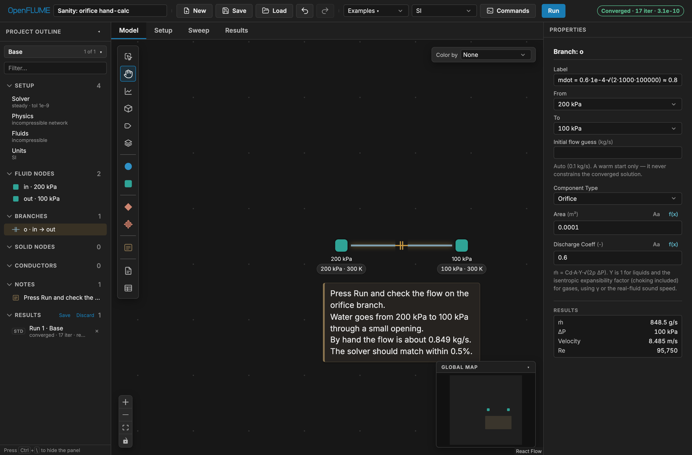
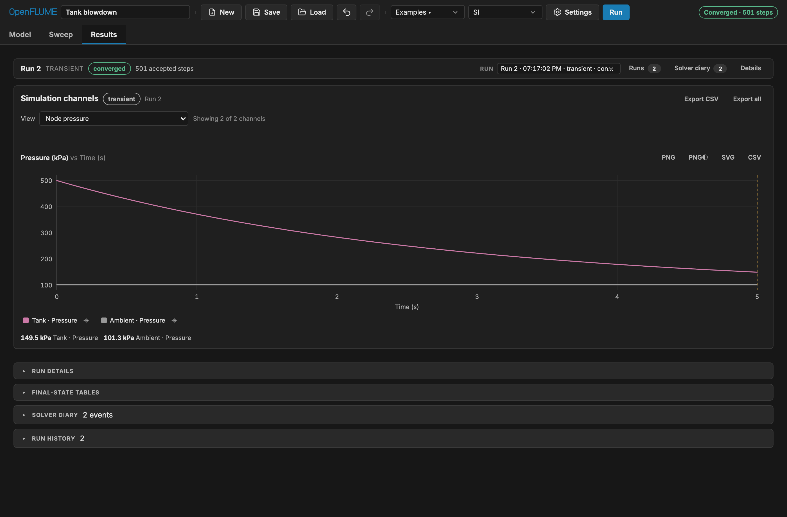

# Getting started

This page takes about five minutes. You run a steady case whose answer you can
check by hand, then a transient. After that it covers saving and sharing your
work, and installing OpenFLUME locally or from Python. The
[user's manual](../user-manual.md) covers each step in more depth; §2.3
(First Simulation) is the same walkthrough in reference form.

OpenFLUME is alpha software (version 0.3.1). It was written by one engineer
with heavy AI assistance, and the project's position is _check it rather than
trust it_. The first two steps below are there so you can do exactly that.

## 1. Open the app

Open **[openflume.github.io/OpenFLUME](https://openflume.github.io/OpenFLUME/)**.
You don't need to install anything or create an account. The solver runs in a
Web Worker in your browser, and real-fluid properties come from CoolProp
compiled to WebAssembly. Your model never leaves your machine.

The app opens with an empty canvas, or with the last model you had open (it
autosaves to browser storage).

## 2. Run a case you can check by hand

Open the orifice sanity check directly:

**[Open "Sanity: orifice hand-calc" →](https://openflume.github.io/OpenFLUME/#example=sanity-orifice-hand-calc)**

You can also load it from the toolbar: **Examples ▾** → _Verify-by-inspection_ →
**Sanity: orifice hand-calc**. If you open a link while the browser already
holds a model, the app asks before replacing it. Loading from the
**Examples ▾** menu replaces the current network without asking, so save any
work you want to keep first.

The model is two boundary nodes joined by one orifice branch:

| Item                | Value                                                               |
| ------------------- | ------------------------------------------------------------------- |
| Fluid               | Incompressible, ρ = 1000 kg/m³, μ = 1×10⁻³ Pa·s, cp = 4182 J/(kg·K) |
| Upstream boundary   | 200 kPa, 300 K                                                      |
| Downstream boundary | 100 kPa, 300 K                                                      |
| Orifice             | area A = 1×10⁻⁴ m², discharge coefficient Cd = 0.6                  |

These values come from `sanityOrificeHandCalc` in
[`src/ui/examples.ts`](../../src/ui/examples.ts). There is also a note on the
canvas that states the expected answer.

1. Click **Run**. The status pill on the right of the toolbar should read
   **Converged**, with an iteration count and the final residual.
2. Click the orifice branch. Its solved mass flow appears in the **Results**
   block at the bottom of the property panel.

Now check it by hand. For an incompressible orifice:

```
ṁ = Cd · A · √(2 ρ ΔP)
  = 0.6 × 1e-4 × √(2 × 1000 × 100 000)
  = 0.6 × 1e-4 × 14 142
  ≈ 0.8485 kg/s
```

The manual (§7.1) requires the solver to match this within 0.5 %. The
screenshot in the manual shows 848.5 g/s. Depending on your **Units ▾**
preset, the panel may display the value in g/s, kg/h, or lbm/s; switch to
**SI** to see kg/s.



This model is the smallest case that runs the whole chain: decode, validate,
assemble, Newton solve, report. If it doesn't converge to the hand value,
something is wrong with the installation or the code, and that is worth
[reporting](https://github.com/OpenFLUME/OpenFLUME/issues).

## 3. Run a transient: tank blowdown

**[Open "Tank blowdown" →](https://openflume.github.io/OpenFLUME/#example=tank-blowdown)**

(Or **Examples ▾** → _Applications_ → **Tank blowdown**.) A 0.1 m³ tank of air
starts at 500 kPa and 300 K and vents through an orifice to 101 325 Pa. The run
lasts 5 s with a fixed 0.01 s time step.

1. Click **Run**. While it runs, the toolbar shows live `t = … s / … s`
   progress. When it finishes, the status pill reports **Converged** with the
   number of accepted steps.
2. Open the **Results** tab. A new plot starts empty. Under **or plot a whole
   set…**, choose **Node pressure**. Tank pressure falls smoothly, always
   downward, from 500 kPa.
3. Choose **Node & solid temperature**. Tank temperature drops well below
   300 K. The model captures adiabatic expansion cooling, so this is the
   expected result, not an error.
4. Go back to the **Model** tab. A time scrubber now sits under the canvas.
   Set **Color by** to **Pressure** and drag the scrubber to replay the
   blowdown.



The [tank blowdown tutorial](tank-blowdown.md) checks this run against the
closed-form choked-blowdown solution. It then changes the orifice and runs a
parameter sweep.

## 4. Save and load `.fn` files

- **Save** downloads the model as a `.fn` file. This is a line-oriented
  text file in SI units that you can diff and review (manual Appendix C).
  The file holds the model and every variant, but no results. If you have
  recorded runs, **Save** also writes a `<model>.runs.json` sidecar next to
  it.
- **Load** opens a `.fn` file or reattaches a `.runs.json` sidecar to the open
  model. A file that fails to parse never replaces the model you have open.
- If a file contains embedded JavaScript components, the app asks whether
  you trust that code before loading it. User code is trusted, not
  sandboxed, so only accept code from sources you trust.
- The browser also autosaves the current model and run history, so an
  ordinary reload loses nothing. Autosave is not a backup, though: save a
  file for anything you want to keep.

## 5. Share a link

**Share** in the toolbar copies a link that contains the whole model,
compressed into the URL fragment (`#model=…`). Browsers never send the
fragment to the server, so the model is not uploaded anywhere. When someone
opens the link, the app applies the same validation and embedded-code trust
prompt as **Load**.

Links to built-in examples are shorter: `#example=<slug>`, like the two links
above. See [Sharing models](sharing.md) for the link format, length limits,
and a table of all 14 example links.

## 6. Install locally (optional)

The hosted app and a local copy run the same code. Install locally if you want
to work offline, run the test suites, or write user components that live on
disk. You need Node.js 22 (pinned in `.nvmrc`) and npm 10.8 or newer:

```bash
git clone https://github.com/OpenFLUME/OpenFLUME.git
cd OpenFLUME
npm install
npm run dev        # http://localhost:5173
```

`npm run serve` builds the app and serves it together with the optional
companion server, which discovers user-component files under
`library/components` (manual §2.4). OpenFLUME is **not** published to npm. If
you want to call the TypeScript core from your own scripts, import it from the
source tree as described in manual §5.5.

## 7. Use it from Python (optional)

```bash
pip install openflume
```

The package bundles a Node.js runtime and runs the same `src/core` solver as
the web app, so you don't need any JavaScript tooling:

```python
import openflume as of

net = of.example("Sanity: orifice hand-calc")
result = net.solve()
print(result.converged, result.branch("o")["mdot"])   # ≈ 0.8485 kg/s

net = of.load("my_model.fn")      # any model saved from the web app
```

See [Python package](../python.md) for the full API, transient results as
numpy/pandas, and parallel sweeps.

## Where next

- [Tank blowdown tutorial](tank-blowdown.md): verify a transient against a
  closed-form solution, then modify and sweep it.
- [Build a propellant feed line](feed-system.md): build a LOX feed system
  from scratch with real-fluid properties.
- [Cryogenic line chilldown](cryogenic-chilldown.md): two-phase flow, film
  boiling, and conjugate heat transfer.
- [Examples gallery](../examples.md): all 14 built-in models, each with a
  one-click link.
- [Coming from GFSSP or SINDA/FLUINT](from-gfssp.md): how the concepts map
  across.
- Before you rely on a result, read manual §1.7 (scope boundaries) and §8
  (verification and validation). Known limits include no shock capture, no
  acoustic or water-hammer waves, two-phase flow by the homogeneous
  equilibrium model (HEM) only, and pump curves as the only turbomachinery
  model.
