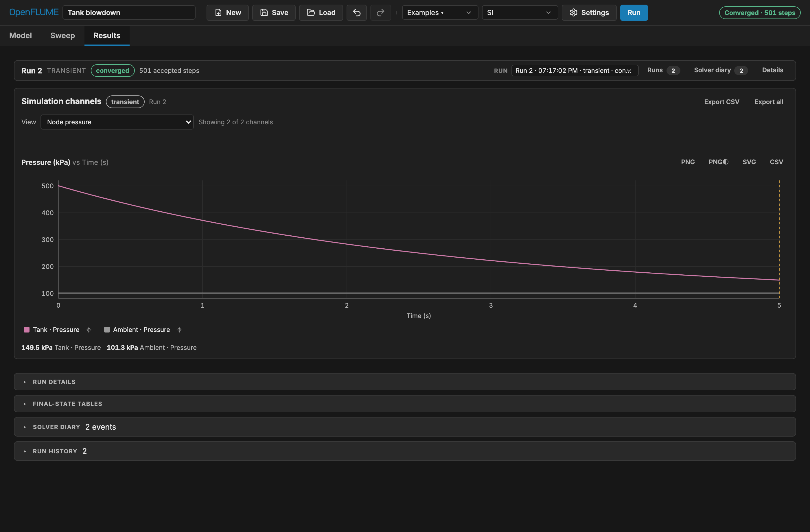
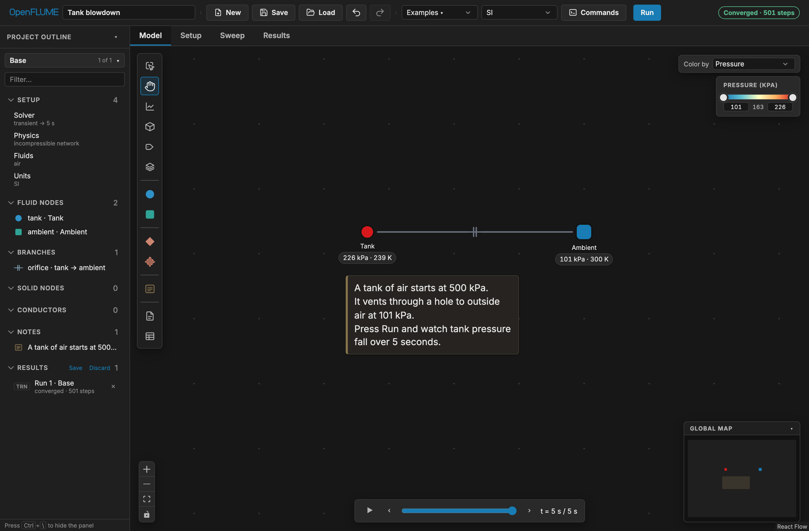
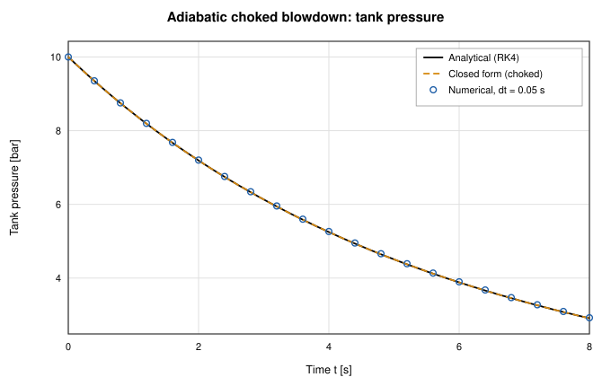
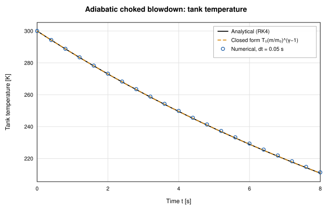

# Tutorial: tank blowdown

Using **Tank blowdown**, the smallest shipped transient, you:

1. run it and read the time-history plots;
2. check it against the closed-form solution for adiabatic choked blowdown;
3. change it and find where that closed form stops applying;
4. sweep the orifice size.

**[Open "Tank blowdown" in the app →](https://openflume.github.io/OpenFLUME/#example=tank-blowdown)**

## What it models

A rigid 0.1 m³ tank of air vents to atmosphere through a sharp-edged orifice.
The tank exchanges no heat with its surroundings, so the gas cools as it
expands; that cooling is the main physics in this case.

The network has three elements:

- **Tank**: an _internal_ fluid node whose `volume` turns on the mass and
  internal-energy storage terms, so P and T are integrated in time.
- **Ambient**: a _boundary_ node, an infinite reservoir at fixed P and T.
- **Orifice**: the branch between them. For a gas it applies an expansibility
  factor and chokes when the pressure ratio drops below the critical value
  (manual §4.3.2).

## Parameters

From `tankBlowdown` in [`src/ui/examples.ts`](../../src/ui/examples.ts):

| Item    | Field                                | Value                                               |
| ------- | ------------------------------------ | --------------------------------------------------- |
| Solver  | mode                                 | transient, fixed step                               |
|         | dt / endTime                         | 0.01 s / 5.0 s                                      |
|         | tolerance, maxIterations, relaxation | 1×10⁻⁶, 200, 0.9                                    |
| Fluid   | model                                | ideal gas, `air` preset (R = 287 J/(kg·K), γ = 1.4) |
| Tank    | internal node                        | 500 000 Pa, 300 K, volume 0.1 m³                    |
| Ambient | boundary node                        | 101 325 Pa, 300 K                                   |
| Orifice | `orifice`                            | area 1×10⁻⁴ m², Cd = 0.6                            |

The air preset constants come from `IdealGas.AIR` in `src/core/fluids/index.ts`.
**Text view** (manual §6.10) shows all of these values in one place as `.fn`
text.

## Run it

Click **Run**. The toolbar shows `t = … s / 5 s · dt = 0.01 s` during the run;
at the end the status pill reads **Converged** with the accepted step count
(the manual's screenshot shows 501).

## Read the time histories

Open the **Results** tab. A plot is one x axis plus a list of channels, and a
new plot starts empty.

1. Under **or plot a whole set…**, choose **Node pressure**: tank pressure
   falls from 500 kPa, and ambient stays flat at 101 325 Pa.
2. Click **+ Plot** for a second plot tab, then choose **Node & solid
   temperature**. Tank temperature falls well below 300 K.
3. Add a third plot with **Branch mass flow** to see the vent flow decay.



When reading these plots:

- **The temperature drop is expected.** The node stores internal energy
  (m·cv·T), while the outgoing flow carries enthalpy (cp·T). For an ideal gas
  in adiabatic blowdown this gives T/T₀ = (m/m₀)^(γ−1). A model that held the
  tank at 300 K throughout would have lost the flow-work term (manual §7.3).
- **Ignore the branch flow at t = 0.** That sample is the Newton warm start:
  the **Initial flow guess**, _Auto (0.1 kg/s)_ unless you set one (manual
  §6.5). Read flows from the first step onward.
- Use the arrow keys on a focused chart to step the cursor between samples.
- **Export CSV** writes the plot's channels with time in the first column,
  plus provenance (model name, settings summary, config
  hash).
- On the **Model** tab, set **Color by** to **Pressure** and drag the time
  scrubber below the canvas to replay the run on the diagram.



## Check it against the analytic solution

The [transient tank validation report](../validation/tank-transient-report.md)
gives the closed form for adiabatic blowdown through a choked orifice. While
the orifice stays choked:

```
m/m₀ = [1 + ((γ−1)/2) · t/τ]^(−2/(γ−1))
P/P₀ = (m/m₀)^γ
T/T₀ = (m/m₀)^(γ−1)

τ = V / ( Cd·A · √(γ R T₀) · (2/(γ+1))^((γ+1)/(2(γ−1))) )
```

The time constant τ depends on V, Cd·A, T₀ and the gas, but **not** on P₀.
Case 1 of the report uses this example's V = 0.1 m³, Cd = 0.6, A = 10⁻⁴ m², and
T₀ = 300 K and reports **τ = 8.295 s**; it starts from 10 bar instead of 5 bar,
which leaves τ unchanged.

**Choking.** For γ = 1.4 the orifice chokes while P_ambient / P_tank ≤ 0.5283,
that is, while the tank is above 101 325 / 0.5283 ≈ 191.8 kPa. The closed form
reaches that pressure at t ≈ 6.1 s, so it applies to the whole 5 s run.

The closed form with the example's numbers (γ = 1.4, P₀ = 500 kPa,
T₀ = 300 K, τ = 8.295 s) gives these reference values:

| t [s] | P_tank, closed form [kPa] | T_tank, closed form [K] |
| ----- | ------------------------- | ----------------------- |
| 1     | 423.2                     | 286.0                   |
| 2     | 359.6                     | 273.0                   |
| 3     | 306.7                     | 260.9                   |
| 4     | 262.5                     | 249.5                   |
| 5     | 225.4                     | 238.9                   |

Compare these with tank pressure and temperature read from your plots. Expect
the solver to sit slightly **above** the closed-form pressure: backward Euler
evaluates the vent flow at the lower-pressure end-of-step state, so each step
discharges slightly too little mass. The lag is one-sided and shrinks linearly
with dt. In the report's time-step study the maximum pressure-trace deviation
is 1.16 % of P₀ at dt = 0.4 s and 0.15 % at dt = 0.05 s, with an observed convergence order of 0.99–1.00. The
example's dt = 0.01 s is five times finer than the finest step in that study.

For a scripted check, run the same model from Python
([Python package](../python.md)):

```python
import numpy as np
import openflume as of

res = of.example("Tank blowdown").solve()
t = np.asarray(res.times)
P = np.asarray(res.series("tank", "pressure"))

g, R, T0, V, CdA, P0 = 1.4, 287.0, 300.0, 0.1, 0.6e-4, 5e5
tau = V / (CdA * np.sqrt(g * R * T0) * (2 / (g + 1)) ** ((g + 1) / (2 * (g - 1))))
P_exact = P0 * (1 + (g - 1) / 2 * t / tau) ** (-2 * g / (g - 1))

print(f"tau = {tau:.3f} s")
print(f"max |P - P_exact| / P0 = {np.max(np.abs(P - P_exact)) / P0:.2e}")
```

The report also covers two-tank equalization, adiabatic fill heating, and
blowdown through a scheduled valve. Its figures compare the solver with an RK4
reference and the closed form:





## Modify it

Each change below is a single edit. After an edit, the existing result is
marked **stale** until you run again (manual §8.7).

**Run longer.** In **Setup → Solver**, set **End Time** to 15 s and rerun. At
about 6.1 s the orifice unchokes; the decay slows and the closed form no
longer applies. Tank pressure approaches 101 325 Pa without overshooting.

**Double the orifice area.** Select the orifice branch and set its area to
2×10⁻⁴ m². τ halves to about 4.15 s. The tank now reaches the unchanged
unchoking pressure (≈ 191.8 kPa) after roughly 3 s instead of 6 s, so the
choked closed form no longer agrees over the subsonic remainder of the run.

**Change the time step.** Set **Time Step** to 0.1 s, then 0.2 s, and compare
runs on one plot (see below). The deviation from the closed form should grow
in proportion to dt, the first-order behavior the report measures. You can
also try **Adaptive** stepping (manual §4.6.3).

**Make the tank isothermal.** Add an **Ambient node** at 300 K, drag from the
tank to it, and choose a convection tie with h·A far above 10⁴ W/K; manual
§3.6 says this holds the tank within about 1 K of the set point. Pressure then
decays more slowly because the gas no longer cools as it expands, a useful
control case against the adiabatic default.

**Compare runs.** Every run is kept in the run history. On any plot,
**+ Compare run…** overlays up to four recorded runs, dashed and interpolated
onto the plot's axis, so runs with different time steps line up (manual §6.8).

## Sweep the orifice size

The **Sweep** tab runs one parameter across up to 25 values (manual §6.9).
Sweeps last only for the session and are never written to the model file.

1. Open **Sweep**. Under **Define a sweep**, pick the orifice branch's
   **area** as the **Sweep target** (the filter box helps with long lists).
2. Set **Start** = `0.5e-4`, **End** = `2e-4`, **Variants** = `4`. Sweep values
   are always SI, whatever your display preset.
3. Click **Run Sweep**. Variants solve sequentially in the worker, and the
   variant table reports each value's status, convergence, peak |ṁ|, pressure
   and temperature ranges, and duration.
4. **Export CSV** writes the variant table. **Promote** on a row saves that
   variant as a named simulation variant with its run attached, to compare
   against the base run on one plot or save in the `.fn` file.

Each sweep job solves a frozen, hashed snapshot of the model. If you edit the
model afterwards, the job shows a staleness banner.

## Scope

This example is an ideal-gas, adiabatic, lumped tank with no wall heat
capacity, real-gas effects, or stratification; the validation report lists
wall heat transfer and real-fluid tank thermodynamics as out of scope. For a
real-fluid tank with wall heat transfer, see the **LH2 tank no-vent fill**
and **Extension: Cryo tank vent control** examples in the
[examples gallery](../examples.md).
