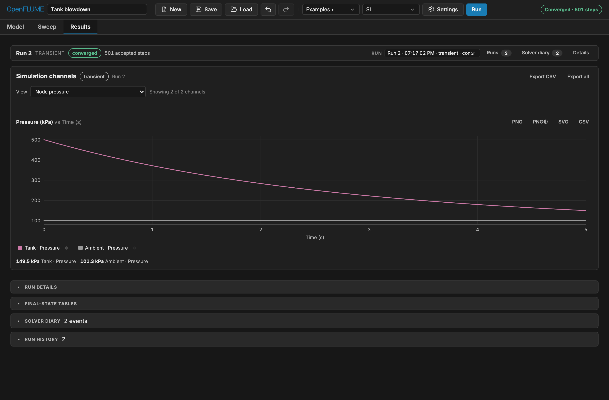

{.home-screenshot}

## Try a model now

Each link below opens a working model in the app:

| Model                                                                                                                        | What it shows                                                                 |
| ---------------------------------------------------------------------------------------------------------------------------- | ----------------------------------------------------------------------------- |
| [Sanity: orifice hand-calc](https://openflume.github.io/OpenFLUME/#example=sanity-orifice-hand-calc)                         | A steady result you can check by hand                                         |
| [Tank blowdown](https://openflume.github.io/OpenFLUME/#example=tank-blowdown)                                                | Transient ideal-gas tank venting through a choked orifice                     |
| [Cryogenic line cooldown](https://openflume.github.io/OpenFLUME/#example=cryogenic-line-cooldown)                            | Two-phase chilldown of a cryogenic transfer line with conjugate heat transfer |
| [LOX/RP-1 thruster (transient startup)](https://openflume.github.io/OpenFLUME/#example=lox-rp-1-thruster-transient-startup)  | Feed system, CEA-coupled combustion chamber, and regen-cooled nozzle          |
| [Spacecraft radiator panel](https://openflume.github.io/OpenFLUME/#example=spacecraft-radiator-panel-ammonia-loop-heat-pipe) | Ammonia loop with a radiating panel                                           |
| [Capillary circuit](https://openflume.github.io/OpenFLUME/#example=capillary-circuit-stop-plus-trigger-valve)                | Microfluidic stop and trigger valves                                          |

All 14 built-in models are in the [examples gallery](./examples.md).

## Where it stands

OpenFLUME is **alpha** software (v0.3.1). It is a lumped-parameter network code and not CFD. It has no shock capture and no method-of-characteristics water hammer, and its two-phase model is HEM only. The [scope boundaries](./user-manual.md#_1-7-scope-boundaries) list every limitation. If you find a case where it disagrees with a reference you trust, [open an issue](https://github.com/OpenFLUME/OpenFLUME/issues/new/choose). A well-documented disagreement is the most useful contribution the project can get.

New here? Start with the [5-minute guide](./guides/getting-started.md). Coming from GFSSP or SINDA/FLUINT? Read [the migration notes](./guides/from-gfssp.md). Teaching a course? See the [educator kit](./teach/index.md).
