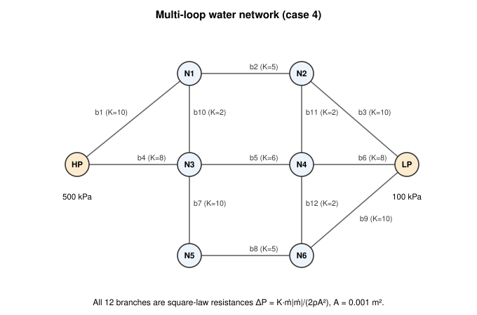

# Lab 1: Pipe networks

Students solve four steady incompressible pipe problems by hand: a branching
junction, a set of parallel pipes, a multi-loop network, and a pumped
distribution system. They then run each problem in OpenFLUME and explain any
difference between the two results. The problems are the shipped
**Three-pipe junction** and **Water distribution network** examples, plus two
cases from the
[incompressible hydraulics validation report](../validation/incompressible-hydraulics-report.md).

## Learning objectives

By the end of the lab, students should be able to:

1. Compute the flow in a pipe from a pressure drop with the Darcy–Weisbach
   equation and an explicit (Swamee–Jain) friction factor.
2. Solve a branching (three-pipe) problem by iterating on the junction
   pressure until continuity closes.
3. Solve a parallel-pipe problem from the common-ΔP condition.
4. Set up the Hardy-Cross loop corrections for a network with two
   fixed-pressure boundaries, and iterate them to convergence.
5. Find a pump operating point and read a pressure profile (the hydraulic
   grade line minus elevation) along a flow path.

## Prerequisites

- Fluid mechanics through internal flow: Darcy–Weisbach, the Moody chart,
  and continuity.
- A spreadsheet or a short script for the iterative parts (Parts A and C).
- No earlier OpenFLUME experience. The [Getting started](../guides/getting-started.md)
  page is useful but not required.

## Time

About 60 minutes of pre-lab hand calculation and 2 hours in the lab.

## Theory

All four problems use water as an incompressible liquid with the solver's
`water` preset: `ρ = 998 kg/m³`, `μ = 0.001 Pa·s`. Gravity is
`g = 9.80665 m/s²`.

**Pipe law.** A `pipe` branch applies Darcy–Weisbach friction plus a
hydrostatic term (user manual §4.3.1):

```
ΔP = P_from − P_to = f (L/D) ρ V|V| / 2 + ρ g Δz
V  = ṁ / (ρ A),   A = π D² / 4,   Re = ρ V D / μ
```

`Δz` is the pipe's **Elevation Change**, positive when the `to` end is higher
(manual §1.4). There are no entrance or fitting losses unless you add them as
separate components.

**Friction factor.** The code (`src/core/components/frictionFactor.ts`) uses
`f = 64/Re` below `Re = 2300`, the Swamee–Jain explicit approximation of
Colebrook at and above `Re = 4000`,

```
f = 0.25 / [ log10( ε/(3.7 D) + 5.74 / Re^0.9 ) ]²
```

and a smooth blend between the two. All flows in this lab are well above
`Re = 4000`, so Swamee–Jain is the only law you need. A pipe can also be set
to a **Constant f**, which then applies at every Reynolds number.

**Valves and resistances.** A `valve` with area `A`, discharge coefficient
`Cd`, and position `p` obeys `ΔP = ṁ|ṁ| / (2ρ (Cd A p)²)` (manual §4.3.6). A
`resistance` obeys `ΔP = K ṁ|ṁ| / (2ρA²)` (manual §4.3.5). Both have the form
`ΔP = R ṁ|ṁ|`.

**Pump.** A `pump` adds a pressure rise interpolated linearly from its curve of
volumetric flow `Q = ṁ/ρ` against rise (manual §4.3.10). The operating point is
where the pump rise equals the system's demand.

**Networks.** Every internal node conserves mass, and every branch relates its
two end pressures to its flow. Going around any closed loop, the signed
pressure drops sum to zero. A path between two fixed-pressure boundaries
behaves like a loop whose drops sum to the boundary pressure difference
(a _pseudo-loop_).

**Hardy-Cross.** Start from any set of flows that satisfies continuity. For each
loop, compute a flow correction and add it, with sign, to every branch in the
loop:

```
ΔQ = − [ Σ s_j R_j Q_j|Q_j| − H ] / [ Σ 2 R_j |Q_j| ]
```

`s_j = +1` when branch `j` is drawn in the loop's direction of travel and `−1`
otherwise, and `H` is the imposed pressure difference (zero for a closed loop,
`P_HP − P_LP` for a pseudo-loop). Because each correction is added around a
closed path, continuity is never violated. Here `Q` is mass flow in kg/s and
`R` is in Pa/(kg/s)².

OpenFLUME does not use Hardy-Cross. It solves the nodal mass balances and branch
momentum equations together with Newton–Raphson (manual §4.6.1). Both methods
have the same converged solution, which is why the comparison is meaningful.

## Pre-lab hand calculation

### Part A: Three-pipe junction (branching)

Water enters at 300 kPa, flows through pipe 1 to a junction, and splits
into pipe 2 (to an outlet at 200 kPa) and pipe 3 (to an outlet at 150 kPa).
All pipes are horizontal with roughness `ε = 1×10⁻⁵ m`.

| Pipe | From → to                  | L [m] | D [mm] |
| ---- | -------------------------- | ----- | ------ |
| 1    | Inlet (300 kPa) → Junction | 2     | 30     |
| 2    | Junction → Out 1 (200 kPa) | 3     | 20     |
| 3    | Junction → Out 2 (150 kPa) | 4     | 15     |

1. Write the continuity condition at the junction in terms of the junction
   pressure `P_j`.
2. Write a procedure that returns `ṁ` for one pipe given its `ΔP`. Guess
   `f = 0.02`, compute `V = sqrt(2 ΔP D / (f ρ L))`, then `Re`, update `f` with
   Swamee–Jain, and repeat until `f` stops changing (two or three passes).
3. Iterate on `P_j` (bisection between 150 and 300 kPa works) until the inflow
   equals the sum of the outflows to within 0.1 %. Report `P_j`, the three
   mass flows, and each pipe's `Re` and `f`.
4. Predict, without calculating, how `P_j` and the three flows change if pipe
   3's diameter is increased from 15 mm to 20 mm.

### Part B: Parallel pipes

Three pipes connect the same two reservoirs, at 150 kPa and 100 kPa
(`ΔP = 50 kPa`). Each has a constant Darcy friction factor. This is case 3
of the validation report.

| Pipe | D [mm] | L [m] | f     |
| ---- | ------ | ----- | ----- |
| p1   | 40     | 8     | 0.020 |
| p2   | 60     | 12    | 0.025 |
| p3   | 25     | 6     | 0.030 |

Compute each pipe's mass flow from `ṁ = A sqrt(2 ρ ΔP D / (f L))` and the total.
Which pipe carries the most flow per unit of cross-sectional area, and why?

### Part C: Hardy-Cross on a loop network

The network in Figure 1 is case 4 of the validation report. Two boundaries,
HP at 500 kPa and LP at 100 kPa, are joined through six internal nodes by
twelve square-law resistances, all with `A = 0.001 m²`.



_Figure 1. Multi-loop network (validation report, case 4)._

| Branch | From → to | K   | Branch | From → to | K   |
| ------ | --------- | --- | ------ | --------- | --- |
| b1     | HP → N1   | 10  | b7     | N3 → N5   | 10  |
| b2     | N1 → N2   | 5   | b8     | N5 → N6   | 5   |
| b3     | N2 → LP   | 10  | b9     | N6 → LP   | 10  |
| b4     | HP → N3   | 8   | b10    | N1 → N3   | 2   |
| b5     | N3 → N4   | 6   | b11    | N2 → N4   | 2   |
| b6     | N4 → LP   | 8   | b12    | N4 → N6   | 2   |

1. Compute `R = K / (2ρA²)` for each branch.
2. Count the unknowns. There are 12 branch flows and 6 internal nodes, so
   you need 12 − 6 = 6 loop equations: 5 closed loops (12 branches − 8 nodes
   - 1. and 1 pseudo-loop from HP to LP. Use these:

   | Loop | Path                             | Branches with sign   |
   | ---- | -------------------------------- | -------------------- |
   | L1   | HP → N1 → N3 → HP                | +b1, +b10, −b4       |
   | L2   | N1 → N2 → N4 → N3 → N1           | +b2, +b11, −b5, −b10 |
   | L3   | N2 → LP → N4 → N2                | +b3, −b6, −b11       |
   | L4   | N3 → N4 → N6 → N5 → N3           | +b5, +b12, −b8, −b7  |
   | L5   | N4 → LP → N6 → N4                | +b6, −b9, −b12       |
   | P    | HP → N1 → N2 → LP, `H = 400 kPa` | +b1, +b2, +b3        |

3. Start from this guess, which satisfies continuity at every node
   (kg/s): b1 = 6, b2 = 5, b3 = 4, b4 = 8, b5 = 5, b6 = 5, b7 = 4, b8 = 4,
   b9 = 5, b10 = 1, b11 = 1, b12 = 1. Check continuity at N3 and N4 yourself.
4. Do one full sweep by hand: apply the corrections in the order L1, L2, L3,
   L4, L5, P, and update the flows after each loop before you compute the
   next one. Report the six corrections.
5. Put the procedure in a spreadsheet and iterate until every correction is
   below 0.001 kg/s. Report the converged flows, the total flow from HP to
   LP, and the pressures at N1 to N6.

### Part D: Pumped network (estimate only)

This is the shipped **Water distribution network** example (see the
[examples gallery](../examples.md#water-distribution-network)). A pump draws from a 200 kPa supply, and the flow passes through
a header, three parallel legs (each a pipe plus a valve), and two return
lines that discharge to boundaries at 150 kPa and 120 kPa. The pump curve
(volumetric flow, rise) is (0, 300 kPa), (0.01 m³/s, 250 kPa),
(0.02 m³/s, 150 kPa), (0.03 m³/s, 50 kPa).

| Branch            | Type         | Parameters                                                                |
| ----------------- | ------------ | ------------------------------------------------------------------------- |
| Leg1 pipe / valve | pipe + valve | L = 8 m, D = 30 mm, Δz = +3 m; valve A = 0.001 m², Cd = 0.6, position 0.5 |
| Leg2 pipe / valve | pipe + valve | L = 8 m, D = 30 mm, Δz = 0; position 0.8                                  |
| Leg3 pipe / valve | pipe + valve | L = 8 m, D = 30 mm, Δz = −3 m; position 1.0                               |

1. Rank the three legs by the flow you expect them to carry, and give your
   reasons.
2. Write down how you would check, from solver output alone, that the pump is
   operating on its curve.

## Procedure in OpenFLUME

Set **Units ▾** to **SI** before you start. Every value in this lab is then
displayed in the units used above.

### Part A: Three-pipe junction

1. Open the example:
   **[Three-pipe junction](https://openflume.github.io/OpenFLUME/#example=three-pipe-junction)**.
   (Or choose it from **Examples ▾** → _Applications_.) Opening an example
   replaces the current model.
2. Click each pipe and check its **Length**, **Diameter**, and **Roughness** in
   the property panel against the table in Part A. Click each boundary node
   and check its **Pressure**.
3. Click **Run**. The status pill should read **Converged**.
4. Click the **Junction** node. The **Results** block at the bottom of the
   property panel shows its solved pressure. Click each pipe to read its mass
   flow and Reynolds number. Record them next to your hand values.
5. Change **Pipe 3**'s **Diameter** to 0.02 m and click **Run** again. Compare
   the result with your prediction from Part A, step 4.
6. Click **Undo** in the toolbar to restore the 15 mm diameter, select **Pipe 3**, and delete it. The
   **Out 2** node is now unconnected; delete it too. Run again. You now have
   two pipes in series. Record the flow and the junction pressure.

### Part B: Parallel pipes

1. Click **New** in the toolbar. A new model is steady-state incompressible
   water.
2. From the left rail, place two **Boundary node**s. Set their **Pressure**
   to 150000 and 100000 Pa and their **Temperature** to 300 K.
3. Drag from the first node's handle to the second. In the **Connect with**
   chooser, pick **Pipe**. Repeat twice more so that three pipes join the same
   two nodes.
4. For each pipe, set **Length**, **Diameter**, and **Roughness** (1e-5), set
   **Friction** to **Constant f**, and enter the **Darcy friction factor f**
   from the Part B table.
5. Click **Run** and read each pipe's mass flow.

If drawing three branches between the same two nodes is awkward on the
canvas, open **Text view**, replace the text with the model below, and click
**Apply**:

```
// Fluid Network config v2
network "Lab 1 parallel pipes" {
settings: {"mode":"steady","tolerance":1e-9,"maxIterations":500,"relaxation":0.9}
fluid: {"model":"incompressible","preset":"water"}
node "A" boundary @ (0, 0) data: {"pressure":150000,"temperature":300}
node "B" boundary @ (400, 0) data: {"pressure":100000,"temperature":300}
branch "p1": "A" -> "B" pipe data: {"length":8,"diameter":0.04,"roughness":0.00001,"frictionFactor":0.02}
branch "p2": "A" -> "B" pipe data: {"length":12,"diameter":0.06,"roughness":0.00001,"frictionFactor":0.025}
branch "p3": "A" -> "B" pipe data: {"length":6,"diameter":0.025,"roughness":0.00001,"frictionFactor":0.03}
}
```

### Part C: Loop network

Building eight nodes and twelve branches by hand takes about 20 minutes and
is good practice with the canvas. To save time, click **New**, open
**Text view**, replace the text with the model below, and click **Apply**:

```
// Fluid Network config v2
network "Lab 1 Hardy-Cross network" {
settings: {"mode":"steady","tolerance":1e-9,"maxIterations":500,"relaxation":0.8}
fluid: {"model":"incompressible","preset":"water"}
node "HP" boundary @ (0, 150) data: {"pressure":500000,"temperature":300}
node "N1" internal @ (200, 0) data: {"pressure":300000,"temperature":300}
node "N2" internal @ (400, 0) data: {"pressure":300000,"temperature":300}
node "N3" internal @ (200, 150) data: {"pressure":300000,"temperature":300}
node "N4" internal @ (400, 150) data: {"pressure":300000,"temperature":300}
node "N5" internal @ (200, 300) data: {"pressure":300000,"temperature":300}
node "N6" internal @ (400, 300) data: {"pressure":300000,"temperature":300}
node "LP" boundary @ (600, 150) data: {"pressure":100000,"temperature":300}
branch "b1": "HP" -> "N1" resistance data: {"k":10,"area":0.001}
branch "b2": "N1" -> "N2" resistance data: {"k":5,"area":0.001}
branch "b3": "N2" -> "LP" resistance data: {"k":10,"area":0.001}
branch "b4": "HP" -> "N3" resistance data: {"k":8,"area":0.001}
branch "b5": "N3" -> "N4" resistance data: {"k":6,"area":0.001}
branch "b6": "N4" -> "LP" resistance data: {"k":8,"area":0.001}
branch "b7": "N3" -> "N5" resistance data: {"k":10,"area":0.001}
branch "b8": "N5" -> "N6" resistance data: {"k":5,"area":0.001}
branch "b9": "N6" -> "LP" resistance data: {"k":10,"area":0.001}
branch "b10": "N1" -> "N3" resistance data: {"k":2,"area":0.001}
branch "b11": "N2" -> "N4" resistance data: {"k":2,"area":0.001}
branch "b12": "N4" -> "N6" resistance data: {"k":2,"area":0.001}
}
```

1. Click **Run**. The status pill shows the number of Newton iterations.
   Compare it with the number of Hardy-Cross sweeps you needed.
2. Click each branch and node to read the solved flows and pressures in the
   property panel's **Results** block (hovering a row in the project outline
   also shows them). Compare them with your converged spreadsheet.
3. Check one loop by hand from the solver's numbers: the signed sum of the
   branch pressure drops around L2 should be zero.

### Part D: Water distribution network

1. Open the example:
   **[Water distribution network](https://openflume.github.io/OpenFLUME/#example=water-distribution-network)**.
2. Click **Run**.
3. Click the **Pump** branch and record its mass flow and pressure drop (the
   pressure drop is negative because a pump raises pressure). Convert the mass
   flow to `Q = ṁ/ρ` and check that the rise lies on the pump curve.
4. Record the mass flow in each leg pipe. Check continuity at the
   **Return merge** node: the three legs in, the two returns out.
5. For **Leg1**, compute the pipe pressure drop (friction plus `ρ g Δz`) and the
   valve pressure drop by hand from the solved flow. Their sum should equal
   `P(Header) − P(Return merge)`.
6. Open the **Results** tab, click **+ Plot**, choose **Station along path**
   as the x axis, pick a path that runs through Leg1 in the **Path** selector,
   and add the node pressures. This is the pressure along the path. Adding
   `ρ g z` at each node would give the hydraulic grade line. Identify the
   largest single pressure loss.
7. Back on the **Model** tab, set **Leg1 valve** **Position** to 1.0 and run
   again. Record the new flows in all three legs and the new pump operating
   point.

## Questions

1. In Part A, how close did your hand calculation come to the solver? If the
   two disagree by more than 0.1 %, find the cause (friction factor, units,
   or an unconverged iteration).
2. Opening pipe 3 (step 5 of Part A) raises the total inflow but lowers the
   flow through pipe 2. Explain why with the junction pressure.
3. In Part B, the solver's result agrees with the closed form to round-off
   (the validation report shows errors below 10⁻¹² %). In Part A it agrees with your hand calculation only as
   well as your iteration converged. What is the difference between the two
   problems that explains this?
4. How many Hardy-Cross sweeps did you need to reach 0.001 kg/s? How many
   Newton iterations did OpenFLUME report? Why does Newton converge in fewer
   iterations, and what does each iteration cost?
5. In Part D, Leg3 carries the most flow. Separate the reasons: how much of
   the difference between Leg1 and Leg3 comes from elevation and how much
   from valve position?
6. In Part D, the **Discharge low** pipe shows a _negative_ pressure drop even
   though water flows through it in the drawn direction. Explain.
7. Opening Leg1's valve fully (Part D, step 7) increases Leg1's flow but
   reduces the flow in Legs 2 and 3. Explain using the pump curve.

## Extensions

- **Friction-factor sensitivity.** In Part A, set every pipe to **Constant f**
  = 0.02 and rerun. How much does the junction pressure move? This shows how
  much the Swamee–Jain correction matters for this problem.
- **Elevation.** In Part D, raise **Leg1 pipe**'s **Elevation Change** from 3 m
  to 6 m and predict the change in Leg1 flow before running. The user manual
  (§7.4) states that raising a leg must reduce its flow. Check this.
- **Sweep.** Use the **Sweep** tab to vary **Leg1 valve** position from 0.1 to
  1.0 in 10 variants. Plot Leg1 flow against position. Why is the curve not
  linear?
- **Hardy-Cross ordering.** Repeat Part C with simultaneous corrections
  (compute all six from the same flows, then apply them together). Does it
  converge faster or slower than the sequential sweep?

::: details Answer key

All values below were computed independently with a Python implementation of
the same equations (Swamee–Jain with the code's blend, bisection, and the
Hardy-Cross sweep described above). They were cross-checked against the
validation report where it covers the case, and against OpenFLUME 0.3.1 run
locally. Values marked _solver_ are OpenFLUME 0.3.1 results. Hand and solver
results agree to at least five significant figures wherever both exist.

**Part A: three-pipe junction**

| Quantity | Pipe 1   | Pipe 2   | Pipe 3   |
| -------- | -------- | -------- | -------- |
| ṁ [kg/s] | 3.6004   | 2.3802   | 1.2202   |
| V [m/s]  | 5.10     | 7.59     | 6.92     |
| Re       | 1.53×10⁵ | 1.52×10⁵ | 1.04×10⁵ |
| f        | 0.01857  | 0.01945  | 0.02102  |

- Junction pressure `P_j = 283.91 kPa`. Continuity: 3.6004 = 2.3802 + 1.2202.
- With a first guess of `P_j = 250 kPa`, the inflow (6.55 kg/s) far exceeds the
  outflow (2.85 kg/s), so `P_j` must rise. Bisection on [150, 300] kPa
  reaches 0.1 % continuity closure in about 12 steps.
- Pipe 3 at D = 20 mm (step 5): `P_j = 273.21 kPa`; ṁ₁ = 4.719, ṁ₂ = 2.215,
  ṁ₃ = 2.504 kg/s. The junction pressure falls, so pipe 1 carries more flow
  and pipe 2 carries less.
- Series (pipe 3 removed, step 6): `P_j = 291.88 kPa`, ṁ = 2.4968 kg/s.

**Part B: parallel pipes** (validation report, case 3)

| Pipe  | ṁ [kg/s]  | Re       |
| ----- | --------- | -------- |
| p1    | 6.276899  | 2.00×10⁵ |
| p2    | 12.632016 | 2.68×10⁵ |
| p3    | 1.827549  | 9.3×10⁴  |
| Total | 20.736463 | —        |

Mass flux `ṁ/A = sqrt(2ρΔP D/(fL))` grows with `D/(fL)`: it is about
4470 kg/(m²·s) for p2, 4990 for p1, and 3720 for p3. Per unit area, p1 carries
the most flow: its `D/(fL)` is 0.25 m⁻¹, against 0.20 m⁻¹ for p2 and 0.139 m⁻¹
for p3. The solver matches the closed form to 6×10⁻¹³ % (report, case 3)
because, with a constant f, the closed form is the solver's own equation.
With Swamee–Jain in Part A the hand answer is only as exact as the iteration.

**Part C: Hardy-Cross**

`R = K/(2ρA²)` with `2ρA² = 1.996×10⁻³`: R = 5010.0 (K = 10), 4008.0 (K = 8),
3006.0 (K = 6), 2505.0 (K = 5), 1002.0 (K = 2) Pa/(kg/s)².

First sequential sweep (kg/s): ΔQ_L1 = +0.5952, ΔQ_L2 = +0.2333,
ΔQ_L3 = +0.2610, ΔQ_L4 = +0.5611, ΔQ_L5 = +0.4131, ΔQ_P = +0.1667. Flows after
the sweep: b1 6.762, b2 5.400, b3 4.428, b4 7.405, b5 5.328, b6 5.152,
b7 3.439, b8 3.439, b9 4.587, b10 1.362, b11 0.972, b12 1.148.

Sequential sweeps reach |ΔQ| below 0.001 kg/s after 13 sweeps, and below 10⁻¹⁰
after 51. The converged solution matches the validation report's independent
Newton reference and OpenFLUME (report case 4 tables; solver 0.3.1 identical
to the digits shown):

| Branch | ṁ [kg/s] | Branch | ṁ [kg/s] |
| ------ | -------- | ------ | -------- |
| b1     | 6.607218 | b7     | 3.272332 |
| b2     | 5.610671 | b8     | 3.272332 |
| b3     | 4.521599 | b9     | 4.463610 |
| b4     | 7.403880 | b10    | 0.996547 |
| b5     | 5.128094 | b11    | 1.089072 |
| b6     | 5.025888 | b12    | 1.191278 |

Total flow HP → LP = b1 + b4 = 14.0111 kg/s. Node pressures (kPa): N1 281.286,
N2 202.429, N3 280.291, N4 201.241, N5 226.643, N6 199.819.

OpenFLUME 0.3.1 reports 28 Newton iterations with the model above (relaxation
0.8, tolerance 10⁻⁹). The report's own undamped reference Newton solve took 18.
Each Newton iteration solves all twelve flows and six pressures together with
a full Jacobian, while each Hardy-Cross correction only updates one loop. The
Newton method converges quadratically near the solution, and Hardy-Cross
converges linearly.

L2 loop check (solver ΔP, kPa): b2 78.857 + b11 1.189 − b5 79.050 − b10 0.995
= 0.000.

**Part D: water distribution network** (solver, OpenFLUME 0.3.1)

| Branch                       | ṁ [kg/s] | ΔP [kPa]         |
| ---------------------------- | -------- | ---------------- |
| Pump                         | 13.9965  | −209.755         |
| Main header                  | 13.9965  | 40.766           |
| Leg1 pipe / valve            | 3.5588   | 92.327 / 70.504  |
| Leg2 pipe / valve            | 4.8323   | 112.053 / 50.778 |
| Leg3 pipe / valve            | 5.6053   | 119.105 / 43.726 |
| Return low / Discharge low   | 8.8808   | 63.056 / −6.898  |
| Return high / Discharge high | 5.1157   | 22.334 / 63.824  |

Node pressures (kPa): Pump out 409.755, Header 368.989, Return merge 206.158,
Return low 143.102, Return high 183.824.

- Pump check: `Q = 13.9965/998 = 0.0140245 m³/s`. On the segment between
  0.01 and 0.02 m³/s, rise = 250 − (0.0040245/0.01)×100 = 209.755 kPa, which
  matches the solver.
- Continuity at Return merge: 3.5588 + 4.8323 + 5.6053 = 13.9965 =
  8.8808 + 5.1157.
- Leg1 by hand from ṁ = 3.5588 kg/s: V = 5.045 m/s, Re = 1.51×10⁵,
  f = 0.01859. Friction = 62.97 kPa, plus `ρgΔz = 998 × 9.80665 × 3`
  = 29.36 kPa, gives a pipe ΔP of 92.33 kPa. Valve:
  `3.5588² / (2 × 998 × (0.6 × 0.001 × 0.5)²) = 70.50 kPa`. The sum, 162.83 kPa,
  equals 368.989 − 206.158.
- The largest single loss along the Leg1 path is the Leg1 pipe (92.3 kPa,
  about a third of it hydrostatic), followed by the Leg1 valve (70.5 kPa).
- Discharge low: friction is +42.04 kPa, but the pipe falls 5 m, so
  `ρgΔz = −48.94 kPa`. The net ΔP is −6.90 kPa, so pressure rises along the
  pipe because of the elevation drop.
- Leg1 valve at position 1.0: Leg1 4.4155, Leg2 4.6464, Leg3 5.4228,
  total 14.4847 kg/s, pump rise 204.86 kPa. The total flow rises, so the pump
  moves down its curve and delivers less rise. The Header pressure falls
  (361.36 kPa), and Legs 2 and 3 lose flow.
- Question 5: with every valve at the same position, the only difference
  between the legs would be `ρgΔz`. Leg1 then has 2 × 29.36 = 58.7 kPa more
  to overcome than Leg3. Leg1's half-open valve has four times the resistance
  of a fully open valve, because `(Cd A p)²` is quartered. Students can
  separate the two effects with the valve-position runs: at position 1.0,
  Leg1 still carries less than Leg3 (4.416 against 5.423 kg/s), which is the
  elevation effect alone.
- Extension, Leg1 Δz = 6 m: Leg1 flow falls from 3.5588 to 3.2060 kg/s, and
  the total falls to 13.7920 kg/s.

:::
