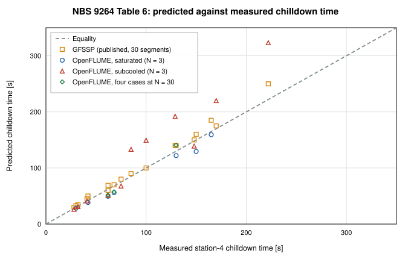
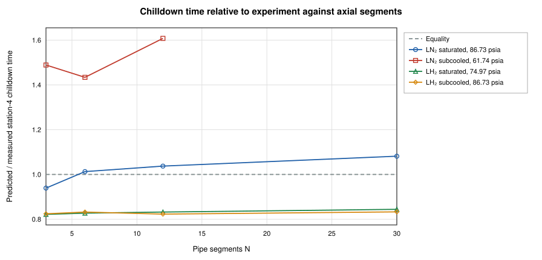
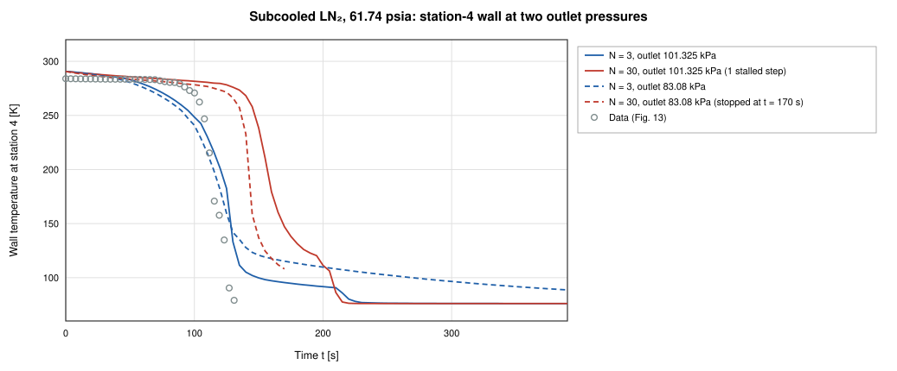
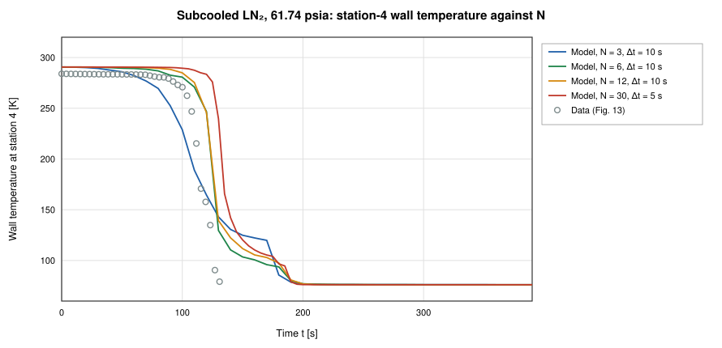
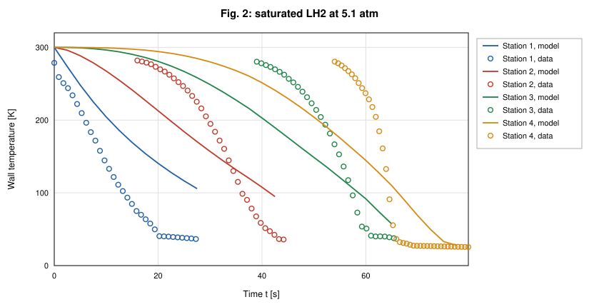
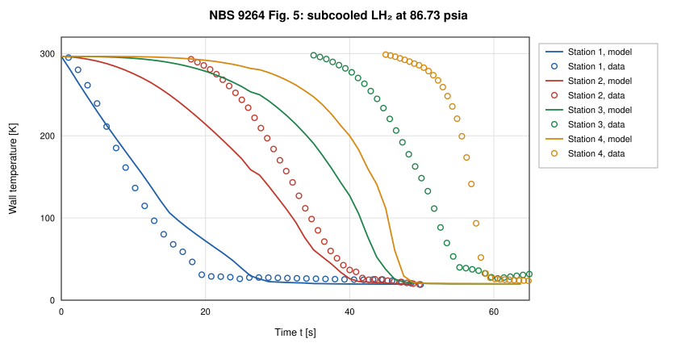
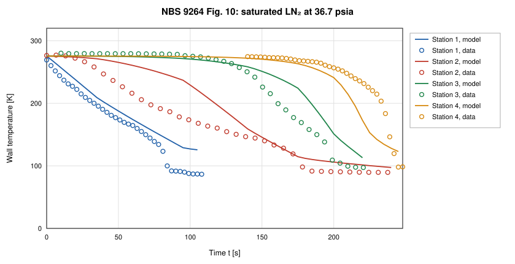
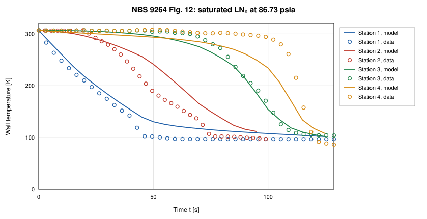
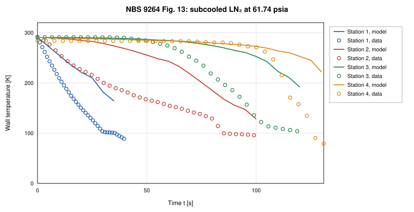
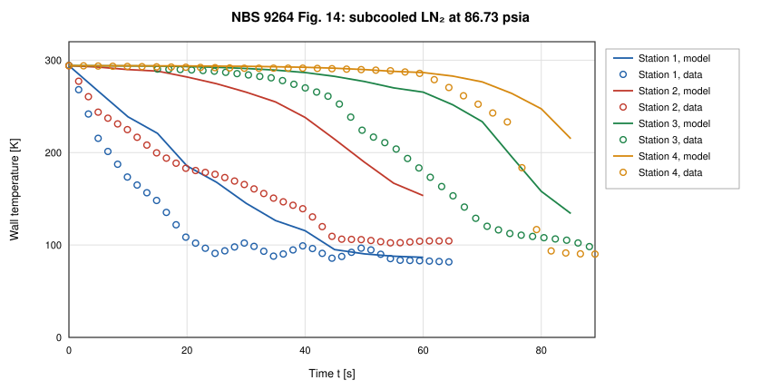

# Cryogenic Transfer-Line Chilldown Validation of OpenFLUME

**Validation against experiment: NBS Report 9264 chilldown times and digitized wall-temperature traces, with GFSSP's published predictions as a code-to-code reference**

Generated by `scripts/chilldown-validation-report.ts` — all model numbers and
figures come from live solves of the current solver. The corresponding CI
gates are `src/ui/tests/chilldownBaseline.test.ts` (saturated and subcooled
LN₂ Table-6 cases and the trusted trace runs; the full suite runs under
`RUN_SLOW=1`), `src/validation/__tests__/nbsTraceCorpus.test.ts` (trace
corpus structure, trust levels, QC, provenance hash),
`src/validation/__tests__/traceBaseline.test.ts` (trace-comparison
plumbing) and `src/validation/__tests__/nbsInitialTemperature.test.ts`
(initial wall temperatures).

## Abstract

This report compares OpenFLUME's two-phase chilldown model with the measured
cooldown of a 61 m vacuum-jacketed copper transfer line, NBS Report 9264
(Brennan et al., 1966), and with the predictions that GFSSP published for the
same tests. It is validation against experiment and therefore subject to the
modeling, closure, discretization, and measurement uncertainties discussed
below. It is also a case in which one-dimensional codes do not fully agree
with the measurement, because both omit the nucleate and transition boiling
regimes; it is included because GFSSP includes it. All eighteen chilldown
times of Table 6 (liquid nitrogen and liquid hydrogen, saturated and
subcooled) are solved at the 3-segment CI configuration, from the measured
initial wall temperature of each run and with one knee definition applied
alike to the model and to the digitized data; trust levels are assigned from
the experimental record alone. The model includes the longitudinal inertia
term of GFSSP's chilldown formulation (without it the outlet flow is
supersonic) and an inlet restriction for the dewar valve and entrance. Over
the eighteen rows the mean absolute error is 20.0 % for OpenFLUME (signed mean
+5.4 %, 5 of 18 late) and 7.6 % for GFSSP's published 30-segment
predictions (signed mean +7.3 %, 16 of 18 late). No row accepted a step
that did not converge; without the subcooled LN₂ rows the mean absolute error is
10.2 % over 13 rows (GFSSP 8.3 %). The subcooled LN₂ rows are late by
+29.4 % to +56.7 %: their outlet wall sits on a film-boiling shelf at near-zero quality
until the outlet node turns liquid, and that node's phase depends on the
outlet pressure and on an exit restriction that GFSSP's model has and whose
coefficient is not published, so they are reported as sensitive to that
input rather than as point values. A representative subset (saturated and subcooled LN₂ and LH₂) is
also solved at GFSSP's 30 segments: its mean absolute error is
22.5 % at N = 3 and, over all 4 cases at
N = 30 (LN₂ subcooled 61.74 psia with stalled steps), 25.5 % against 5.6 % for GFSSP.
Cryogenic chilldown is the least mature area of the code;
the numbers below are the evidence for that statement.

## Experiment and Data

### The NBS 9264 transfer line

Brennan, Brentari, Smith, and Steward (NBS Report 9264, 1966) admitted
liquid hydrogen and liquid nitrogen from a pressurized dewar into a
horizontal, vacuum-jacketed copper line, 200 ft
(60.96 m) long, 0.625 in
inside and 0.75 in outside diameter, venting to
the atmosphere. Wall thermocouples sat at four stations,
20 ft, 80 ft, 141 ft, 198 ft from the inlet
(6.10 m, 24.38 m, 42.98 m, 60.35 m). The
report defines the chilldown time as the low-temperature knee of the wall
temperature at 60.4 m (station 4) and notes that it is not uniquely defined.
NBS reports no error bars; the report's own caveats (thermocouple accuracy
traded for range, physically inconsistent low-temperature curve crossings,
chart-read knees) are carried with every data point.

### The knee definition

One definition is used for every chilldown time and every knee in this report.
At a station, the knee is the first smooth (linearly interpolated) crossing, from
above, of the threshold T_sat(P_local) + 15 K, where P_local is the mean over the
final 10 % of the solve of the model's pressure interpolated to the station.
The wall trace is interpolated in space to the exact station coordinate. The
same threshold temperature is then applied to the digitized trace of the same
run, so the model's and the data's knees are evaluated under the identical
definition; the digitized record carries no pressure, which is why the model
solve of the run at its driving pressure supplies it. A data trace that never
reaches the threshold has no knee under the definition, and is reported as such
(table "Knee of the digitized traces"). The definition is implemented once, in
`localSaturationThreshold` (`src/validation/chilldownMetric.ts`), and is used
by the Table-6 times, the trace comparison and the data knees alike.

### Table 6: chilldown times

The measured chilldown times are taken as tabulated, with GFSSP's
predictions, in Table 6 of Majumdar, LeClair, Moore, and Schallhorn
(AIAA 2015-3850): eighteen rows, verified digit for digit against the NTRS
scan and, for the hydrogen rows, against the earlier TFAWS 2013 paper. GFSSP's
values are model output and are used here as a code-to-code reference, never as
data. GFSSP's model of the line (§4.3 of that paper) has 30 pipe segments
and 31 fluid nodes, each with a solid node, and the dewar and the ambient outlet
as boundary nodes 1 and 33 (the paper's text is internally inconsistent about
the boundary nodes; this report follows its description of 31 fluid nodes with
solid nodes and two boundary nodes). OpenFLUME solves N segments with N − 1 solved
fluid nodes between two boundary nodes (the legacy layout) or N + 1 internal
fluid nodes (the GFSSP layout used here); N = 30 is GFSSP's resolution.
This report solves every row at N = 3: four saturated and six subcooled hydrogen
rows, three saturated and five subcooled nitrogen rows.

### Initial wall temperature

The line was "at ambient temperature" before the valve opened and NBS 9264 gives no
number. The measured value is the pre-arrival plateau of the digitized wall
traces: the median of the first samples of a run's four station traces. Eleven runs give
270.8–306.8 K (mean 287.6 K), not the 300 K the line
builder defaults to (`src/validation/nbsInitialTemperature.ts`). A Table-6 row takes
the value of the digitized run of the same test where one exists (nine rows); the
other nine rows (ᵃ) take the mean of the eleven runs, with the lowest and highest
run value as the bracket over which the sensitivity is quoted. It is an input
from the record, never fitted; each value is applied as the uniform initial
temperature of the wall and of the fluid in the line.

| Figure | Run | First sample at stations 1–4 [K] | Median [K] |
| ------ | --- | -------------------------------- | ---------- |
| Fig. 2 | LH2 saturated | 278.8 / 282.0 / 280.3 / 280.4 | 280.3 |
| Fig. 3 | LH2 subcooled | 270.9 / 270.6 / 270.3 / 273.3 | 270.8 |
| Fig. 4 | LH2 subcooled | 273.5 / 277.8 / 281.5 / 275.7 | 276.7 |
| Fig. 5 | LH2 subcooled | 295.1 / 293.1 / 297.9 / 298.7 | 296.5 |
| Fig. 6 | LH2 subcooled | 273.3 / 296.4 / 296.1 / 296.6 | 296.3 |
| Fig. 7 | LH2 subcooled | 268.5 / 281.6 / 281.3 / 277.5 | 279.4 |
| Fig. 10 | LN2 saturated | 269.3 / 276.4 / 280.1 / 274.6 | 275.5 |
| Fig. 11 | LN2 saturated | 295.6 / 297.2 / 299.7 / 296.1 | 296.6 |
| Fig. 12 | LN2 saturated | 306.8 / 306.8 / 306.8 / 306.8 | 306.8 |
| Fig. 13 | LN2 subcooled | 290.2 / 291.5 / 291.1 / 284.0 | 290.7 |
| Fig. 14 | LN2 subcooled | 294.4 / 294.0 / 290.4 / 294.1 | 294.1 |

### Digitized trace corpus and trust levels

Eleven oscillograph figures of NBS 9264 (Figs. 2–7 hydrogen, 10–14 nitrogen)
were digitized into 44 station traces and 10195
samples (`validation/data/digitized/chilldown/nbs9264_fig*.csv`, rebuilt into
`src/validation/generated/nbsTraceCorpusData.ts` by `npm run gen:trace-corpus`;
the CSVs' SHA-256 is rechecked on every CI run). The physical run, not the
station trace, is the independent unit. Trust levels are assigned from the
experimental record alone. A run is **diagnostic only** when its record is
compromised as a whole: the cold tails of several stations overlap in the
figure so that their assignment to stations cannot be recovered, or the
valve opened before the chart's zero time so that every timing feature is
shifted by an unknown amount. Every other run is **trusted**. Per-trace QC
flags (curve crossings in the low-temperature region, truncated cold tails,
an oscillatory segment, drawn-line reconstruction) then restrict which
features of a trusted trace may be compared, and set its weight.

| Figure | Fluid | Inlet | P_drive [atm] | Table-6 row | Samples | Cold tail usable | QC flags | Trust level |
| ------ | ----- | ----- | ------------- | ----------- | ------- | ---------------- | -------- | ----------- |
| Fig. 2 | LH2 | saturated | 5.1 | satLH2-P74.97 | 502 | 4/4 | curveCrossingRegion | trusted |
| Fig. 3 | LH2 | subcooled | 2.5 | subLH2-P36.75 | 1590 | 0/4 | ambiguousTailAssignment | diagnostic only |
| Fig. 4 | LH2 | subcooled | 4.2 | subLH2-P61.74 | 1047 | 1/4 | ambiguousTailAssignment, curveCrossingRegion | diagnostic only |
| Fig. 5 | LH2 | subcooled | 5.9 | subLH2-P86.73 | 597 | 4/4 | curveCrossingRegion | trusted |
| Fig. 6 | LH2 | subcooled | 7.6 | subLH2-P111.72 | 983 | 0/4 | preTZeroValveOpening, ambiguousTailAssignment | diagnostic only |
| Fig. 7 | LH2 | subcooled | 11 | subLH2-P161.7 | 992 | 0/4 | ambiguousTailAssignment | diagnostic only |
| Fig. 10 | LN2 | saturated | 2.5 | — | 1128 | 4/4 | none | trusted |
| Fig. 11 | LN2 | saturated | 3.4 | — | 669 | 1/4 | truncatedColdTail | trusted |
| Fig. 12 | LN2 | saturated | 5.9 | satLN2-P86.73 | 893 | 4/4 | none | trusted |
| Fig. 13 | LN2 | subcooled | 4.2 | subLN2-P61.74 | 719 | 2/4 | truncatedColdTail | trusted |
| Fig. 14 | LN2 | subcooled | 5.9 | subLN2-P86.73 | 1075 | 2/4 | oscillatorySegment, truncatedColdTail | trusted |

**Trusted** runs: 7 runs, 28 traces, 21 with a usable cold
tail. **Diagnostic-only** runs: 4 (3, 4, 6, 7), all
subcooled hydrogen. A Table-6 row inherits the trust level of the digitized
run of the same test where one exists; the other rows carry only the
report-wide NBS caveats and are trusted. The trust level describes the
measurement, not the model: rows the model reproduces poorly are reported
in full.

## Numerical Model

The line is built by `buildChilldownTwoPhase` (`src/ui/examples.ts`; the
shipped 20-segment cryogenic line cooldown example of user manual §7.11 is a
separate model) in GFSSP's layout of this line (`endNodeLayout: "internal"`): N equal pipe segments between
N + 1 internal fluid nodes at x = 0 … L with real-fluid (CoolProp,
homogeneous-equilibrium) properties, a lumped copper wall node on each of them
(so every wall node convects to a solved fluid node at its own position and none
to a boundary node), joined by axial conduction, and the saturated (or subcooled)
liquid inlet and the atmospheric outlet as boundary nodes on short, negligible-friction end
branches. The convection conductor is Miropolskii film boiling in the two-phase
states and Dittus–Boelter on single-phase states (`src/core/correlations/miropolskii.ts`).
The two end wall nodes own half a segment each and the end fluid nodes half a
segment of volume, so the total wall mass, wetted area and fluid volume equal
the line's (`NBS_LINE_WALL_MODEL`, `src/validation/nbsChilldown.ts`). The wall
uses the temperature-dependent NIST OFHC-copper specific heat and conductivity
(4–300 K, RRR 100); the vacuum jacket is represented by an adiabatic outer wall.
Nitrogen is CoolProp Nitrogen; hydrogen is ParaHydrogen.

The branch momentum equation includes the longitudinal inertia (momentum-flux)
term and the energy balance the kinetic energy of the flow (`NBS_LINE_FLOW_MODEL`).
GFSSP's chilldown formulation includes the inertia term (Cross, Majumdar,
Bennett, and Malla, 2002, Eq. 17). Without it the vapor-filled line
accelerates its outflow past the speed of sound at the outlet node, which a
constant-area duct fed from upstream cannot do (table "Longitudinal inertia"). The short inlet branch is a
K-factor resistance, ΔP = K ṁ|ṁ|/(2ρA²) on the line's flow area, standing for the
valve and entrance between the dewar and the line; GFSSP's model has a restriction
branch there (AIAA 2015-3850, Fig. 14) whose coefficient is not published.
K = 2 is set from a physical argument, not fitted: a sharp-edged entrance (K ≈ 0.5)
plus a fully open valve (K of order 1). K = 1 and 5 are the sensitivity. The
outlet is a boundary node at 101325 Pa. NBS 9264 and GFSSP give 12.05 psia
(83.08 kPa); GFSSP's model also has an exit restriction whose coefficient is
not published, and without it that pressure leaves the subcooled-LN₂ outlet node two-phase
(see "Outlet pressure and the exit restriction"). Transients use backward
Euler with a fixed step, Δt = 5 s for nitrogen and 1.25 s for hydrogen
(from the time-step study below), a horizon of three measured chilldown times (at least
300 s) and each run's measured initial wall temperature. Nothing in this
report is fitted: N, Δt and the initial temperature are fixed by the definitions
above, the closure constants are the published ones, and K is set from the
physical argument above. A solve that accepts a step whose scaled residual stays above
0.01 (a stalled step) is flagged: such steps do not conserve energy, and the
energy closure (fluid enthalpy gain over the wall energy removed) is listed
with every Table-6 row. Flagged rows are reported but excluded from the
summary statistics, which are given with and without them.

The earlier layout (`endNodeLayout: "boundary"`: N segments between the boundary
nodes, the two end wall nodes borrowing a neighbouring fluid node) is kept for
comparison. It ties the outlet wall, the wall that defines the station-4 time,
to the fluid a segment length L/N upstream of it (20 m at N = 3).

## Results

### Table 6: experiment, GFSSP, and OpenFLUME

| Fluid | Inlet | P_drive [psia] | Experiment [s] | GFSSP [s] | OpenFLUME N = 3 [s] | Stalled steps | Energy closure | OpenFLUME N = 30 [s] | T₀ [K] | Digitized record | Trust level |
| ----- | ----- | -------------- | -------------- | --------- | ----------- | ------------- | -------------- | ------------- | ------ | ---------------- | ----------- |
| LH₂ | saturated | 74.97 | 68 | 70 (+2.9 %) | 55.9 (−17.8 %) | 0 | +0.3 % | 57.4 (−15.6 %) | 280 | Fig. 2 | trusted |
| LH₂ | saturated | 86.73 | 62 | 69 (+11.3 %) | 49.5 (−20.2 %) | 0 | +0.4 % | — | 288ᵃ | not digitized | trusted |
| LH₂ | saturated | 111.72 | 42 | 50 (+19.0 %) | 38.5 (−8.2 %) | 0 | +0.8 % | — | 288ᵃ | not digitized | trusted |
| LH₂ | saturated | 161.72 | 30 | 33 (+10.0 %) | 28.2 (−5.9 %) | 0 | +1.8 % | — | 288ᵃ | not digitized | trusted |
| LH₂ | subcooled | 36.75 | 148 | 150 (+1.4 %) | 120.9 (−18.3 %) | 0 | +1.3 % | — | 271 | Fig. 3: cold tails overlap | diagnostic only |
| LH₂ | subcooled | 61.74 | 75 | 80 (+6.7 %) | 67.8 (−9.6 %) | 0 | +4.5 % | — | 277 | Fig. 4: cold tails overlap | diagnostic only |
| LH₂ | subcooled | 86.73 | 62 | 60 (−3.2 %) | 51.1 (−17.6 %) | 0 | +6.8 % | 51.6 (−16.7 %) | 297 | Fig. 5 | trusted |
| LH₂ | subcooled | 111.72 | 41 | 45 (+9.8 %) | 40.0 (−2.5 %) | 0 | +8.6 % | — | 296 | Fig. 6: valve opened before t = 0, cold tails overlap | diagnostic only |
| LH₂ | subcooled | 136.72 | 32 | 35 (+9.4 %) | 31.2 (−2.4 %) | 0 | +6.8 % | — | 288ᵃ | not digitized | trusted |
| LH₂ | subcooled | 161.7 | 28 | 30 (+7.1 %) | 26.2 (−6.3 %) | 0 | +9.1 % | — | 279 | Fig. 7: cold tails overlap | diagnostic only |
| LN₂ | saturated | 61.74 | 165 | 185 (+12.1 %) | 159.3 (−3.5 %) | 0 | +0.0 % | — | 288ᵃ | not digitized | trusted |
| LN₂ | saturated | 74.97 | 150 | 160 (+6.7 %) | 129.4 (−13.7 %) | 0 | +0.1 % | — | 288ᵃ | not digitized | trusted |
| LN₂ | saturated | 86.73 | 130 | 140 (+7.7 %) | 122.1 (−6.1 %) | 0 | +0.1 % | 140.6 (+8.1 %) | 307 | Fig. 12 | trusted |
| LN₂ | subcooled | 36.75 | 222 | 250 (+12.6 %) | 320.5 (+44.4 %) | 0 | −0.5 % | — | 288ᵃ | not digitized | trusted |
| LN₂ | subcooled | 49.97 | 170 | 175 (+2.9 %) | 220.0 (+29.4 %) | 0 | −2.2 % | — | 288ᵃ | not digitized | trusted |
| LN₂ | subcooled | 61.74 | 129 | 140 (+8.5 %) | 191.7 (+48.6 %) | 0 | +8.3 % | 208.4 (+61.6 %)* | 291 | Fig. 13 | trusted |
| LN₂ | subcooled | 74.97 | 100 | 100 (+0.0 %) | 149.6 (+49.6 %) | 0 | +0.3 % | — | 288ᵃ | not digitized | trusted |
| LN₂ | subcooled | 86.73 | 85 | 90 (+5.9 %) | 133.2 (+56.7 %) | 0 | −0.6 % | — | 294 | Fig. 14 | trusted |

OpenFLUME errors are relative to experiment. N = 3 for all eighteen rows; N = 30 only for the
four representative rows (— : not solved). Station-4 knee as defined above.
ᵃ: mean initial wall temperature of the eleven runs (no digitized run of this
test). * : the solve accepted stalled steps (flagged). † : the solve failed or was stopped at the time limit.
Energy closure: fluid energy gain over wall energy removed, minus one, at N = 3.

| Rows | n | OpenFLUME MAE | OpenFLUME signed mean | OpenFLUME late | GFSSP MAE | GFSSP signed mean | GFSSP late | Correlation of errors |
| ---- | - | ------------- | --------------------- | -------------- | --------- | ----------------- | --------- | --------------------- |
| All 18 rows | 18 | 20.0 % | +5.4 % | 5 | 7.6 % | +7.3 % | 16 | -0.05 |
| 18 rows without a flagged step | 18 | 20.0 % | +5.4 % | 5 | 7.6 % | +7.3 % | 16 | -0.05 |
| All rows except subcooled LN₂ | 13 | 10.2 % | −10.2 % | 0 | 8.3 % | +7.8 % | 12 | 0.52 |
| Rows without a flagged step, except subcooled LN₂ | 13 | 10.2 % | −10.2 % | 0 | 8.3 % | +7.8 % | 12 | 0.52 |
| 14 trusted rows | 14 | 23.1 % | +9.5 % | 5 | 8.0 % | +7.6 % | 12 | -0.12 |
| Saturated LN₂ | 3 | 7.8 % | −7.8 % | 0 | 8.8 % | +8.8 % | 3 | 0.81 |
| Subcooled LN₂ | 5 | 45.7 % | +45.7 % | 5 | 6.0 % | +6.0 % | 4 | 0.12 |
| Saturated LH₂ | 4 | 13.0 % | −13.0 % | 0 | 10.8 % | +10.8 % | 4 | 0.49 |
| Subcooled LH₂ | 6 | 9.4 % | −9.4 % | 0 | 6.3 % | +5.2 % | 5 | 0.94 |

OpenFLUME at N = 3. No row is flagged, so the second and fourth lines equal the first and third. The correlation is the Pearson correlation between OpenFLUME's
and GFSSP's relative errors over the rows. "Late" counts rows whose predicted time exceeds the measured one.
Chilldown time falls with driving pressure in 14 of 14 adjacent pairs of rows within a group. At matched pressure the subcooled time is shorter than the saturated one in none of the 5 pairs (LH₂ 86.73 psia: saturated 49.5 s, subcooled 51.1 s, measured 62 s and 62 s; LH₂ 111.72 psia: saturated 38.5 s, subcooled 40.0 s, measured 42 s and 41 s; LN₂ 61.74 psia: saturated 159.3 s, subcooled 191.7 s, measured 165 s and 129 s; LN₂ 74.97 psia: saturated 129.4 s, subcooled 149.6 s, measured 150 s and 100 s; LN₂ 86.73 psia: saturated 122.1 s, subcooled 133.2 s, measured 130 s and 85 s), where the measured subcooled time is the shorter in 4 of the 5 pairs and equal in 1. Solves that failed or did not converge are listed at the end of this section.

*Figure 1. Predicted against measured station-4 chilldown time for all eighteen Table-6 rows: GFSSP's published predictions and OpenFLUME (N = 3; the four representative rows also at N = 30).*

#### Representative subset at GFSSP's resolution

A saturated and a subcooled case of each fluid are solved at the refinement
ladder N = 3, 6, 12, 30; N = 30 is GFSSP's resolution. The other fourteen rows are not
solved above N = 3.

| Case | P_drive [psia] | Experiment [s] | GFSSP [s] | N = 3 | N = 6 | N = 12 | N = 30 |
| ---- | -------------- | -------------- | --------- | --- | --- | --- | --- |
| LN₂ saturated | 86.73 | 130 | 140 (+7.7 %) | 122.1 (−6.1 %) | 131.7 (+1.3 %) | 134.8 (+3.7 %) | 140.6 (+8.1 %) |
| LN₂ subcooled | 61.74 | 129 | 140 (+8.5 %) | 191.7 (+48.6 %) | 181.1 (+40.4 %) | 203.7 (+57.9 %)* | 208.4 (+61.6 %)* |
| LH₂ saturated | 74.97 | 68 | 70 (+2.9 %) | 55.9 (−17.8 %) | 56.2 (−17.3 %) | 56.6 (−16.8 %) | 57.4 (−15.6 %) |
| LH₂ subcooled | 86.73 | 62 | 60 (−3.2 %) | 51.1 (−17.6 %) | 51.6 (−16.8 %) | 51.0 (−17.7 %) | 51.6 (−16.7 %) |

| Four-row subset | n | MAE | Signed mean | Late | Range of errors |
| --------------- | - | --- | ----------- | ---- | --------------- |
| OpenFLUME, N = 3 | 4 | 22.5 % | +1.8 % | 1 | −17.8 % to +48.6 % |
| OpenFLUME, N = 6 | 4 | 19.0 % | +1.9 % | 2 | −17.3 % to +40.4 % |
| OpenFLUME, N = 12 | 4 | 24.0 % | +6.8 % | 2 | −17.7 % to +57.9 % |
| OpenFLUME, N = 30 | 4 | 25.5 % | +9.4 % | 2 | −16.7 % to +61.6 % |
| GFSSP (30 segments), published | 4 | 5.6 % | +4.0 % | 3 | −3.2 % to +8.5 % |

*Figure 2. Predicted over measured station-4 chilldown time of the four representative cases against the number of axial segments.*

### Time-step sensitivity

The step used (Δt, 5 s for nitrogen and 1.25 s for hydrogen) is doubled and halved
on the four representative cases at N = 3 (also quartered) and at N = 30
(a quarter step is not solved at N = 30); a solve is stopped after 1170 s and listed with its partial history.

| Case | N | Δt × 2 | Δt (used) | Δt / 2 | Δt / 4 | |Δt − Δt/2| [s] | |Δt/2 − Δt/4| [s] |
| ---- | - | ------ | --------- | ------ | ------ | ------------- | --------------- |
| LN₂ saturated 86.73 | 3 | 119.6 | 122.1 | 119.2 | 119.2 | 2.9 | 0.0 |
| LN₂ saturated 86.73 | 30 | 141.7 | 140.6 | 137.4 | not run | 3.2 | — |
| LN₂ subcooled 61.74 | 3 | 188.1 | 191.7 | 197.5 | 188.6 | 5.8 | 8.9 |
| LN₂ subcooled 61.74 | 30 | 200.7 | 208.4* | 177.5* | not run | 30.9 | — |
| LH₂ saturated 74.97 | 3 | 57.3 | 55.9 | 54.9 | 54.6 | 1.0 | 0.2 |
| LH₂ saturated 74.97 | 30 | 59.4 | 57.4 | 56.6 | not run | 0.8 | — |
| LH₂ subcooled 86.73 | 3 | 55.0 | 51.1 | 48.3 | 48.0 | 2.7 | 0.3 |
| LH₂ subcooled 86.73 | 30 | 54.7 | 51.6 | 53.6 | not run | 1.9 | — |

(* : the solve accepted stalled steps; † : failed or stopped at the time limit.) Between Δt and Δt/2 the
chilldown time moves by at most 5.8 s at N = 3 and 30.9 s at N = 30
over the cases where both completed.

Not completed or not converged:

- LN₂ subcooled 61.74 psia, N = 30, Δt = 5.000 s: 1 stalled step(s)
- LN₂ subcooled 61.74 psia, N = 30, Δt = 2.500 s: 6 stalled step(s)

### Longitudinal inertia

The four representative cases with and without the momentum-flux and
kinetic-energy terms (`longitudinalInertia`), at N = 3 and N = 30:

| Case | P_drive [psia] | Experiment [s] | GFSSP [s] | No inertia, N = 3 | Inertia, N = 3 | No inertia, N = 30 | Inertia, N = 30 |
| ---- | -------------- | -------------- | --------- | --------------- | ------------ | ---------------- | ------------- |
| LN₂ saturated | 86.73 | 130 | 140 | 113.5 (−12.7 %) | 122.1 (−6.1 %) | 134.9 (+3.8 %) | 140.6 (+8.1 %) |
| LN₂ subcooled | 61.74 | 129 | 140 | 176.1 (+36.5 %) | 191.7 (+48.6 %) | 191.6 (+48.5 %) | 208.4 (+61.6 %)* |
| LH₂ saturated | 74.97 | 68 | 70 | 49.9 (−26.7 %) | 55.9 (−17.8 %) | 53.3 (−21.7 %) | 57.4 (−15.6 %) |
| LH₂ subcooled | 86.73 | 62 | 60 | 45.0 (−27.5 %) | 51.1 (−17.6 %) | 47.7 (−23.1 %) | 51.6 (−16.7 %) |

Largest outlet-node Mach number at N = 30 (single-phase vapor steps):

| Case | P_drive [psia] | No inertia | Inertia |
| ---- | -------------- | ---------- | ------- |
| LN₂ saturated | 86.73 | 1.62 (> 1 for t = 80–105 s) | 0.71 |
| LN₂ subcooled | 61.74 | 1.32 (> 1 for t = 130–140 s) | 0.66 |
| LH₂ saturated | 74.97 | 1.73 (> 1 for t = 44–51 s) | 0.70 |
| LH₂ subcooled | 86.73 | 1.93 (> 1 for t = 34–45 s) | 0.72 |

Over all eighteen rows at N = 3 the mean absolute error is 24.0 % without the inertia
terms and 20.0 % with them (18.8 % and 10.2 % without the subcooled LN₂ rows); the
terms move the predicted time by +0.6 s to +15.5 s. Without inertia no row is flagged.

### Inlet restriction

Chilldown time of the subset at N = 3 against the inlet loss coefficient K (none: the
0.05 m negligible-friction inlet branch). [n]: number of stalled steps.

| Case | P_drive [psia] | Experiment [s] | No restriction | K = 1 | K = 2 (used) | K = 5 |
| ---- | -------------- | -------------- | -------------- | ----- | ------------ | ----- |
| LN₂ saturated | 86.73 | 130 | 121.8 (−6.3 %) | 121.9 (−6.2 %) | 122.1 (−6.1 %) | 122.4 (−5.8 %) |
| LN₂ subcooled | 61.74 | 129 | 184.4 (+43.0 %) | 202.9 (+57.3 %) | 191.7 (+48.6 %) | 183.8 (+42.5 %) |
| LH₂ saturated | 74.97 | 68 | 55.8 (−17.9 %) | 55.8 (−17.9 %) | 55.9 (−17.8 %) | 55.9 (−17.8 %) |
| LH₂ subcooled | 86.73 | 62 | 51.1 (−17.6 %) | 51.1 (−17.6 %) | 51.1 (−17.6 %) | 51.6 (−16.8 %) |

Between K = 1 and K = 5 the chilldown time moves by 0.5 s (LN₂ saturated), 19.1 s (LN₂ subcooled), 0.1 s (LH₂ saturated), 0.5 s (LH₂ subcooled).
Over all eighteen rows at N = 3, no row is flagged with or without the restriction.
Without it the first fluid node is held at the dewar pressure, where a subcooled inlet
switches it between liquid and two-phase from one iteration to the next; the
convection coefficient then jumps between Dittus–Boelter (of order 10³ W/m²K) and
Miropolskii at low quality (of order 10 W/m²K). At N = 3 this no longer leaves a stalled step on any row.

### Outlet pressure and the exit restriction

NBS 9264 and GFSSP give the outlet pressure as 12.05 psia (83.08 kPa;
TFAWS 2013), and GFSSP's model has an exit restriction (Fig. 14 of AIAA
2015-3850) whose coefficient is not published. The subset at N = 3 with the outlet at
83.08 kPa and no exit restriction:

| Case | P_drive [psia] | Experiment [s] | GFSSP [s] | Outlet 101.325 kPa | Outlet 83.08 kPa |
| ---- | -------------- | -------------- | --------- | ------------------ | ---------------- |
| LN₂ saturated | 86.73 | 130 | 140 | 122.1 (−6.1 %) | 121.3 (−6.7 %) |
| LN₂ subcooled | 61.74 | 129 | 140 | 191.7 (+48.6 %) | 353.8 (+174.3 %) |
| LH₂ saturated | 74.97 | 68 | 70 | 55.9 (−17.8 %) | 54.9 (−19.2 %) |
| LH₂ subcooled | 86.73 | 62 | 60 | 51.1 (−17.6 %) | 50.0 (−19.4 %) |

The subcooled LN₂ case at 61.74 psia, station-4 knee and the state of the outlet
fluid node (the node the outlet wall convects to) over the last 10 % of the solve:

| N | Outlet pressure [kPa] | Station-4 knee [s] | First liquid step at the outlet node [s] | Outlet node at the end |
| - | --------------------- | ------------------ | ---------------------------------------- | ---------------------- |
| 3 | 101.325 | 191.7 (+48.6 %) | 230.0 | liquid |
| 3 | 83.08 (12.05 psia) | 353.8 (+174.3 %) | never | twoPhase, x = 0.001 |
| 30 | 101.325 | 208.4 (+61.6 %)* | 215.0 | liquid |
| 30 | 83.08 (12.05 psia) | not reached in 170 s† | never | twoPhase, x = 0.100–0.278 |

The subcooled LN₂ inlet (76 K) is saturated at 86.1 kPa. Near the
outlet the line pressure approaches the boundary pressure, so below that pressure the
liquid that reaches the outlet node cannot stay liquid: at 83.08 kPa the node stays
two-phase at near-zero quality, where the Miropolskii coefficient is of order 10 W/m²K,
instead of turning liquid (Dittus–Boelter, of order 10³ W/m²K). An exit restriction
raises the outlet node's pressure above the boundary's; GFSSP's model has one, and its
subcooled-LN₂ times are finite at 12.05 psia, which is consistent with a restriction that
keeps that node liquid, but its coefficient is not published and this is not established
here. At N = 30, with the outlet at 101.325 kPa station 4 reaches the knee at 208.4 s (+61.6 %), with 1 stalled step (energy closure 13 %); with the outlet at 83.08 kPa the solve was stopped at the time limit at t = 170 s, before station 4 reached the knee, without stalled steps (energy closure 2 %). The subcooled LN₂ rows therefore depend on an unpublished input of GFSSP's model and
are not quoted as point values.

*Figure 11. Subcooled LN₂ at 61.74 psia: station-4 wall temperature at N = 3 and N = 30 with the outlet at 101.325 kPa (solid) and 83.08 kPa (dashed), no exit restriction, against the digitized trace.*

### Knee of the digitized traces under the same definition

The threshold temperature of each digitized run's model solve (N = 3) is applied to
the station-4 data trace of that run. The last column is the earlier
data-native convention (T_inlet + 15 K), which sits above the unified threshold
by the difference between the inlet liquid temperature and the local saturation
temperature at the late-time pressure.

| Figure | P_drive [psia] | Table 6 [s] | Threshold [K] | Data knee | Model knee | Data knee at T_inlet + 15 K |
| ------ | -------------- | ----------- | ------------- | --------- | ---------- | --------------------------- |
| Fig. 2 | 74.97 | 68 | 37.4 | 65.9 (−3.2 %) | 55.9 (−17.8 %) | 65.7 (−3.4 %) |
| Fig. 3 | 36.75 | 148 | 35.3 | 139.4 (−5.8 %) | 120.9 (−18.3 %) | 139.4 (−5.8 %) |
| Fig. 4 | 61.74 | 75 | 35.4 | 72.6 (−3.2 %) | 67.8 (−9.6 %) | 72.6 (−3.2 %) |
| Fig. 5 | 86.73 | 62 | 35.4 | 58.8 (−5.2 %) | 51.1 (−17.6 %) | 58.8 (−5.2 %) |
| Fig. 6 | 111.72 | 41 | 35.5 | 39.0 (−4.9 %) | 40.0 (−2.5 %) | not reached |
| Fig. 7 | 161.7 | 28 | 35.8 | 25.9 (−7.4 %) | 26.2 (−6.3 %) | 25.9 (−7.4 %) |
| Fig. 12 | 86.73 | 130 | 100.2 | 119.5 (−8.0 %) | 122.1 (−6.1 %) | 118.8 (−8.6 %) |
| Fig. 13 | 61.74 | 129 | 92.6 | 126.9 (−1.6 %) | 191.7 (+48.6 %) | 127.0 (−1.5 %) |
| Fig. 14 | 86.73 | 85 | 92.8 | 82.6 (−2.9 %) | 133.2 (+56.7 %) | 84.6 (−0.5 %) |

The data's knee under the identical definition is available for 9 of 9 digitized rows
and differs from the tabulated chilldown time by −8.0 % to −1.6 %.
The tabulated Table-6 times and the digitized knees are two readings of the same
event, not independent constraints.

### Sensitivity to the knee margin

The margin above T_sat,local is varied on the N = 3 solves of all rows.

| Fluid | P_drive [psia] | Experiment [s] | P_local,late [psia] | Threshold at 15 K [K] | T_sat,local + 15 K [s] | T_sat,local + 30 K [s] | Shift |
| ----- | -------------- | -------------- | ------------------- | --------------------- | ----------------------- | ----------------------- | ----- |
| LH₂ saturated | 74.97 | 68 | 26.06 | 37.4 | 55.9 | 55.1 | +0.7 s |
| LH₂ saturated | 86.73 | 62 | 28.73 | 37.8 | 49.5 | 48.7 | +0.8 s |
| LH₂ saturated | 111.72 | 42 | 34.32 | 38.5 | 38.5 | 38.1 | +0.4 s |
| LH₂ saturated | 161.72 | 30 | 44.93 | 39.7 | 28.2 | 27.6 | +0.7 s |
| LH₂ subcooled | 36.75 | 148 | 14.93 | 35.3 | 120.9 | 119.8 | +1.1 s |
| LH₂ subcooled | 61.74 | 75 | 15.19 | 35.4 | 67.8 | 66.3 | +1.5 s |
| LH₂ subcooled | 86.73 | 62 | 15.46 | 35.4 | 51.1 | 50.6 | +0.5 s |
| LH₂ subcooled | 111.72 | 41 | 15.74 | 35.5 | 40.0 | 39.6 | +0.4 s |
| LH₂ subcooled | 136.72 | 32 | 16.19 | 35.6 | 31.2 | 30.9 | +0.4 s |
| LH₂ subcooled | 161.7 | 28 | 16.97 | 35.8 | 26.2 | 25.8 | +0.4 s |
| LN₂ saturated | 61.74 | 165 | 26.69 | 97.8 | 159.3 | 145.3 | +14.0 s |
| LN₂ saturated | 74.97 | 150 | 30.53 | 99.1 | 129.4 | 118.8 | +10.6 s |
| LN₂ saturated | 86.73 | 130 | 33.91 | 100.2 | 122.1 | 113.1 | +9.0 s |
| LN₂ subcooled | 36.75 | 222 | 14.93 | 92.5 | 320.5 | 311.3 | +9.1 s |
| LN₂ subcooled | 49.97 | 170 | 15.07 | 92.6 | 220.0 | 211.7 | +8.3 s |
| LN₂ subcooled | 61.74 | 129 | 15.19 | 92.6 | 191.7 | 138.0 | +53.6 s |
| LN₂ subcooled | 74.97 | 100 | 15.33 | 92.7 | 149.6 | 146.5 | +3.1 s |
| LN₂ subcooled | 86.73 | 85 | 15.45 | 92.8 | 133.2 | 117.2 | +16.0 s |

Raising the margin from 15 K to 30 K moves the predicted time by +0.4 s to +53.6 s (+0.8 % to +41.6 % of the measured time).

### Initial wall temperature: sensitivity

| Fluid | P_drive [psia] | T₀ used [K] | 300 K start | Measured T₀ start | Shift |
| ----- | -------------- | ----------- | ----------- | ----------------- | ----- |
| LH₂ saturated | 74.97 | 280.3 | 59.7 (−12.3 %) | 55.9 (−17.8 %) | −3.8 s |
| LH₂ saturated | 86.73 | 287.6ᵃ | 51.1 (−17.5 %) | 49.5 (−20.2 %) | −1.6 s |
| LH₂ saturated | 111.72 | 287.6ᵃ | 40.2 (−4.2 %) | 38.5 (−8.2 %) | −1.7 s |
| LH₂ saturated | 161.72 | 287.6ᵃ | 29.4 (−2.2 %) | 28.2 (−5.9 %) | −1.1 s |
| LH₂ subcooled | 36.75 | 270.8 | 134.8 (−8.9 %) | 120.9 (−18.3 %) | −13.9 s |
| LH₂ subcooled | 61.74 | 276.7 | 74.8 (−0.3 %) | 67.8 (−9.6 %) | −7.0 s |
| LH₂ subcooled | 86.73 | 296.5 | 51.2 (−17.4 %) | 51.1 (−17.6 %) | −0.1 s |
| LH₂ subcooled | 111.72 | 296.3 | 40.4 (−1.4 %) | 40.0 (−2.5 %) | −0.4 s |
| LH₂ subcooled | 136.72 | 287.6ᵃ | 32.5 (+1.5 %) | 31.2 (−2.4 %) | −1.3 s |
| LH₂ subcooled | 161.7 | 279.4 | 28.7 (+2.4 %) | 26.2 (−6.3 %) | −2.4 s |
| LN₂ saturated | 61.74 | 287.6ᵃ | 169.7 (+2.9 %) | 159.3 (−3.5 %) | −10.4 s |
| LN₂ saturated | 74.97 | 287.6ᵃ | 137.1 (−8.6 %) | 129.4 (−13.7 %) | −7.7 s |
| LN₂ saturated | 86.73 | 306.8 | 115.6 (−11.1 %) | 122.1 (−6.1 %) | +6.5 s |
| LN₂ subcooled | 36.75 | 287.6ᵃ | 340.8 (+53.5 %) | 320.5 (+44.4 %) | −20.3 s |
| LN₂ subcooled | 49.97 | 287.6ᵃ | 229.4 (+34.9 %) | 220.0 (+29.4 %) | −9.3 s |
| LN₂ subcooled | 61.74 | 290.7 | 189.6 (+47.0 %) | 191.7 (+48.6 %) | +2.1 s |
| LN₂ subcooled | 74.97 | 287.6ᵃ | 153.7 (+53.7 %) | 149.6 (+49.6 %) | −4.1 s |
| LN₂ subcooled | 86.73 | 294.1 | 138.8 (+63.3 %) | 133.2 (+56.7 %) | −5.6 s |

With the 300 K start the mean absolute error at N = 3 is 19.1 % (signed mean +9.7 %); with the measured initial
temperatures 20.0 % (+5.4 %). The shift in the predicted time is −20.3 s to +6.5 s.
For the nine rows without a digitized run, the lowest and highest initial temperature
of the corpus bracket the prediction (N = 3):

| Fluid | P_drive [psia] | T₀ = 270.8 K [s] | T₀ = 287.6 K [s] | T₀ = 306.8 K [s] | Spread [s] |
| ----- | -------------- | ------------ | ------------ | ------------ | ---------- |
| LH₂ saturated | 86.73 | 46.3 | 49.5 | 52.3 | 6.0 |
| LH₂ saturated | 111.72 | 36.5 | 38.5 | 41.0 | 4.5 |
| LH₂ saturated | 161.72 | 26.8 | 28.2 | 29.7 | 2.9 |
| LH₂ subcooled | 136.72 | 29.9 | 31.2 | 33.7 | 3.8 |
| LN₂ saturated | 61.74 | 146.7 | 159.3 | 174.8 | 28.1 |
| LN₂ saturated | 74.97 | 119.0 | 129.4 | 140.4 | 21.5 |
| LN₂ subcooled | 36.75 | 326.9 | 320.5 | 336.8 | 9.9 |
| LN₂ subcooled | 49.97 | 209.1 | 220.0 | 234.7 | 25.6 |
| LN₂ subcooled | 74.97 | 138.9 | 149.6 | 159.1 | 20.2 |

The bracket spans 2.9 s to 28.1 s for these rows.

### Layout

| Fluid | P_drive [psia] | Experiment [s] | Legacy layout, N = 3 | GFSSP layout, N = 3 |
| ----- | -------------- | -------------- | ------------------ | ------------------ |
| LH₂ saturated | 74.97 | 68 | 57.7 (−15.2 %) | 55.9 (−17.8 %) |
| LH₂ saturated | 86.73 | 62 | 51.0 (−17.8 %) | 49.5 (−20.2 %) |
| LH₂ saturated | 111.72 | 42 | 40.1 (−4.4 %) | 38.5 (−8.2 %) |
| LH₂ saturated | 161.72 | 30 | 29.9 (−0.4 %) | 28.2 (−5.9 %) |
| LH₂ subcooled | 36.75 | 148 | 133.3 (−9.9 %) | 120.9 (−18.3 %) |
| LH₂ subcooled | 61.74 | 75 | 68.4 (−8.7 %) | 67.8 (−9.6 %) |
| LH₂ subcooled | 86.73 | 62 | 51.1 (−17.5 %) | 51.1 (−17.6 %) |
| LH₂ subcooled | 111.72 | 41 | 39.9 (−2.7 %) | 40.0 (−2.5 %) |
| LH₂ subcooled | 136.72 | 32 | 32.3 (+0.9 %) | 31.2 (−2.4 %) |
| LH₂ subcooled | 161.7 | 28 | 27.2 (−2.9 %) | 26.2 (−6.3 %) |
| LN₂ saturated | 61.74 | 165 | 188.5 (+14.3 %) | 159.3 (−3.5 %) |
| LN₂ saturated | 74.97 | 150 | 160.3 (+6.9 %) | 129.4 (−13.7 %) |
| LN₂ saturated | 86.73 | 130 | 160.6 (+23.5 %) | 122.1 (−6.1 %) |
| LN₂ subcooled | 36.75 | 222 | 289.4 (+30.4 %) | 320.5 (+44.4 %) |
| LN₂ subcooled | 49.97 | 170 | 194.8 (+14.6 %) | 220.0 (+29.4 %) |
| LN₂ subcooled | 61.74 | 129 | 159.1 (+23.4 %) | 191.7 (+48.6 %) |
| LN₂ subcooled | 74.97 | 100 | 127.6 (+27.6 %) | 149.6 (+49.6 %) |
| LN₂ subcooled | 86.73 | 85 | 112.2 (+32.1 %) | 133.2 (+56.7 %) |

With the legacy layout the N = 3 mean absolute error is 14.1 % (signed mean +5.2 %) against 20.0 % (+5.4 %) with GFSSP's layout.
The legacy layout has no inlet branch, so it carries no inlet restriction; both include longitudinal inertia.

### Subcooled liquid nitrogen

The subcooled liquid-nitrogen case at 61.74 psia has the largest error of the
representative subset (191.7 (+48.6 %) at N = 3, 181.1 (+40.4 %) at N = 6, 203.7 (+57.9 %)* at N = 12, 208.4 (+61.6 %)* at N = 30; GFSSP +8.5 %). The
diagnostics record the outlet fluid node (the one the outlet wall convects to),
the heat the wall gives up by the phase of the fluid it is attached to, and the
energy closure. The saturated case at 86.73 psia is the comparison. All solves
are at the step used (Δt = 5 s).

| Case | N | Δt [s] | t(250 K) [s] | t(150 K) [s] | Knee [s] | First liquid at outlet node [s] | Minimum two-phase quality (wall < 150 K) | Minimum h, two-phase [W/m²K] | h at first liquid step [W/m²K] | Wall heat to vapor / two-phase / liquid [%] | Energy closure |
| ---- | - | ----- | ------------ | ------------ | -------- | ------------------------------- | ---------------------------------------- | ---------------------------- | ------------------------------ | -------------------------------------------- | -------------- |
| subLN2-P61.74 | 3 | 5 | 98.8 | 128.3 | 191.7 | 230.0 | 0.000 | 25 | 6707 | 80 / 10 / 11 | 8.3 % |
| subLN2-P61.74 | 6 | 5 | 116.9 | 147.3 | 181.1 | 195.0 | 0.000 | 25 | 6724 | 75 / 7 / 18 | 0.3 % |
| subLN2-P61.74 | 12* | 5 | 131.7 | 151.5 | 203.7 | 210.0 | 0.001 | 27 | 6648 | 64 / 12 / 24 | 7.7 % |
| subLN2-P61.74 | 30* | 5 | 147.0 | 168.9 | 208.4 | 215.0 | 0.001 | 28 | 6719 | 53 / 24 / 23 | 12.8 % |
| satLN2-P86.73 | 3 | 5 | 82.2 | 106.0 | 122.1 | never | 0.128 | 266 | — | 86 / 14 / 0 | 0.1 % |
| satLN2-P86.73 | 6 | 5 | 94.7 | 112.8 | 131.7 | never | 0.138 | 250 | — | 81 / 19 / 0 | 0.1 % |
| satLN2-P86.73 | 12 | 5 | 102.3 | 114.9 | 134.8 | never | 0.147 | 239 | — | 72 / 28 / 0 | 0.0 % |
| satLN2-P86.73 | 30 | 5 | 107.1 | 119.1 | 140.6 | never | 0.159 | 226 | — | 61 / 39 / 0 | -0.0 % |

*Figure 10. Subcooled LN₂ at 61.74 psia: station-4 wall temperature of the model at N = 3, 6, 12, 30 against the digitized Fig. 13 trace.*

What the diagnostics show (a * on N marks a solve with stalled steps, a † one stopped at the
time limit; their numbers are listed but not used in the statements below):

1. **Shelf and handoff.** On the converged subcooled solves (N = 3, 6) the outlet node's two-phase quality falls to
   0.000 while the outlet wall is below 150 K (saturated case: 0.13–0.16). The Miropolskii coefficient
   falls with quality (`src/core/correlations/miropolskii.ts`): its minimum is 25 W/m²K on the subcooled
   shelf against 226–266 W/m²K in the saturated case. When the outlet node turns single-phase liquid the
   conductor switches to Dittus–Boelter and h is 6707–6724 W/m²K at the first liquid step, which comes +38 s (N = 3), +14 s (N = 6) relative to the station-4 knee of these solves; in the saturated case the outlet node never turns liquid.
2. **The correlation as implemented is the documented one.** Its coefficients (0.023, exponents 0.8 and 0.4, and the factor Y with
   0.1, 0.4, 0.4) are those of Eq. 7h of the GFSSP manual, with Dittus–Boelter (Eq. 7g) on single-phase states, so the
   switch at the liquid boundary is the formulation's. Quality is clamped to [0.01, 0.99] inside the correlation. No change to the
   correlation was made.
3. **Refinement.** The chilldown time of this case is 191.7 s (N = 3), 181.1 s (N = 6), 203.7 s* (N = 12), 208.4 s* (N = 30); in the saturated case 122.1 s (N = 3), 131.7 s (N = 6), 134.8 s (N = 12), 140.6 s (N = 30).
   The interval from the outlet wall's 150 K arrival to the knee is 63.4 s (N = 3), 33.9 s (N = 6) for the subcooled case and 16.1 s, 18.9 s, 19.9 s, 21.5 s for the saturated one.
4. **Outlet pressure.** The outlet node's phase, and with it the coefficient of the outlet wall, depends on the outlet
   pressure and on GFSSP's unpublished exit restriction ("Outlet pressure and the exit restriction"). The subcooled
   LN₂ times are therefore a sensitivity to that input, not point predictions.

### Wall-temperature traces of the trusted runs

The 7 trusted runs are solved at N = 6 with the validation model, each from its measured initial wall temperature, with Δt = 5 s for nitrogen and
1.25 s for para-hydrogen (the frozen calibration plan, `TRACE_BASELINE_SOLVE_PLAN`, differs from these: Δt = 10 s and 2.5 s, 300 K start);
subcooled runs start at their recorded inlet temperature. Model traces are interpolated to the exact station positions and aligned to the
digitized record; nothing is tuned. The knee threshold is the unified one, from each solve's own late-time pressure. These numbers are reported, not
gated.

| Run | Condition | Model | Converged | Pooled RMSE [K] | Pooled MAE [K] |
| --- | --------- | ----- | --------- | --------------- | -------------- |
| Fig. 2 | saturated LH2, 5.1 atm | ParaHydrogen, N = 6, Δt = 1.25 s, T₀ = 280.3 K | yes | 68.0 | 47.0 |
| Fig. 5 | subcooled LH2, 5.9 atm | ParaHydrogen, N = 6, Δt = 1.25 s, T₀ = 296.5 K | yes | 63.1 | 38.2 |
| Fig. 10 | saturated LN2, 2.5 atm | Nitrogen, N = 6, Δt = 5 s, T₀ = 275.5 K | yes | 30.2 | 22.0 |
| Fig. 11 | saturated LN2, 3.4 atm | Nitrogen, N = 6, Δt = 5 s, T₀ = 296.6 K | yes | 34.9 | 27.8 |
| Fig. 12 | saturated LN2, 5.9 atm | Nitrogen, N = 6, Δt = 5 s, T₀ = 306.8 K | yes | 23.0 | 16.2 |
| Fig. 13 | subcooled LN2, 4.2 atm | Nitrogen, N = 6, Δt = 5 s, T₀ = 290.7 K | yes | 57.4 | 40.2 |
| Fig. 14 | subcooled LN2, 5.9 atm | Nitrogen, N = 6, Δt = 5 s, T₀ = 294.1 K | yes | 68.7 | 49.9 |

| Run | Station | Knee threshold [K] | Data t(150 K) [s] | Model t(150 K) [s] | Data knee [s] | Model knee [s] | Knee lag | RMSE [K] |
| --- | ------- | ------------------ | ----------------- | ------------------ | ------------- | -------------- | -------- | -------- |
| Fig. 2 | 1 | 42.0 | 9.3 | 13.1 | 19.9 | 30.2 | +10.3 s | 34.7 |
| Fig. 2 | 2 | 41.2 | 33.3 | 32.1 | 42.5 | 46.0 | +3.5 s | 33.3 |
| Fig. 2 | 3 | 39.8 | 55.0 | 45.5 | 63.9 | 53.9 | −10.0 s | 92.8 |
| Fig. 2 | 4 | 37.0 | 63.5 | 50.9 | 65.9 | 56.2 | −9.6 s | 128.1 |
| Fig. 5 | 1 | 42.4 | 9.5 | 12.1 | 18.4 | 26.1 | +7.7 s | 24.2 |
| Fig. 5 | 2 | 40.8 | 31.7 | 29.6 | 39.4 | 41.0 | +1.6 s | 35.2 |
| Fig. 5 | 3 | 38.6 | 49.9 | 41.4 | 56.3 | 48.8 | −7.5 s | 90.7 |
| Fig. 5 | 4 | 35.4 | 56.7 | 46.3 | 58.8 | 52.1 | −6.7 s | 150.7 |
| Fig. 10 | 1 | 100.8 | 68.9 | 81.7 | 83.9 | 294.9 | +211.0 s | 25.6 |
| Fig. 10 | 2 | 100.0 | 132.5 | 154.2 | 177.6 | 243.2 | +65.6 s | 33.8 |
| Fig. 10 | 3 | 98.2 | 188.1 | 213.1 | 213.7 | 269.1 | +55.5 s | 34.5 |
| Fig. 10 | 4 | 94.0 | 238.7 | 239.0 | — | — | — | 10.9 |
| Fig. 11 | 1 | 104.1 | 59.7 | 67.4 | — | 196.9 | — | 18.4 |
| Fig. 11 | 2 | 103.0 | 104.2 | 125.5 | — | 181.9 | — | 49.3 |
| Fig. 11 | 3 | 100.8 | 161.3 | 169.5 | — | 206.0 | — | 22.7 |
| Fig. 11 | 4 | 95.6 | 195.5 | 188.4 | 200.0 | 224.1 | +24.1 s | 41.7 |
| Fig. 12 | 1 | 110.8 | 36.9 | 41.3 | 44.0 | 88.5 | +44.5 s | 16.2 |
| Fig. 12 | 2 | 109.3 | 63.7 | 75.0 | 73.9 | 99.3 | +25.4 s | 29.2 |
| Fig. 12 | 3 | 106.5 | 102.0 | 101.1 | 115.3 | 119.0 | +3.7 s | 9.3 |
| Fig. 12 | 4 | 99.4 | 116.1 | 112.8 | 119.6 | 131.7 | +12.0 s | 31.4 |
| Fig. 13 | 1 | 105.7 | 19.9 | 39.9 | — | 60.0 | — | 59.9 |
| Fig. 13 | 2 | 102.5 | 65.1 | 93.4 | — | 116.3 | — | 66.7 |
| Fig. 13 | 3 | 98.3 | 96.8 | 130.5 | — | 148.5 | — | 60.5 |
| Fig. 13 | 4 | 92.6 | 120.9 | 139.3 | 126.9 | 184.0 | +57.1 s | 44.6 |
| Fig. 14 | 1 | 109.8 | 14.5 | 31.4 | — | 45.6 | — | 53.0 |
| Fig. 14 | 2 | 105.9 | 34.9 | 66.1 | — | 83.3 | — | 93.0 |
| Fig. 14 | 3 | 100.6 | 65.6 | 91.2 | 87.0 | 112.0 | +25.0 s | 69.9 |
| Fig. 14 | 4 | 92.8 | 78.0 | 108.6 | 82.6 | 161.2 | +78.6 s | 53.0 |

(N = 6; — : the feature is unavailable — the trace never reaches it inside the record, or the data trace's cold tail is QC-excluded.)

Observations (computed from the tables; the figures overlay model and data). Pooled
RMSE at N = 6 is 23.0–68.0 K for the saturated runs and 57.4–68.7 K for the subcooled ones.

- **Station 1 (6.1 m, N = 6, all trusted runs).** The modeled wall reaches the unified knee threshold inside the record in 7 of 7 runs (the data trace does in 4). Where both knees exist the model's is +7.7 s to +211.0 s from the measured one (4 later, 0 earlier of 4). The 150 K arrival at station 1 differs by +2.5 s to +20.0 s; the first 30 K of cooling (the leading edge) by −1.1 s to +5.4 s.
- **Station 4 (60.35 m).** Where both knees exist the model's is −9.6 s to +78.6 s from the measured one (4 later, 2 earlier of 6); the leading edge differs by −27.1 s to +9.2 s.
- **150 K arrivals at stations 2–4.** The modeled arrival is later than the measured one in 12 and earlier in 9 of 21 station pairs (range −12.6 s to +33.7 s). The model and the data order the stations' arrivals identically in 7 of 7 runs.
- **Front width at station 4** (time from 250 K to the knee threshold): model 21.7, 17.6, —, 60.1, 36.9, 62.2, 79.1 s against data 7.2, 5.3, —, 14.1, 9.3, 19.8, 12.6 s (— : not available, the data trace's cold tail is QC-excluded or a threshold is not reached). Where both exist the model/data ratio is 3.0–6.3.

*Figure 3. Fig. 2 of NBS 9264 (saturated LH₂, 5.1 atm): digitized wall temperature (markers) and the OpenFLUME solve (lines, N = 6, Δt = 1.25 s, T₀ = 280.3 K) at the four stations.*

*Figure 4. Fig. 5 of NBS 9264 (subcooled LH₂, 5.9 atm): digitized wall temperature (markers) and the OpenFLUME solve (lines, N = 6, Δt = 1.25 s, T₀ = 296.5 K) at the four stations.*

*Figure 5. Fig. 10 of NBS 9264 (saturated LN₂, 2.5 atm): digitized wall temperature (markers) and the OpenFLUME solve (lines, N = 6, Δt = 5 s, T₀ = 275.5 K) at the four stations.*

*Figure 6. Fig. 11 of NBS 9264 (saturated LN₂, 3.4 atm): digitized wall temperature (markers) and the OpenFLUME solve (lines, N = 6, Δt = 5 s, T₀ = 296.6 K) at the four stations.*

*Figure 7. Fig. 12 of NBS 9264 (saturated LN₂, 5.9 atm): digitized wall temperature (markers) and the OpenFLUME solve (lines, N = 6, Δt = 5 s, T₀ = 306.8 K) at the four stations.*

*Figure 8. Fig. 13 of NBS 9264 (subcooled LN₂, 4.2 atm): digitized wall temperature (markers) and the OpenFLUME solve (lines, N = 6, Δt = 5 s, T₀ = 290.7 K) at the four stations.*

*Figure 9. Fig. 14 of NBS 9264 (subcooled LN₂, 5.9 atm): digitized wall temperature (markers) and the OpenFLUME solve (lines, N = 6, Δt = 5 s, T₀ = 294.1 K) at the four stations.*

### Solves that failed or did not converge

- `dt|subLN2-P61.74|N30|P|dt2.5`: 6 stalled step(s)
- `t6|subLN2-P61.74|N12|P`: 2 stalled step(s)
- `t6|subLN2-P61.74|N30|P`: 1 stalled step(s)
- `t6|subLN2-P61.74|N30|P83`: stopped at the 1170 s limit at t = 170.0 s, 0 stalled step(s)

## Trust Levels

| Comparison | Evidence class | Trust level | What may be quoted |
| ---------- | -------------- | ----------- | ------------------ |
| Table-6 rows without a compromised record (14 rows) | Validation against experiment | Trusted | The error, with the definition, initial temperature and discretization stated |
| Table-6 rows whose digitized record is compromised (4 rows) | Validation against experiment | Diagnostic only | The trend; the error with that caveat |
| GFSSP Table-6 predictions | Code-to-code | Reference | Agreement between codes, not with experiment |
| Rows with stalled steps (0 at N = 3) | Validation against experiment | Flagged | The time with the flag; excluded from the summary statistics |
| Subcooled LN₂ rows | Validation against experiment | Sensitive to an unpublished input (GFSSP's exit restriction, outlet pressure) | That the time depends on the outlet node's phase; not a point estimate |
| Trusted trace runs (Figs. 2, 5, 10, 11, 12, 13, 14) | Validation against experiment | Trusted, reported (not gated) | Station order, knees where available, RMSE as a baseline |
| Diagnostic trace runs (Figs. 3, 4, 6, 7) | Validation against experiment | Diagnostic only | Nothing quantitative |

## Conclusions

Over all eighteen NBS 9264 Table-6 chilldown times, OpenFLUME's untuned
two-phase network model, with GFSSP's longitudinal inertia term and an inlet
restriction, has a mean absolute error of 20.0 % at the CI
configuration (signed mean +5.4 %, 5 of 18 late), against 7.6 % for GFSSP's published
predictions (+7.3 %, 16 late). No row is flagged; without the subcooled LN₂ rows it is
10.2 % over 13 rows (GFSSP 8.3 %).
At GFSSP's resolution the mean absolute error over all 4 cases of the subset (LN₂ subcooled 61.74 psia with stalled steps) is
25.5 % (GFSSP 5.6 %; the four cases at N = 3: 22.5 %). The subcooled liquid-nitrogen rows are late; their outlet wall
waits on a near-zero-quality film-boiling shelf, and whether the outlet node turns liquid depends on the outlet pressure and
on GFSSP's unpublished exit restriction. The remaining difference from GFSSP on the hydrogen rows is not explained here; GFSSP's
unpublished inputs (the valve and exit-restriction coefficients, the wall roughness, the copper properties
below 100 K) are candidates. The chilldown-time comparison also depends on the initial wall temperature
(−20.3 s to +6.5 s between a 300 K and the measured start) and on the knee margin
(+0.8 % to +41.6 % for 15 K against 30 K). Cryogenic chilldown remains the least
mature capability of the code, and these results are a baseline for model improvement, not a calibration.

## References

1. Brennan, J. A., Brentari, E. G., Smith, R. V., and Steward, W. G.,
   "Cooldown of Cryogenic Transfer Lines — An Experimental Report,"
   NBS Report 9264, National Bureau of Standards, Boulder CO, 1966
   (NASA-CR-81338, NTRS 19670007291).
2. Majumdar, A., LeClair, A., Moore, R., and Schallhorn, P., "Generalized
   Fluid System Simulation Program (GFSSP) Version 6," AIAA 2015-3850, 51st
   AIAA/SAE/ASEE Joint Propulsion Conference, 2015 (NTRS 20150016531),
   §4.3 and Table 6.
3. Majumdar, A., "No Vent Tank Fill and Transfer Line Chilldown Analysis by
   Generalized Fluid System Simulation Program (GFSSP)," TFAWS 2013
   (NASA M13-2805).
4. Miropolskii, Z. L., "Heat Transfer in Film Boiling of a Steam–Water
   Mixture in Steam-Generating Tubes," *Teploenergetika* 10(5), 1963,
   pp. 49–52, as used for chilldown by Cross, M. F., Majumdar, A. K.,
   Bennett, J. C., and Malla, R. B., "Modeling of Chill Down in Cryogenic
   Transfer Lines," *Journal of Spacecraft and Rockets* 39(2), 2002,
   pp. 284–289 (Eq. 17: the momentum equation with the longitudinal inertia term).
5. NIST Cryogenic Material Properties Database, "OFHC Copper (UNS
   C10100/C10200)," rev. 2010 (Marquardt, Le, and Radebaugh, 2000).

## Nomenclature

| Symbol | Meaning |
| ------ | ------- |
| MAE | mean absolute error |
| N | number of axial pipe segments |
| P_drive | dewar (driving) pressure |
| P_local,late | pressure at a station, mean over the final 10 % of the solve |
| RMSE | root-mean-square error between aligned traces |
| t(150 K) | first smooth crossing of 150 K |
| T₀ | initial wall temperature |
| T_inlet | inlet liquid temperature |
| T_sat, T_sat,local | saturation temperature; at the station's late-time pressure |
| Δt | solver time step |
