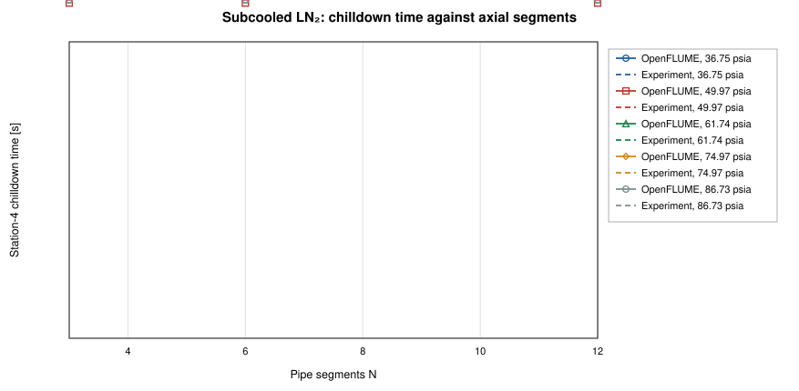
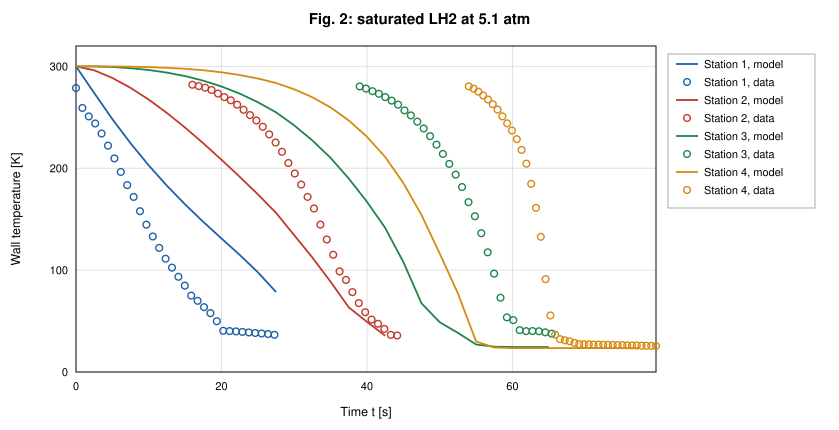
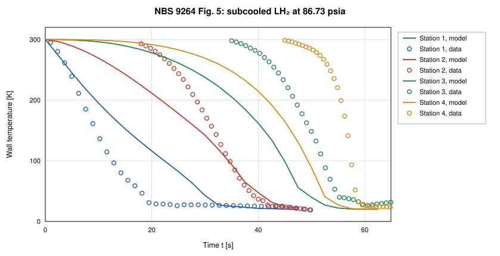
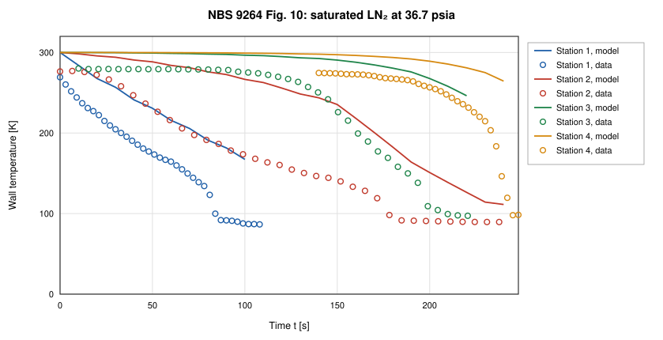
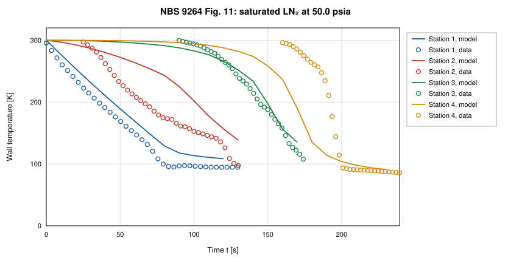
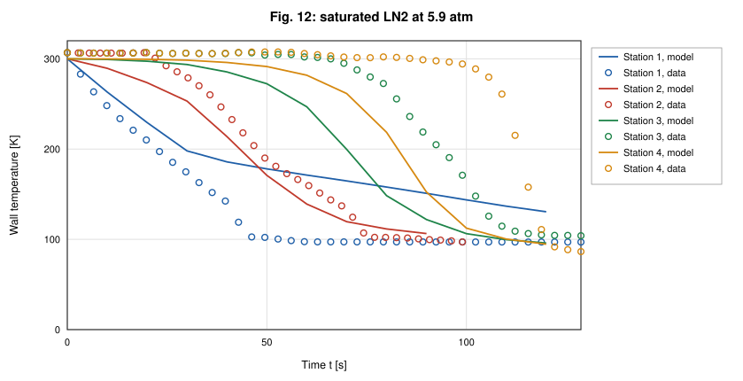
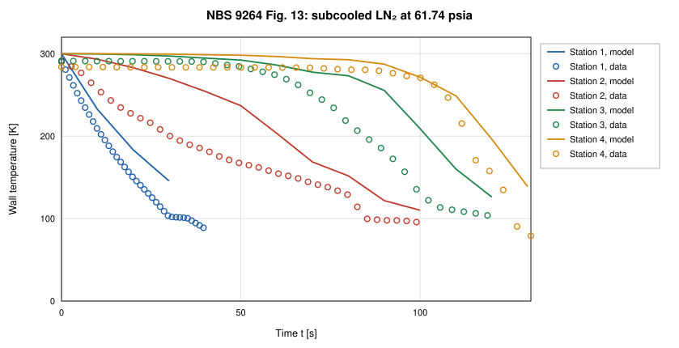
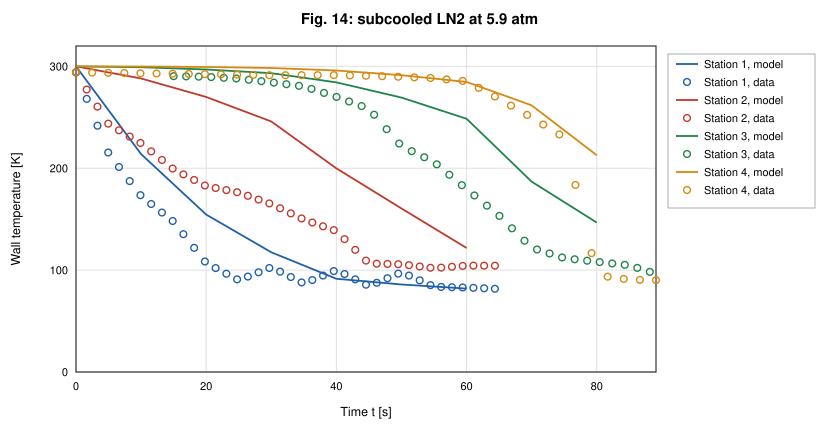

# Cryogenic Transfer-Line Chilldown Validation of OpenFLUME

**Validation against experiment: NBS Report 9264 chilldown times and digitized wall-temperature traces, with GFSSP's published predictions as a code-to-code reference**

Generated by `scripts/chilldown-validation-report.ts` — all model numbers and
figures come from live solves of the current solver. The corresponding CI
gates are `src/ui/tests/chilldownBaseline.test.ts` (saturated and subcooled
LN₂ Table-6 cases and the trusted trace runs; the full suite runs under
`RUN_SLOW=1`), `src/validation/__tests__/nbsTraceCorpus.test.ts` (trace
corpus structure, trust levels, QC, provenance hash) and
`src/validation/__tests__/traceBaseline.test.ts` (trace-comparison plumbing).

## Abstract

This report compares OpenFLUME's two-phase chilldown model with the measured
cooldown of a 61 m vacuum-jacketed copper transfer line, NBS Report 9264
(Brennan et al., 1966), and with the predictions that GFSSP published for the
same tests. It is validation against experiment and therefore subject to the
modeling, closure, discretization, and measurement uncertainties discussed
below. All eighteen chilldown times of Table 6 (liquid nitrogen and liquid
hydrogen, saturated and subcooled) are solved and reported; trust levels are
assigned from the experimental record alone. At the CI configuration (3 axial
segments) the mean absolute error over the eighteen rows is
13.5 % for OpenFLUME and 7.6 % for GFSSP's published
33-node predictions. For the three saturated liquid-nitrogen cases OpenFLUME
predicts station-4 chilldown times +8.1 %, +2.2 %, +8.0 % from
experiment (mean absolute error 6.1 %), against
+12.1 %, +6.7 %, +7.7 % (8.8 %) for GFSSP;
over 3 to 12 segments the saturated predictions lie between
−2.0 % and +11.8 %. The subcooled
liquid-nitrogen error grows with axial refinement, from +9.4 % to +38.5 % at
N = 3 to +34.3 % to +74.7 % at N = 12. The wall uses the temperature-dependent
OFHC-copper specific heat and conductivity. Against the digitized
wall-temperature traces of the 7 trusted runs, the untuned model
(N = 6) places the station-4 knee within 0.2–44.2 s of the measured one where
both are available, but its pooled trace RMSE is 38.1–71.9 K for the
saturated runs and 64.0–69.1 K for the subcooled ones. The main model deficiency is the
quench front: the modeled front is 2.3–3.6 times broader than the measured one at this
discretization. Cryogenic chilldown is the least mature area of the code;
the numbers below are the evidence for that statement.

## Experiment and Data

### The NBS 9264 transfer line

Brennan, Brentari, Smith, and Steward (NBS Report 9264, 1966) admitted
liquid hydrogen and liquid nitrogen from a pressurized dewar into a
horizontal, vacuum-jacketed copper line, 200 ft
(60.96 m) long, 0.625 in
inside and 0.75 in outside diameter, venting to
the atmosphere. Wall thermocouples sat at four stations,
20 ft, 80 ft, 141 ft, 198 ft from the inlet
(6.10 m, 24.38 m, 42.98 m, 60.35 m). The
report defines the chilldown time as the low-temperature knee of the wall
temperature at 60.4 m (station 4) and notes that it is not uniquely defined;
OpenFLUME operationalizes the knee as the first smooth crossing of the
local saturation temperature plus 15 K, with the wall trace interpolated in
space to the exact station coordinate (`src/validation/nbsChilldown.ts`).
NBS reports no error bars; the report's own caveats (thermocouple accuracy
traded for range, physically inconsistent low-temperature curve crossings,
chart-read knees) are carried with every data point.

### Table 6: chilldown times

The measured chilldown times are taken as tabulated, with GFSSP's
predictions, in Table 6 of Majumdar, LeClair, Moore, and Schallhorn
(AIAA 2015-3850): eighteen rows, verified digit for digit against the NTRS
scan and, for the hydrogen rows, against the earlier TFAWS 2013 paper. GFSSP's
values are model output (a 33-node network with the Miropolskii film-boiling
correlation) and are used here as a code-to-code reference, never as data.
This report solves every row: four saturated and six subcooled hydrogen
rows, three saturated and five subcooled nitrogen rows.

### Digitized trace corpus and trust levels

Eleven oscillograph figures of NBS 9264 (Figs. 2–7 hydrogen, 10–14 nitrogen)
were digitized into 44 station traces and 10195
samples (`validation/data/digitized/chilldown/nbs9264_fig*.csv`, rebuilt into
`src/validation/generated/nbsTraceCorpusData.ts` by `npm run gen:trace-corpus`;
the CSVs' SHA-256 is rechecked on every CI run). The physical run, not the
station trace, is the independent unit. Trust levels are assigned from the
experimental record alone. A run is **diagnostic only** when its record is
compromised as a whole: the cold tails of several stations overlap in the
figure so that their assignment to stations cannot be recovered, or the
valve opened before the chart's zero time so that every timing feature is
shifted by an unknown amount. Every other run is **trusted**. Per-trace QC
flags (curve crossings in the low-temperature region, truncated cold tails,
an oscillatory segment, drawn-line reconstruction) then restrict which
features of a trusted trace may be compared, and set its weight.

| Figure | Fluid | Inlet | P_drive [atm] | Table-6 row | Samples | Cold tail usable | QC flags | Trust level |
| ------ | ----- | ----- | ------------- | ----------- | ------- | ---------------- | -------- | ----------- |
| Fig. 2 | LH2 | saturated | 5.1 | satLH2-P74.97 | 502 | 4/4 | curveCrossingRegion | trusted |
| Fig. 3 | LH2 | subcooled | 2.5 | subLH2-P36.75 | 1590 | 0/4 | ambiguousTailAssignment | diagnostic only |
| Fig. 4 | LH2 | subcooled | 4.2 | subLH2-P61.74 | 1047 | 1/4 | ambiguousTailAssignment, curveCrossingRegion | diagnostic only |
| Fig. 5 | LH2 | subcooled | 5.9 | subLH2-P86.73 | 597 | 4/4 | curveCrossingRegion | trusted |
| Fig. 6 | LH2 | subcooled | 7.6 | subLH2-P111.72 | 983 | 0/4 | preTZeroValveOpening, ambiguousTailAssignment | diagnostic only |
| Fig. 7 | LH2 | subcooled | 11 | subLH2-P161.7 | 992 | 0/4 | ambiguousTailAssignment | diagnostic only |
| Fig. 10 | LN2 | saturated | 2.5 | — | 1128 | 4/4 | none | trusted |
| Fig. 11 | LN2 | saturated | 3.4 | — | 669 | 1/4 | truncatedColdTail | trusted |
| Fig. 12 | LN2 | saturated | 5.9 | satLN2-P86.73 | 893 | 4/4 | none | trusted |
| Fig. 13 | LN2 | subcooled | 4.2 | subLN2-P61.74 | 719 | 2/4 | truncatedColdTail | trusted |
| Fig. 14 | LN2 | subcooled | 5.9 | subLN2-P86.73 | 1075 | 2/4 | oscillatorySegment, truncatedColdTail | trusted |

**Trusted** runs: 7 runs, 28 traces, 21 with a usable cold
tail. **Diagnostic-only** runs: 4 (3, 4, 6, 7), all
subcooled hydrogen. A Table-6 row inherits the trust level of the digitized
run of the same test where one exists; the other rows carry only the
report-wide NBS caveats and are trusted. The trust level describes the
measurement, not the model: rows the model reproduces poorly are reported
in full.

The gated cross-check that ties the two data products together: the station-4
trace of Fig. 2 (saturated hydrogen, 5.1 atm) crosses
T_sat + 15 K at 65.7 s, against 68 s in Table 6 for the
same run (−3.4 %; the gate is ±20 %). These are
two readings of one event, not independent constraints.

## Numerical Model

The line is built by `buildChilldownTwoPhase` (`src/ui/examples.ts`; the
shipped 20-segment cryogenic line cooldown example of user manual §7.11 is a
separate model): N equal pipe segments between a saturated (or
subcooled) liquid inlet boundary at the driving pressure and an atmospheric
outlet boundary, N − 1 internal fluid nodes with real-fluid (CoolProp,
homogeneous-equilibrium) properties, and N + 1 lumped copper wall nodes at
the segment ends, joined by axial conduction. As in GFSSP's model of the
line, every wall node convects to a solved (internal) fluid node and none to
a boundary node: each interior wall node to the fluid node at its position,
the inlet wall node to the first internal fluid node and the outlet wall
node to the last, through a Miropolskii film-boiling conductor
(Dittus–Boelter on single-phase states). A wall node on the inlet boundary
would exchange heat with fixed zero-quality liquid, where the Miropolskii
coefficient is at its minimum and cannot respond to the heat the wall
releases. The two end wall nodes own half a segment each, so the total wall
mass and wetted area equal the line's (`NBS_LINE_WALL_MODEL`,
`src/validation/nbsChilldown.ts`). The wall uses the temperature-dependent
NIST OFHC-copper specific heat and conductivity (4–300 K, RRR 100); the
vacuum jacket is represented by an adiabatic outer wall. Nitrogen is
CoolProp Nitrogen; hydrogen is ParaHydrogen. Transients use backward Euler
with a fixed step: Δt = 10 s for nitrogen and 2.5 s for hydrogen. Nothing in
this report is fitted: the CI configuration (N = 3) and the trace-baseline
plan (N = 6) were fixed before these comparisons, and the closure constants
are the published ones.

## Results

### Table 6: experiment, GFSSP, and OpenFLUME

| Fluid | Inlet | P_drive [psia] | Experiment [s] | GFSSP [s] | GFSSP error | OpenFLUME [s] | OpenFLUME error | Converged | Digitized record | Trust level |
| ----- | ----- | -------------- | -------------- | --------- | ----------- | ------------- | --------------- | --------- | ---------------- | ----------- |
| LN₂ | saturated | 61.74 | 165 | 185 | +12.1 % | 178.3 | +8.1 % | yes | not digitized | trusted |
| LN₂ | saturated | 74.97 | 150 | 160 | +6.7 % | 153.3 | +2.2 % | yes | not digitized | trusted |
| LN₂ | saturated | 86.73 | 130 | 140 | +7.7 % | 140.4 | +8.0 % | yes | Fig. 12 | trusted |
| LN₂ | subcooled | 36.75 | 222 | 250 | +12.6 % | 307.5 | +38.5 % | yes | not digitized | trusted |
| LN₂ | subcooled | 49.97 | 170 | 175 | +2.9 % | 186.0 | +9.4 % | yes | not digitized | trusted |
| LN₂ | subcooled | 61.74 | 129 | 140 | +8.5 % | 147.6 | +14.4 % | yes | Fig. 13 | trusted |
| LN₂ | subcooled | 74.97 | 100 | 100 | +0.0 % | 120.0 | +20.0 % | yes | not digitized | trusted |
| LN₂ | subcooled | 86.73 | 85 | 90 | +5.9 % | 98.3 | +15.6 % | yes | Fig. 14 | trusted |
| LH₂ | saturated | 74.97 | 68 | 70 | +2.9 % | 63.1 | −7.2 % | yes | Fig. 2 | trusted |
| LH₂ | saturated | 86.73 | 62 | 69 | +11.3 % | 54.6 | −11.9 % | yes | not digitized | trusted |
| LH₂ | saturated | 111.72 | 42 | 50 | +19.0 % | 44.7 | +6.4 % | yes | not digitized | trusted |
| LH₂ | saturated | 161.72 | 30 | 33 | +10.0 % | 36.4 | +21.3 % | yes | not digitized | trusted |
| LH₂ | subcooled | 36.75 | 148 | 150 | +1.4 % | 138.5 | −6.4 % | yes | Fig. 3: cold tails overlap | diagnostic only |
| LH₂ | subcooled | 61.74 | 75 | 80 | +6.7 % | 76.6 | +2.1 % | yes | Fig. 4: cold tails overlap | diagnostic only |
| LH₂ | subcooled | 86.73 | 62 | 60 | −3.2 % | 56.3 | −9.2 % | yes | Fig. 5 | trusted |
| LH₂ | subcooled | 111.72 | 41 | 45 | +9.8 % | 46.1 | +12.6 % | yes | Fig. 6: valve opened before t = 0, cold tails overlap | diagnostic only |
| LH₂ | subcooled | 136.72 | 32 | 35 | +9.4 % | 39.6 | +23.8 % | yes | not digitized | trusted |
| LH₂ | subcooled | 161.7 | 28 | 30 | +7.1 % | 35.4 | +26.3 % | yes | Fig. 7: cold tails overlap | diagnostic only |

OpenFLUME: N = 3, station-4 knee at T_sat,local + 15 K. All eighteen solves converged.

| Group | Rows | OpenFLUME mean abs. error (range) | GFSSP mean abs. error (range) | Trusted rows | OpenFLUME, trusted | GFSSP, trusted |
| ----- | ---- | --------------------------------- | ----------------------------- | ------------ | ------------------ | -------------- |
| Saturated LN₂ | 3 | 6.1 % (+2.2 % to +8.1 %) | 8.8 % (+6.7 % to +12.1 %) | 3 | 6.1 % | 8.8 % |
| Subcooled LN₂ | 5 | 19.6 % (+9.4 % to +38.5 %) | 6.0 % (+0.0 % to +12.6 %) | 5 | 19.6 % | 6.0 % |
| Saturated LH₂ | 4 | 11.7 % (−11.9 % to +21.3 %) | 10.8 % (+2.9 % to +19.0 %) | 4 | 11.7 % | 10.8 % |
| Subcooled LH₂ | 6 | 13.4 % (−9.2 % to +26.3 %) | 6.3 % (−3.2 % to +9.8 %) | 2 | 16.5 % | 6.3 % |

Over all eighteen rows the mean absolute error is 13.5 % for OpenFLUME and
7.6 % for GFSSP. The model reproduces both trends in the data:
chilldown shortens as driving pressure rises, and subcooling shortens it at
matched pressure (120.0 s subcooled against 153.3 s
saturated at 74.97 psia). The CI gate holds each of its four LN₂ cases (the saturated
rows and subcooled 74.97 psia) inside a factor-of-1.6 band and the saturated mean absolute error below 25 %; that band is a
regression guard, not a statement of accuracy.

*Figure 1. Predicted against measured station-4 chilldown time for all eighteen Table-6 rows: GFSSP's published predictions and OpenFLUME (N = 3).*

### Sensitivity to the chilldown-time definition

The knee is a graphical quantity, so the definition is varied on the same
saturated LN₂ solves (N = 3). Columns: the primary definition; local T_sat +
30 K; inlet liquid temperature + 15 K; a fixed 100 K; and station 3 instead of
station 4.

| P_drive [psia] | Experiment [s] | T_sat,local + 15 K | T_sat,local + 30 K | T_inlet + 15 K | 100 K | Station 3 |
| -------------- | -------------- | ------------------ | ------------------ | -------------- | ----- | --------- |
| 61.74 | 165 | 178.3 | 147.6 | 148.2 | 157.2 | 154.5 |
| 74.97 | 150 | 153.3 | 120.8 | 119.7 | 130.3 | 126.1 |
| 86.73 | 130 | 140.4 | 105.9 | 103.2 | 115.3 | 108.5 |

Raising the margin from 15 K to 30 K shortens the predicted time by
30.7–34.5 s
(19–27 % of the measured time).
At N = 3 the model's station-4 wall approaches the liquid temperature slowly,
so the comparison above depends on the definition at that level. The trace
comparison below shows that the measured knee is much sharper.

### Discretization

Saturated LN₂:

| P_drive [psia] | Experiment [s] | N = 3 | N = 4 | N = 6 | N = 8 | N = 12 |
| -------------- | -------------- | ------ | ------ | ------ | ------ | ------ |
| 61.74 | 165 | 178.3 (+8.1 %) | 178.9 (+8.4 %) | 180.4 (+9.4 %) | 181.7 (+10.1 %) | 184.5 (+11.8 %) |
| 74.97 | 150 | 153.3 (+2.2 %) | 149.9 (−0.1 %) | 148.4 (−1.1 %) | 148.3 (−1.1 %) | 147.0 (−2.0 %) |
| 86.73 | 130 | 140.4 (+8.0 %) | 135.3 (+4.1 %) | 134.4 (+3.4 %) | 133.1 (+2.4 %) | 133.9 (+3.0 %) |

Every saturated solve converged. Between N = 3 and N = 12 the saturated
predictions span 6.2, 6.4, 7.3 s, the largest at
86.73 psia. Halving the time step to Δt = 5 s at N = 3 moves them by
8.5, 4.3, 6.1 s. Every saturated LN₂ prediction in this
study lies between −2.0 % and +11.8 % of
experiment; GFSSP's errors for the same cases are +6.7 % to +12.1 %.

Subcooled LN₂:

| P_drive [psia] | Experiment [s] | N = 3 | N = 6 | N = 12 |
| -------------- | -------------- | ------ | ------ | ------ |
| 36.75 | 222 | 307.5 (+38.5 %) | failed† | 347.6 (+56.6 %)* |
| 49.97 | 170 | 186.0 (+9.4 %) | 199.5 (+17.3 %) | 228.4 (+34.3 %) |
| 61.74 | 129 | 147.6 (+14.4 %) | 159.4 (+23.5 %) | 176.6 (+36.9 %) |
| 74.97 | 100 | 120.0 (+20.0 %) | 129.5 (+29.5 %) | 157.1 (+57.1 %) |
| 86.73 | 85 | 98.3 (+15.6 %) | 108.1 (+27.2 %) | 148.5 (+74.7 %) |

(* : the solve did not converge — 36.75 psia at N = 12. † : the solve could not be completed — 36.75 psia at N = 6 (timed out after 600 s); a solver robustness failure at that condition, reported rather than dropped.) The subcooled
error grows with axial refinement: in 4 of the 4 cases with a time at every
level the N = 12 error exceeds the N = 3 error, and over the converged solves the error rises
from +9.4 % to +38.5 % at N = 3 to +34.3 % to +74.7 % at N = 12, reaching
+74.7 % (N = 12). Refinement does not repair the subcooled
predictions. This is a model result.

*Figure 2. Station-4 chilldown time of the three saturated LN₂ cases against the number of axial segments (dashed: measurement).*

*Figure 3. Station-4 chilldown time of the five subcooled LN₂ cases against the number of axial segments (dashed: measurement).*

### Wall-temperature traces of the trusted runs

The 7 trusted runs are solved with the plan in
`TRACE_BASELINE_SOLVE_PLAN` (`src/validation/traceBaseline.ts`: N = 6,
Δt = 10 s for nitrogen and 2.5 s for para-hydrogen; subcooled runs at their
recorded inlet temperature) and compared station by station, with model
traces interpolated to the exact station positions and aligned to the
digitized record; nothing is tuned. The trace knee threshold here is the
data-native T_inlet + 15 K, because the digitized corpus has no pressure
record. These numbers are reported, not gated: the trace tests pin the
comparison plumbing, and a model-error value would change legitimately as
the model improves.

| Run | Condition | Model | Converged | Pooled RMSE [K] | Pooled MAE [K] | Discordant 150 K arrival pairs |
| --- | --------- | ----- | --------- | --------------- | -------------- | ------------------------------ |
| Fig. 2 | saturated LH2, 5.1 atm | ParaHydrogen, N = 6, Δt = 2.5 s | yes | 71.9 | 57.7 | 0 |
| Fig. 5 | subcooled LH2, 5.9 atm | ParaHydrogen, N = 6, Δt = 2.5 s | yes | 69.1 | 46.5 | 0 |
| Fig. 10 | saturated LN2, 2.5 atm | Nitrogen, N = 6, Δt = 10 s | yes | 68.7 | 57.7 | 0 |
| Fig. 11 | saturated LN2, 3.4 atm | Nitrogen, N = 6, Δt = 10 s | yes | 41.7 | 29.2 | 0 |
| Fig. 12 | saturated LN2, 5.9 atm | Nitrogen, N = 6, Δt = 10 s | yes | 38.1 | 22.8 | 0 |
| Fig. 13 | subcooled LN2, 4.2 atm | Nitrogen, N = 6, Δt = 10 s | yes | 64.0 | 48.5 | 0 |
| Fig. 14 | subcooled LN2, 5.9 atm | Nitrogen, N = 6, Δt = 10 s | yes | 64.7 | 47.1 | 0 |

| Run | Station | RMSE [K] | NRMSE | Data t(150 K) [s] | Model t(150 K) [s] | Data knee [s] | Model knee [s] | QC weight |
| --- | ------- | -------- | ----- | ----------------- | ------------------ | ------------- | -------------- | --------- |
| Fig. 2 | 1 | 70.5 | 0.29 | 9.3 | 18.4 | 19.9 | 36.5 | 1 |
| Fig. 2 | 2 | 37.4 | 0.15 | 33.3 | 34.5 | 42.4 | 48.2 | 1 |
| Fig. 2 | 3 | 72.3 | 0.30 | 55.0 | 47.8 | 60.9 | 56.4 | 0.5 |
| Fig. 2 | 4 | 117.6 | 0.46 | 63.5 | 52.6 | 65.7 | 59.0 | 0.5 |
| Fig. 5 | 1 | 45.4 | 0.16 | 9.5 | 15.4 | 18.9 | 31.3 | 1 |
| Fig. 5 | 2 | 39.9 | 0.15 | 31.7 | 28.9 | 40.9 | 42.1 | 1 |
| Fig. 5 | 3 | 91.3 | 0.34 | 49.9 | 41.1 | 58.3 | 51.0 | 0.5 |
| Fig. 5 | 4 | 147.7 | 0.54 | 56.7 | 46.1 | 58.8 | 53.7 | 0.5 |
| Fig. 10 | 1 | 58.3 | 0.32 | 68.9 | 115.7 | 83.8 | 221.7 | 1 |
| Fig. 10 | 2 | 70.6 | 0.38 | 132.5 | 200.8 | 177.2 | — | 1 |
| Fig. 10 | 3 | 78.1 | 0.42 | 188.1 | 261.0 | 208.2 | — | 1 |
| Fig. 10 | 4 | 51.3 | 0.29 | 238.7 | 279.5 | 244.6 | — | 1 |
| Fig. 11 | 1 | 18.9 | 0.09 | 59.7 | 69.4 | — | 146.3 | 1 |
| Fig. 11 | 2 | 46.1 | 0.23 | 104.2 | 123.6 | — | 178.1 | 1 |
| Fig. 11 | 3 | 11.0 | 0.06 | 161.3 | 163.0 | — | 193.8 | 1 |
| Fig. 11 | 4 | 72.5 | 0.34 | 195.5 | 177.3 | 199.2 | 199.4 | 1 |
| Fig. 12 | 1 | 9.9 | 0.05 | 36.9 | 40.0 | 43.9 | 62.1 | 1 |
| Fig. 12 | 2 | 20.6 | 0.10 | 63.7 | 69.9 | 73.6 | 93.1 | 1 |
| Fig. 12 | 3 | 31.4 | 0.15 | 102.0 | 89.8 | 109.9 | 105.4 | 1 |
| Fig. 12 | 4 | 63.8 | 0.29 | 116.1 | 98.7 | 118.8 | 110.0 | 1 |
| Fig. 13 | 1 | 74.7 | 0.37 | 19.9 | 50.1 | — | 82.9 | 1 |
| Fig. 13 | 2 | 66.9 | 0.34 | 65.1 | 96.7 | — | 133.4 | 1 |
| Fig. 13 | 3 | 67.1 | 0.36 | 96.8 | 131.7 | — | 161.1 | 1 |
| Fig. 13 | 4 | 54.7 | 0.27 | 120.9 | 145.4 | 127.0 | 171.2 | 1 |
| Fig. 14 | 1 | 57.2 | 0.27 | 14.5 | 34.9 | — | 57.7 | 0.75 |
| Fig. 14 | 2 | 80.2 | 0.42 | 34.9 | 64.6 | — | 91.4 | 1 |
| Fig. 14 | 3 | 66.1 | 0.34 | 65.6 | 88.2 | — | 109.4 | 1 |
| Fig. 14 | 4 | 53.2 | 0.26 | 78.0 | 92.9 | 84.6 | 118.5 | 1 |

(— : the feature is unavailable — the trace never reaches it inside the
record, or the data trace's cold tail is QC-excluded.) Station NRMSE, scaled
by each data trace's observed span, ranges from
0.05 to 0.54. Figures 4–10
overlay model and data. Three findings recur across the runs:

1. **Cold-front arrival.** Over the trusted runs the modeled 150 K
   arrivals at stations 2–4 differ from the measured ones by
   −18.2 s to +72.9 s; at station 1 the difference is
   +9 s (Fig. 2), +6 s (Fig. 5), +47 s (Fig. 10), +10 s (Fig. 11), +3 s (Fig. 12), +30 s (Fig. 13), +20 s (Fig. 14). The model and the data order the stations' 150 K arrivals identically in every run.
   The modeled station-1 wall reaches T_inlet + 15 K inside the record in
   7 of the 7 runs, +12.5 s to +137.8 s from the measured knee where both are available.
2. **The modeled quench front is diffuse.** At station 4 the wall takes
   18.3, 19.1, —, 45.5, 27.0, 45.4, 38.3 s to fall from 250 K to T_inlet + 15 K in the
   model against 7.0, 5.3, 37.2, 13.2, 8.5, 19.9, 14.6 s in the data, and
   1.1, 1.6, —, 12.0, 5.3, 4.9, 6.3 s against 0.5, 0.5, 2.1, 1.2, 1.1, 1.0, 5.0 s
   to cross the band from T_inlet + 30 K to T_inlet + 15 K. With 10 m of copper
   lumped into each wall node the front cannot be sharper than a segment's
   transit time, so the downstream traces begin to fall early and reach the
   knee late, and the knee time is less sensitive to these errors than the
   trace RMSE.
3. **Subcooled runs fit no better than saturated ones.** The pooled RMSE of
   the subcooled trusted runs (Figs. 5, 13, 14) is 64.0–69.1 K,
   against 38.1–71.9 K for the saturated runs.

*Figure 4. Fig. 2 of NBS 9264 (saturated LH2, 5.1 atm): digitized wall temperature (markers) and the OpenFLUME solve (lines, ParaHydrogen, N = 6, Δt = 2.5 s) at the four stations.*

*Figure 5. Fig. 5 of NBS 9264 (subcooled LH2, 5.9 atm): digitized wall temperature (markers) and the OpenFLUME solve (lines, ParaHydrogen, N = 6, Δt = 2.5 s) at the four stations.*

*Figure 6. Fig. 10 of NBS 9264 (saturated LN2, 2.5 atm): digitized wall temperature (markers) and the OpenFLUME solve (lines, Nitrogen, N = 6, Δt = 10 s) at the four stations.*

*Figure 7. Fig. 11 of NBS 9264 (saturated LN2, 3.4 atm): digitized wall temperature (markers) and the OpenFLUME solve (lines, Nitrogen, N = 6, Δt = 10 s) at the four stations.*

*Figure 8. Fig. 12 of NBS 9264 (saturated LN2, 5.9 atm): digitized wall temperature (markers) and the OpenFLUME solve (lines, Nitrogen, N = 6, Δt = 10 s) at the four stations.*

*Figure 9. Fig. 13 of NBS 9264 (subcooled LN2, 4.2 atm): digitized wall temperature (markers) and the OpenFLUME solve (lines, Nitrogen, N = 6, Δt = 10 s) at the four stations.*

*Figure 10. Fig. 14 of NBS 9264 (subcooled LN2, 5.9 atm): digitized wall temperature (markers) and the OpenFLUME solve (lines, Nitrogen, N = 6, Δt = 10 s) at the four stations.*

## Trust Levels

| Comparison | Evidence class | Trust level | What may be quoted |
| ---------- | -------------- | ----------- | ------------------ |
| Table-6 rows without a compromised record (14 rows) | Validation against experiment | Trusted | The error, with the definition and discretization stated |
| Table-6 rows whose digitized record is compromised (4 rows) | Validation against experiment | Diagnostic only | The trend; the error with that caveat |
| GFSSP Table-6 predictions | Code-to-code | Reference | Agreement between codes, not with experiment |
| Trusted trace runs (Figs. 2, 5, 10, 11, 12, 13, 14) | Validation against experiment | Trusted, reported (not gated) | Station order, station-4 knee where available, RMSE as a baseline |
| Diagnostic trace runs (Figs. 3, 4, 6, 7) | Validation against experiment | Diagnostic only | Nothing quantitative |

## Conclusions

Over all eighteen NBS 9264 Table-6 chilldown times, OpenFLUME's untuned
two-phase network model has a mean absolute error of 13.5 % at the CI
configuration, against 7.6 % for GFSSP's published predictions. For
saturated liquid nitrogen OpenFLUME's mean absolute error is 6.1 %
against 8.8 % for GFSSP, with discretization changing individual predictions by up to
7.3 s. For subcooled liquid nitrogen the error grows with axial
refinement (+9.4 % to +38.5 % at N = 3, +34.3 % to +74.7 % at N = 12, up to
+74.7 % at N = 12), so agreement at the coarse grid is not evidence
that the subcooled closure is right. The chilldown-time
comparison depends on a graphical knee definition at the
19–27 % level, and the trace comparison shows where agreement
in a single time is partly fortuitous: the model's quench front is too
broad and its knee too gradual. Cryogenic chilldown remains the least
mature capability of the code, and these results are a baseline for model
improvement, not a calibration.

## References

1. Brennan, J. A., Brentari, E. G., Smith, R. V., and Steward, W. G.,
   "Cooldown of Cryogenic Transfer Lines — An Experimental Report,"
   NBS Report 9264, National Bureau of Standards, Boulder CO, 1966
   (NASA-CR-81338, NTRS 19670007291).
2. Majumdar, A., LeClair, A., Moore, R., and Schallhorn, P., "Generalized
   Fluid System Simulation Program (GFSSP) Version 6," AIAA 2015-3850, 51st
   AIAA/SAE/ASEE Joint Propulsion Conference, 2015 (NTRS 20150016531),
   Table 6.
3. Majumdar, A., "No Vent Tank Fill and Transfer Line Chilldown Analysis by
   Generalized Fluid System Simulation Program (GFSSP)," TFAWS 2013
   (NASA M13-2805).
4. Miropolskii, Z. L., "Heat Transfer in Film Boiling of a Steam–Water
   Mixture in Steam-Generating Tubes," *Teploenergetika* 10(5), 1963,
   pp. 49–52, as used for chilldown by Cross, M. F., Majumdar, A. K.,
   Bennett, J. C., and Malla, R. B., "Modeling of Chill Down in Cryogenic
   Transfer Lines," *Journal of Spacecraft and Rockets* 39(2), 2002,
   pp. 284–289.
5. NIST Cryogenic Material Properties Database, "OFHC Copper (UNS
   C10100/C10200)," rev. 2010 (Marquardt, Le, and Radebaugh, 2000).

## Nomenclature

| Symbol | Meaning |
| ------ | ------- |
| MAE | mean absolute error |
| N | number of axial pipe segments |
| NRMSE | RMSE divided by the data trace's observed temperature span |
| P_drive | dewar (driving) pressure |
| RMSE | root-mean-square error between aligned traces |
| t(150 K) | first smooth crossing of 150 K |
| T_inlet | inlet liquid temperature |
| T_sat, T_sat,local | saturation temperature; at the station's late-time pressure |
| Δt | solver time step |
