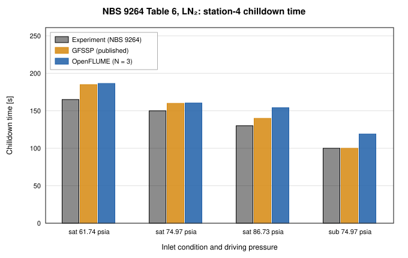
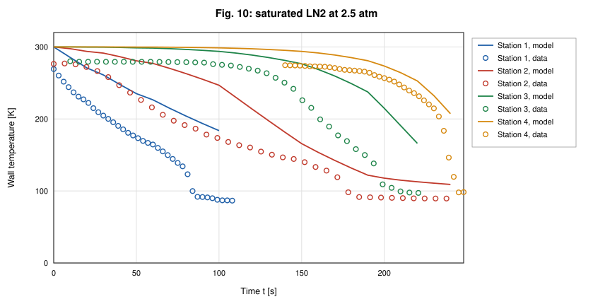
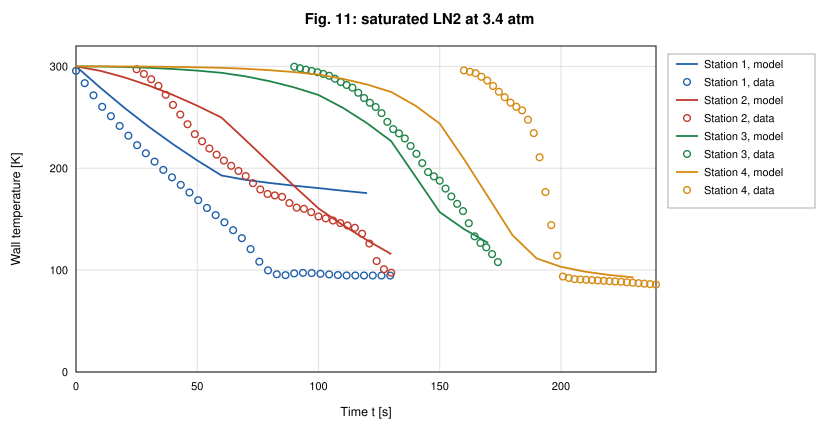
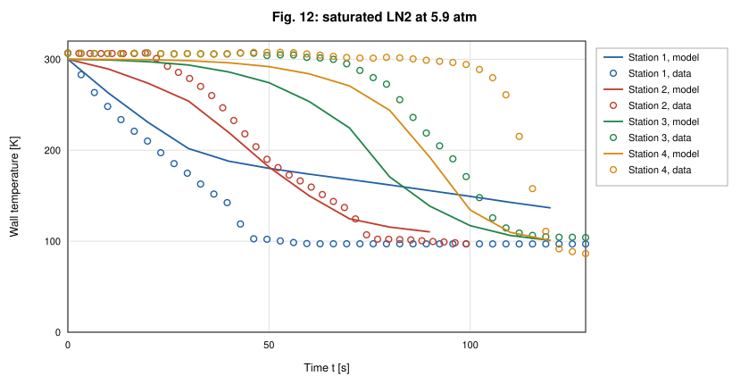

# Cryogenic Transfer-Line Chilldown Validation of OpenFLUME

**Validation against experiment: NBS Report 9264 chilldown times and digitized wall-temperature traces, with GFSSP's published predictions as a code-to-code reference**

Generated by `scripts/chilldown-validation-report.ts` — all model numbers and
figures come from live solves of the current solver. The corresponding CI
gates are `src/ui/tests/chilldownBaseline.test.ts` (Table 6; the four-case
suite runs under `RUN_SLOW=1`), `src/validation/__tests__/nbsTraceCorpus.test.ts`
(trace corpus structure, trust levels, QC, provenance hash) and
`src/validation/__tests__/traceBaseline.test.ts` (trace-comparison plumbing).

## Abstract

This report compares OpenFLUME's two-phase chilldown model with the measured
cooldown of a 61 m vacuum-jacketed copper transfer line, NBS Report 9264
(Brennan et al., 1966), and with the predictions that GFSSP published for the
same tests. It is validation against experiment and therefore subject to the
modeling, closure, discretization, and measurement uncertainties discussed
below. For the three saturated liquid-nitrogen cases of Table 6 the CI
configuration (3 axial segments, 10 s fixed step) predicts station-4
chilldown times +13.0 %, +6.9 %, +18.6 %
from experiment (mean absolute error 12.8 %), against
+12.1 %, +6.7 %, +7.7 %
(8.8 %) for GFSSP's published 33-node predictions. Refining
the line from 3 to 12 segments moves the
predictions by at most 14.6 s, and every
saturated prediction in that study lies between +2.1 % and
+18.6 % of experiment. The subcooled case is
over-predicted by +19.1 %
and is classified diagnostic only. Against the digitized wall-temperature
traces of the four trusted saturated runs, the untuned pre-registered model
(N = 6) places the station-4 knee within
0.7–9.4 s
of the measured one where both are available, but its pooled trace RMSE is
49.0–60.6 K. Two model deficiencies
stand out: the inlet wall chills far too slowly, because the
film-boiling closure returns a small coefficient at the zero-quality inlet
state, and the modeled quench front is 2.0–4.8 times broader than
the measured one at coarse discretization. Cryogenic chilldown is the least mature area of the code; the
numbers below are the evidence for that statement.

## Experiment and Data

### The NBS 9264 transfer line

Brennan, Brentari, Smith, and Steward (NBS Report 9264, 1966) admitted
liquid hydrogen and liquid nitrogen from a pressurized dewar into a
horizontal, vacuum-jacketed copper line, 200 ft
(60.96 m) long, 0.625 in
inside and 0.75 in outside diameter, venting to
the atmosphere. Wall thermocouples sat at four stations,
20 ft, 80 ft, 141 ft, 198 ft from the inlet
(6.10 m, 24.38 m, 42.98 m, 60.35 m). The
report defines the chilldown time as the low-temperature knee of the wall
temperature at 60.4 m (station 4) and notes that it is not uniquely defined;
OpenFLUME operationalizes the knee as the first smooth crossing of the
local saturation temperature plus 15 K, with the wall trace interpolated in
space to the exact station coordinate (`src/validation/nbsChilldown.ts`).
NBS reports no error bars; the report's own caveats (thermocouple accuracy
traded for range, physically inconsistent low-temperature curve crossings,
chart-read knees) are carried with every data point.

### Table 6: chilldown times

The measured chilldown times are taken as tabulated, with GFSSP's
predictions, in Table 6 of Majumdar, LeClair, Moore, and Schallhorn
(AIAA 2015-3850): eighteen rows, verified digit for digit against the NTRS
scan and, for the hydrogen rows, against the earlier TFAWS 2013 paper. GFSSP's values are model
output (a 33-node network with the Miropolskii film-boiling correlation) and
are used here as a code-to-code reference, never as data. This report uses
the three saturated nitrogen rows and the subcooled nitrogen row at the middle
pressure (74.97 psia), the four cases of the CI gate.

### Digitized trace corpus

Eleven oscillograph figures of NBS 9264 (Figs. 2–7 hydrogen, 10–14 nitrogen)
were digitized into 44 station traces and 10195
samples (`validation/data/digitized/chilldown/nbs9264_fig*.csv`, rebuilt into
`src/validation/generated/nbsTraceCorpusData.ts` by `npm run gen:trace-corpus`;
the CSVs' SHA-256 is rechecked on every CI run). The physical run, not the
station trace, is the independent unit. Every run carries a trust level:

| Figure | Fluid | Inlet | P_drive [atm] | Table-6 row | Samples | Cold tail usable | Trust level |
| ------ | ----- | ----- | ------------- | ----------- | ------- | ---------------- | ----------- |
| Fig. 2 | LH2 | saturated | 5.1 | satLH2-P74.97 | 502 | 4/4 | trusted |
| Fig. 3 | LH2 | subcooled | 2.5 | subLH2-P36.75 | 1590 | 0/4 | diagnostic only |
| Fig. 4 | LH2 | subcooled | 4.2 | subLH2-P61.74 | 1047 | 1/4 | diagnostic only |
| Fig. 5 | LH2 | subcooled | 5.9 | subLH2-P86.73 | 597 | 4/4 | diagnostic only |
| Fig. 6 | LH2 | subcooled | 7.6 | subLH2-P111.72 | 983 | 0/4 | diagnostic only |
| Fig. 7 | LH2 | subcooled | 11 | subLH2-P161.7 | 992 | 0/4 | diagnostic only |
| Fig. 10 | LN2 | saturated | 2.5 | — | 1128 | 4/4 | trusted |
| Fig. 11 | LN2 | saturated | 3.4 | — | 669 | 1/4 | trusted |
| Fig. 12 | LN2 | saturated | 5.9 | satLN2-P86.73 | 893 | 4/4 | trusted |
| Fig. 13 | LN2 | subcooled | 4.2 | subLN2-P61.74 | 719 | 2/4 | diagnostic only |
| Fig. 14 | LN2 | subcooled | 5.9 | subLN2-P86.73 | 1075 | 2/4 | diagnostic only |

**Trusted** runs (4 runs, 16 traces, 13 with a usable cold tail) are saturated conditions at which
the solver is defensible. **Diagnostic-only** runs (7 subcooled runs) may be
used to diagnose the model but not quoted as agreement: at subcooled inlet
conditions the model's error grows with axial refinement, reaching +80 %
(user manual §8.4), and several steps are uncertified. Per-trace
QC flags (drawn-line reconstruction, curve crossings, truncated cold tails)
further restrict which features of a trusted trace may be compared.

The gated cross-check that ties the two data products together: the station-4
trace of Fig. 2 (saturated hydrogen, 5.1 atm) crosses
T_sat + 15 K at 65.7 s, against 68 s in Table 6 for the
same run (−3.4 %; the gate is ±20 %). These are
two readings of one event, not independent constraints.

## Numerical Model

The line is built by `buildChilldownTwoPhase` (`src/ui/examples.ts`, the
model behind example 7.11): N equal pipe segments between a saturated (or
subcooled) liquid inlet boundary at the driving pressure and an atmospheric
outlet boundary, N − 1 internal fluid nodes with real-fluid (CoolProp,
homogeneous-equilibrium) properties, and N + 1 lumped copper wall nodes, each
coupled to its fluid node by a Miropolskii film-boiling convection conductor
(Dittus–Boelter on single-phase states) and to its neighbors by axial
conduction. The wall uses a constant room-temperature specific heat
(385 J/(kg·K)) and conductivity (400 W/(m·K)); the vacuum jacket is
represented by an adiabatic outer wall. The outlet wall node convects to the
last internal fluid node ("upwind" coupling) so that station 4 is bracketed
by chilled wall nodes. Transients use backward Euler with a fixed step.
Nothing in this report is fitted: the CI configuration (N = 3, Δt = 10 s) and
the trace-baseline plan (N = 6, Δt = 10 s for nitrogen, 2.5 s for
para-hydrogen) were fixed before these comparisons, and the closure constants
are the published ones.

## Results

### Table 6: experiment, GFSSP, and OpenFLUME

| Inlet | P_drive [psia] | Experiment [s] | GFSSP [s] | GFSSP error | OpenFLUME [s] | OpenFLUME error | Trust level |
| ----- | -------------- | -------------- | --------- | ----------- | ------------- | --------------- | ----------- |
| saturated | 61.74 | 165 | 185 | +12.1 % | 186.5 | +13.0 % | trusted |
| saturated | 74.97 | 150 | 160 | +6.7 % | 160.4 | +6.9 % | trusted |
| saturated | 86.73 | 130 | 140 | +7.7 % | 154.2 | +18.6 % | trusted |
| subcooled | 74.97 | 100 | 100 | +0.0 % | 119.1 | +19.1 % | diagnostic only |

OpenFLUME: N = 3, Δt = 10 s, station-4 knee at T_sat,local + 15 K
(threshold 92.8, 92.9, 93.1, 92.7 K). All four
solves converged. Over the saturated cases the mean absolute error is
12.8 % for OpenFLUME and 8.8 % for GFSSP. Both
codes over-predict every saturated case; at 61.74 and 74.97 psia the two
predictions agree within 1.5 s, while at 86.73 psia
OpenFLUME's N = 3 prediction is 14.2 s longer
than GFSSP's — a discretization effect (next section). The model also
reproduces both trends in the data: chilldown shortens as driving pressure
rises, and subcooling shortens it at matched pressure
(119.1 s subcooled against 160.4 s saturated at 74.97 psia).
The subcooled case is over-predicted by
+19.1 % where GFSSP
matches the measurement; it is shown for completeness and, per the trust
levels, is not quoted as agreement. The CI gate holds each case inside a
factor-of-1.6 band and the saturated mean absolute error below 25 %; that
band is a regression guard, not a statement of accuracy.

*Figure 1. Station-4 chilldown time for the four LN₂ cases of Table 6: NBS 9264 measurement, GFSSP's published prediction, and OpenFLUME (N = 3, Δt = 10 s).*

### Sensitivity to the chilldown-time definition

The knee is a graphical quantity, so the definition is varied on the same
solves (N = 3). Columns: the primary definition; local T_sat + 30 K; inlet
liquid temperature + 15 K; a fixed 100 K; and station 3 instead of station 4.

| P_drive [psia] | Experiment [s] | T_sat,local + 15 K | T_sat,local + 30 K | T_inlet + 15 K | 100 K | Station 3 |
| -------------- | -------------- | ------------------ | ------------------ | -------------- | ----- | --------- |
| 61.74 | 165 | 186.5 | 146.7 | 147.3 | 157.0 | 153.5 |
| 74.97 | 150 | 160.4 | 118.7 | 118.1 | 128.8 | 122.7 |
| 86.73 | 130 | 154.2 | 105.5 | 102.5 | 117.2 | 108.6 |

Raising the margin from 15 K to 30 K shortens the predicted time by
39.8–48.6 s
(24–37 % of the measured time).
At N = 3 the model's station-4 wall approaches the liquid temperature slowly,
so the comparison above depends on the definition at that level. The trace
comparison below shows that the measured knee is much sharper.

### Discretization

| P_drive [psia] | Experiment [s] | N = 3 | N = 4 | N = 6 | N = 8 | N = 12 |
| -------------- | -------------- | ------ | ------ | ------ | ------ | ------ |
| 61.74 | 165 | 186.5 (+13.0 %) | 184.7 (+11.9 %) | 186.0 (+12.7 %) | 184.6 (+11.9 %) | 195.6 (+18.5 %) |
| 74.97 | 150 | 160.4 (+6.9 %) | 156.4 (+4.2 %) | 153.1 (+2.1 %) | 157.8 (+5.2 %) | 161.7 (+7.8 %) |
| 86.73 | 130 | 154.2 (+18.6 %) | 143.2 (+10.1 %) | 139.7 (+7.4 %) | 139.8 (+7.5 %) | 139.5 (+7.3 %) |

Every solve converged. Between N = 3 and N = 12 the saturated
predictions move by 11.0, 8.6, 14.6 s, and they do not
converge monotonically. Halving the time step to Δt = 5 s at N = 3 moves them by
1.2, 0.3, 4.2 s. The 86.73 psia case carries the largest grid
sensitivity: its N = 3 over-prediction falls to about +7 % from N = 6 on,
level with GFSSP. A practical reading is that the saturated LN₂
chilldown time is predicted to within roughly +2 % to +19 % at every
discretization tried, with GFSSP inside the same band. The subcooled cases
are not grid-converged (user manual §8.4) and are excluded from this
study.

*Figure 2. Station-4 chilldown time of the three saturated LN₂ cases against the number of axial segments (dashed: measurement).*

### Wall-temperature traces of the trusted runs

The four trusted runs are solved with the pre-registered plan
(`TRACE_BASELINE_SOLVE_PLAN` in `src/validation/traceBaseline.ts`) and
compared station by station, with model traces interpolated to the exact
station positions and aligned to the digitized record; nothing is tuned. The
trace knee threshold here is the data-native T_sat(P_drive) + 15 K, because
the digitized corpus has no pressure record. These numbers are reported, not
gated: the trace tests pin the comparison plumbing, and a model-error value
would change legitimately as the model improves.

| Run | Condition | Model | Converged | Pooled RMSE [K] | Pooled MAE [K] | Discordant 150 K arrival pairs |
| --- | --------- | ----- | --------- | --------------- | -------------- | ------------------------------ |
| Fig. 2 | LH2, 5.1 atm | ParaHydrogen, N = 6, Δt = 2.5 s | yes | 60.6 | 54.7 | 0 |
| Fig. 10 | LN2, 2.5 atm | Nitrogen, N = 6, Δt = 10 s | yes | 49.0 | 41.5 | 0 |
| Fig. 11 | LN2, 3.4 atm | Nitrogen, N = 6, Δt = 10 s | yes | 50.8 | 37.2 | 3 |
| Fig. 12 | LN2, 5.9 atm | Nitrogen, N = 6, Δt = 10 s | yes | 51.0 | 36.2 | 3 |

| Run | Station | RMSE [K] | NRMSE | Data t(150 K) [s] | Model t(150 K) [s] | Data knee [s] | Model knee [s] | QC weight |
| --- | ------- | -------- | ----- | ----------------- | ------------------ | ------------- | -------------- | --------- |
| Fig. 2 | 1 | 70.0 | 0.29 | 9.3 | 18.3 | 19.9 | 55.9 | 1 |
| Fig. 2 | 2 | 48.1 | 0.19 | 33.3 | 31.3 | 42.4 | 55.3 | 1 |
| Fig. 2 | 3 | 57.9 | 0.24 | 55.0 | 49.8 | 60.9 | 68.6 | 0.5 |
| Fig. 2 | 4 | 63.6 | 0.25 | 63.5 | 59.1 | 65.7 | 73.6 | 0.5 |
| Fig. 10 | 1 | 66.7 | 0.36 | 68.9 | — | 83.8 | — | 1 |
| Fig. 10 | 2 | 43.9 | 0.23 | 132.5 | 163.2 | 177.2 | — | 1 |
| Fig. 10 | 3 | 52.1 | 0.28 | 188.1 | 230.1 | 208.2 | — | 1 |
| Fig. 10 | 4 | 28.0 | 0.16 | 238.7 | 261.5 | 244.6 | — | 1 |
| Fig. 11 | 1 | 59.1 | 0.29 | 59.7 | 208.8 | — | — | 1 |
| Fig. 11 | 2 | 22.8 | 0.11 | 104.2 | 106.5 | — | 172.1 | 1 |
| Fig. 11 | 3 | 21.0 | 0.11 | 161.3 | 154.2 | — | 194.0 | 1 |
| Fig. 11 | 4 | 79.6 | 0.38 | 195.5 | 175.8 | 199.2 | 198.5 | 1 |
| Fig. 12 | 1 | 51.6 | 0.25 | 36.9 | 98.8 | 43.9 | 185.7 | 1 |
| Fig. 12 | 2 | 17.3 | 0.08 | 63.7 | 60.0 | 73.6 | 88.0 | 1 |
| Fig. 12 | 3 | 45.4 | 0.22 | 102.0 | 86.4 | 109.9 | 105.4 | 1 |
| Fig. 12 | 4 | 69.7 | 0.31 | 116.1 | 97.3 | 118.8 | 109.3 | 1 |

(— : the feature is unavailable — the trace never reaches it inside the
record, or the data trace's cold tail is QC-excluded.) Station NRMSE, scaled
by each data trace's observed span, ranges from
0.08 to 0.38. Figures 3–6
overlay model and data. Three findings recur across the runs:

1. **Stations 2–4 are in order and roughly on time; station 1 is late.**
   The model chills stations 2–4 in sequence. Their 150 K arrivals fall
   within about 20 s of the measured ones in Figs. 2, 11, and 12 and lag
   by 23–42 s in Fig. 10, the lowest-pressure run. Station 1 is late in
   every run and, in Figs. 11 and 12, arrives after the downstream stations,
   which accounts for the discordant arrival pairs. The cause is the inlet
   wall node. It convects to the inlet boundary state, saturated liquid at
   zero quality, where the Miropolskii coefficient (evaluated at the clamped
   quality 0.01) is small: averaged over each record it is
   343, 6, 16, 42 W/(m²·K) at the inlet wall
   node against 1766, 136, 145, 294 W/(m²·K) at the
   next one (Figs. 2, 10, 11, 12). The line inlet therefore stays warm, and
   station 1 (6.1 m) takes 40 % of its interpolated value from it. In the
   experiment the inlet chills first.
2. **The modeled quench front is diffuse.** At station 4 the wall takes
   33.2, 75.9, 52.0, 31.6 s to fall from 250 K to T_sat + 15 K in the
   model against 7.0, 37.2, 13.2, 8.5 s in the data, and
   2.1, 20.7, 12.0, 6.1 s against 0.5, 2.1, 1.2, 1.1 s
   to cross the band from T_sat + 30 K to T_sat + 15 K. With 10 m of copper
   lumped into each wall node the front cannot be sharper than a segment's
   transit time, so the downstream traces begin to fall early and reach the
   knee late, and the knee time is less sensitive to these errors than the
   trace RMSE. A constant room-temperature copper specific heat, which
   overstates the wall's stored energy at cryogenic temperature, acts in
   the same direction. Neither is adjusted here.

*Figure 3. Fig. 2 of NBS 9264 (saturated LH2, 5.1 atm): digitized wall temperature (markers) and the pre-registered OpenFLUME solve (lines, ParaHydrogen, N = 6, Δt = 2.5 s) at the four stations.*

*Figure 4. Fig. 10 of NBS 9264 (saturated LN2, 2.5 atm): digitized wall temperature (markers) and the pre-registered OpenFLUME solve (lines, Nitrogen, N = 6, Δt = 10 s) at the four stations.*

*Figure 5. Fig. 11 of NBS 9264 (saturated LN2, 3.4 atm): digitized wall temperature (markers) and the pre-registered OpenFLUME solve (lines, Nitrogen, N = 6, Δt = 10 s) at the four stations.*

*Figure 6. Fig. 12 of NBS 9264 (saturated LN2, 5.9 atm): digitized wall temperature (markers) and the pre-registered OpenFLUME solve (lines, Nitrogen, N = 6, Δt = 10 s) at the four stations.*

## Trust Levels

| Comparison | Evidence class | Trust level | What may be quoted |
| ---------- | -------------- | ----------- | ------------------ |
| Saturated LN₂, Table 6 | Validation against experiment | Trusted | Station-4 time within the band reported here, with the definition and discretization stated |
| Subcooled LN₂, Table 6 | Validation against experiment | Diagnostic only | Trend (subcooling shortens chilldown); not the error |
| GFSSP Table 6 predictions | Code-to-code | Reference | Agreement between codes, not with experiment |
| Trusted trace runs (Figs. 2, 10, 11, 12) | Validation against experiment | Trusted, reported (not gated) | Order of stations 2–4, station-4 knee where available, RMSE as a baseline |
| Subcooled trace runs (Figs. 3–7, 13, 14) | Validation against experiment | Diagnostic only | Nothing quantitative |

## Conclusions

For saturated liquid-nitrogen chilldown of the NBS 9264 line, OpenFLUME's
untuned two-phase network model predicts the station-4 chilldown time with
the same sign and comparable magnitude of error as GFSSP's published
predictions: 12.8 % against 8.8 % mean absolute error at the CI
configuration, with discretization changing individual predictions by up to
14.6 s. The chilldown-time comparison depends on a graphical knee
definition at the 24–37 % level, and the full trace comparison shows where
the agreement in a single time is partly fortuitous: the model's inlet-region
quench is too slow and its knee too gradual. Subcooled inlet conditions are
outside the defensible range of the current model. Cryogenic chilldown
remains the least mature capability of the code, and these results are a
baseline for model improvement, not a calibration.

## References

1. Brennan, J. A., Brentari, E. G., Smith, R. V., and Steward, W. G.,
   "Cooldown of Cryogenic Transfer Lines — An Experimental Report,"
   NBS Report 9264, National Bureau of Standards, Boulder CO, 1966
   (NASA-CR-81338, NTRS 19670007291).
2. Majumdar, A., LeClair, A., Moore, R., and Schallhorn, P., "Generalized
   Fluid System Simulation Program (GFSSP) Version 6," AIAA 2015-3850, 51st
   AIAA/SAE/ASEE Joint Propulsion Conference, 2015 (NTRS 20150016531),
   Table 6.
3. Majumdar, A., "No Vent Tank Fill and Transfer Line Chilldown Analysis by
   Generalized Fluid System Simulation Program (GFSSP)," TFAWS 2013
   (NASA M13-2805).
4. Miropolskii, Z. L., "Heat Transfer in Film Boiling of a Steam–Water
   Mixture in Steam-Generating Tubes," *Teploenergetika* 10(5), 1963,
   pp. 49–52, as used for chilldown by Cross, M. F., Majumdar, A. K.,
   Bennett, J. C., and Malla, R. B., "Modeling of Chill Down in Cryogenic
   Transfer Lines," *Journal of Spacecraft and Rockets* 39(2), 2002,
   pp. 284–289.

## Nomenclature

| Symbol | Meaning |
| ------ | ------- |
| MAE | mean absolute error |
| N | number of axial pipe segments |
| NRMSE | RMSE divided by the data trace's observed temperature span |
| P_drive | dewar (driving) pressure |
| RMSE | root-mean-square error between aligned traces |
| t(150 K) | first smooth crossing of 150 K |
| T_inlet | inlet liquid temperature |
| T_sat, T_sat,local | saturation temperature; at the station's late-time pressure |
| Δt | solver time step |
