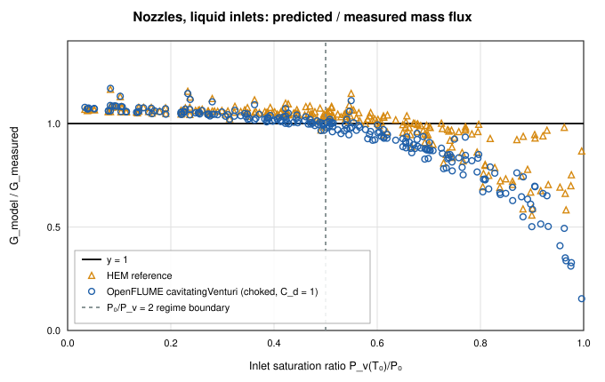
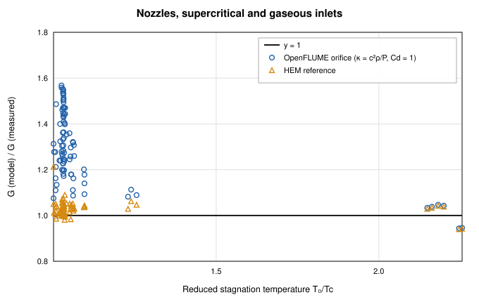
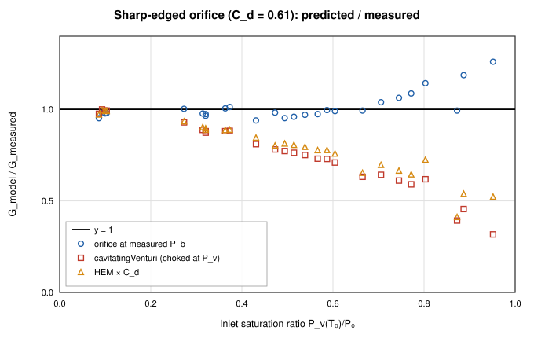
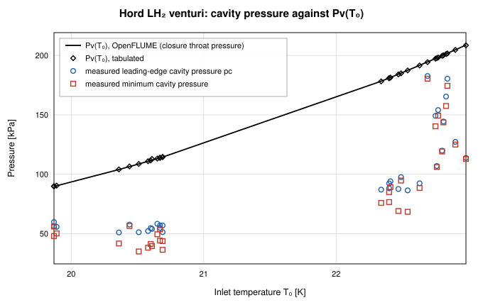

# Choked Cryogenic Flow and Cavitating-Venturi Validation of OpenFLUME

**Validation against experiment: maximum flow of nitrogen and methane through nozzles and a sharp-edged orifice (NASA TP-1484, TM X-71760), and liquid-hydrogen venturi cavitation (NASA CR-2054)**

Generated by `scripts/choked-flow-validation-report.ts` — all model numbers
and figures come from live solves of the current solver. Cases, transcription
QC and models are defined once in `src/validation/chokedFlow.ts` and
`src/validation/cavitationHord.ts`; the CI gates are
`src/validation/__tests__/chokedFlow.test.ts`,
`src/validation/__tests__/cavitationHord.test.ts` (scientific tier,
`npm run test:all`) and `src/validation/__tests__/experimentalData.test.ts`
(source hash, fast tier).

## Abstract

OpenFLUME represents a flow restriction with one of two algebraic closures:
the `orifice`, whose expansibility factor uses the real-fluid isentropic
exponent κ = c_s²ρ/P and chokes at the corresponding critical pressure ratio,
and the `cavitatingVenturi`, which treats the liquid as incompressible down
to its vapor pressure and chokes there. This report compares both with
352 measured maximum mass fluxes of nitrogen
and methane — 326 through four converging–diverging nozzles
(Simoneau & Hendricks, NASA TP-1484, 1979) and 26 through a
sharp-edged orifice (Simoneau, NASA TM X-71760, 1975) — and checks the
venturi closure's throat-pressure assumption against 32 developed
liquid-hydrogen cavities (Hord, Anderson & Hall, NASA CR-2054, 1972). The
agreement depends on the inlet regime, and the report is organized by it.
For subcooled liquid nozzle inlets (P0 ≥ 2 P_v(T0)) the choked-liquid closure
predicts the measured flux with a median ratio of 1.045
(range 0.966–1.171), and for gaseous inlets the
expansibility closure gives 0.944–1.047. Two regimes
are outside what the closures represent. Near saturation the measured flux
exceeds the prediction (median 0.879, down to 0.154),
the signature of liquid that stays metastable below its vapor pressure; an
equilibrium model under-predicts there too. For dense supercritical inlets
the expansibility closure, with κ frozen at the inlet state, over-predicts
by a median +30 % (up to +57 %), where an
isentropic homogeneous-equilibrium (HEM) calculation is within
+2.9 % median. Through the sharp-edged orifice, the
`orifice` closure with the textbook C_d = 0.61 at the measured back
pressure is within −6.1 % to +1.3 % for subcooled
inlets. In Hord's venturi the cavity at the throat sits 6–55 %
below P_v(T0) because evaporation cools it, so for a choked venturi at
these conditions the closure would under-predict the flow by
10–41 %.

## Introduction

Feed systems for cryogenic propellants are sized around restrictions that
choke: injector orifices, cavitating venturis used as flow regulators, and
nozzles and valves that pass flashing liquid. A network code reduces each of
these to an algebraic relation between upstream state, downstream pressure
and mass flow, and the quality of that relation sets the predicted flow.
The NASA Lewis choked-flow program of the 1970s measured exactly that
quantity — the maximum mass flux through a restriction as a function of the
stagnation state — across subcooled, saturated, near-critical, supercritical
and gaseous inlets, and Hord's cavitation program measured the cavity
pressures and temperatures that a cavitating-venturi closure assumes. Both
are therefore direct tests of the closures, independent of any network.

## Experiments and Data

### Nozzles (NASA TP-1484)

Simoneau and Hendricks measured the maximum (choked) mass flux of nitrogen
through four converging–diverging nozzles — 7° and 3.5° conical, elliptical,
and two-dimensional — and of methane and hydrogen through the elliptical
nozzle, with stagnation temperatures from well below to above the critical
temperature and stagnation pressures up to about 9 MPa. Each table row gives
T0, P0, the back pressure, the throat-to-stagnation pressure ratio, the
measured G = ṁ/A_throat, and properties computed by the authors (stagnation
entropy and saturation pressures). The digitized run-summary columns are
used here; the axial pressure profiles were not digitized. The hydrogen
table is excluded: most of its rows have no transcribed stagnation state.

### Sharp-edged orifice (NASA TM X-71760)

Simoneau measured the maximum flow of subcooled liquid nitrogen through a
0.318 cm sharp-edged orifice at stagnation temperatures of 95–130 K, with the
back pressure, the back (jet) temperature and the authors' discharge
coefficient C_d = G/√(2ρ0(P0 − P_b)) tabulated.

### Transcription quality control

The CSVs were extracted from scanned tables by OCR with per-cell flags, and
some rows carry shifted or mis-read columns. A row is used only if every
field the comparison needs is present and unflagged, and if values the paper
tabulates redundantly agree with values recomputed from the transcribed
fields: the saturation pressure at T0 within 5 % of CoolProp (both datasets);
for the orifice also the back temperature within 1.5 K of T_sat(P_b) and the
tabulated C_d within 3 % of G/√(2ρ0(P0 − P_b)). These checks use only the
transcribed numbers and the equation of state, never a flow model.

| Nozzle | Source | Rows | Usable |
| ------ | ------ | ---- | ------ |
| 7° conical nozzle | TP-1484 Table VI | 119 | 108 |
| 3.5° conical nozzle | TP-1484 Table VII | 46 | 42 |
| 2-D nozzle | TP-1484 Table VIII | 91 | 85 |
| elliptical (N₂) nozzle | TP-1484 Table IX | 152 | 65 |
| elliptical (CH₄) nozzle | TP-1484 Table X | 39 | 26 |
| Sharp-edged orifice | TM X-71760 Table I | 109 | 26 |

| Reason a row was excluded (first failing check) | Rows |
| ----------------------------------------------- | ---- |
| T0, P0 or G flagged OCR-uncertain, fused, unparsed or ditto | 62 |
| T0, P0, G (or Pb, T_b) blank | 59 |
| row flagged by the digitizer (fit failed / fields blank in report) | 52 |
| tabulated C_d ≠ G/√(2ρ0(P0 − P_b)) ± 3 % | 17 |
| tabulated P_v(T0) disagrees with CoolProp by > 5 % | 10 |
| back temperature ≠ T_sat(P_b) ± 1.5 K (column shift) | 4 |

The orifice C_d check makes the orifice comparison at the measured back
pressure equivalent to comparing 0.61 Y with the usable rows' discharge
coefficients, which range from 0.446 to 0.618; Y is the closure's
expansibility factor (below).

### Inlet regimes

Results are segmented by the stagnation state, with T_c = 126.19 K and
P_c = 3.396 MPa for nitrogen (T_c = 190.56 K for methane):

| Regime | Definition | Physics at the restriction |
| ------ | ---------- | -------------------------- |
| subcooled liquid, P0/Pv ≥ 2 | T0 < T_c, P0 ≥ 2 P_v(T0) | liquid accelerates to near P_v, then flashes |
| near-saturated liquid, P0/Pv < 2 | T0 < T_c, P0 < 2 P_v(T0) | flashing begins close to the inlet; non-equilibrium matters most |
| supercritical, 1 ≤ T0/Tc < 1.5 | T_c ≤ T0 < 1.5 T_c | dense fluid whose compressibility changes strongly on expansion |
| gas, T0/Tc ≥ 1.5 | T0 ≥ 1.5 T_c | near-ideal gas |

## Models

Each data point is one OpenFLUME steady network: a boundary node at
(P0, T0), one branch, and a downstream boundary node, with the CoolProp
equation of state for the fluid. Nothing is fitted.

- **Liquid inlets (T0 < T_c): `cavitatingVenturi`**, choked branch,
  ṁ = C_d A √(2ρ0(P0 − P_v(T0))). The downstream boundary is set to
  0.5 P_v(T0), so the closure is evaluated choked, the state in which the
  experiments were run.
- **Supercritical and gaseous inlets: `orifice`**, ṁ = C_d A Y(r, κ) √(2ρ0 ΔP)
  with κ = c_s²ρ/P at the inlet state and choking at
  r* = (2/(κ + 1))^(κ/(κ−1)); the downstream boundary is at 0.05 P0, below r*.
- **Sharp-edged orifice data:** the `orifice` closure at the measured back
  pressure (the model one would build for this restriction), and the
  `cavitatingVenturi` closure for comparison.
- **Discharge coefficient:** C_d = 1 for the nozzles (the papers compare
  their data with ideal flow at the measured throat area) and C_d = 0.61
  for the sharp-edged orifice (the standard high-Reynolds-number value;
  White, *Fluid Mechanics*).
- **Reference model (not an OpenFLUME closure):** isentropic homogeneous
  equilibrium flow, G* = max over P of ρ(P, s0)√(2(h0 − h(P, s0))), computed
  directly from CoolProp and multiplied by the same C_d. It separates the
  error of each closure's idealization from the non-equilibrium physics that
  no equilibrium model contains. Its implementation is checked against the
  ideal-gas critical flux of nitrogen at 300 K (gate test, < 0.5 %).

All 378 solves converged.

## Results

### Nozzles

Ratios are G_model/G_measured; "HEM" is the reference model.

| Data | Regime | OpenFLUME closure | n | Median | Range | Mean abs. deviation | HEM median | HEM range |
| ---- | ------ | ----------------- | - | ------ | ----- | ------------------- | ---------- | --------- |
| Nozzles (all four) | subcooled liquid, P0/Pv ≥ 2 | cavitatingVenturi (choked) | 115 | 1.045 | 0.966–1.171 | 4.5 % | 1.058 | 0.969–1.166 |
| Nozzles (all four) | near-saturated liquid, P0/Pv < 2 | cavitatingVenturi (choked) | 124 | 0.879 | 0.154–1.111 | 17.4 % | 0.968 | 0.558–1.146 |
| Nozzles (all four) | supercritical, 1 ≤ T0/Tc < 1.5 | orifice (κ = c²ρ/P, choked) | 81 | 1.304 | 1.075–1.568 | 31.8 % | 1.029 | 0.981–1.213 |
| Nozzles (all four) | gas, T0/Tc ≥ 1.5 | orifice (κ = c²ρ/P, choked) | 6 | 1.036 | 0.944–1.047 | 4.5 % | 1.031 | 0.940–1.042 |

By nozzle and fluid:

| Nozzle | Fluid | Regime | Closure | n | Median | Range | HEM median | HEM range |
| ------ | ----- | ------ | ------- | - | ------ | ----- | ---------- | --------- |
| 7° conical nozzle | N₂ | subcooled liquid, P0/Pv ≥ 2 | cavitatingVenturi (choked) | 37 | 1.028 | 0.991–1.062 | 1.051 | 1.022–1.067 |
| 7° conical nozzle | N₂ | near-saturated liquid, P0/Pv < 2 | cavitatingVenturi (choked) | 43 | 0.877 | 0.502–1.003 | 0.962 | 0.558–1.050 |
| 7° conical nozzle | N₂ | supercritical, 1 ≤ T0/Tc < 1.5 | orifice (κ = c²ρ/P, choked) | 26 | 1.422 | 1.172–1.548 | 1.031 | 1.004–1.053 |
| 7° conical nozzle | N₂ | gas, T0/Tc ≥ 1.5 | orifice (κ = c²ρ/P, choked) | 2 | 1.036 | 1.034–1.038 | 1.031 | 1.029–1.034 |
| 3.5° conical nozzle | N₂ | subcooled liquid, P0/Pv ≥ 2 | cavitatingVenturi (choked) | 14 | 1.040 | 0.998–1.055 | 1.059 | 1.047–1.096 |
| 3.5° conical nozzle | N₂ | near-saturated liquid, P0/Pv < 2 | cavitatingVenturi (choked) | 26 | 0.872 | 0.311–1.004 | 0.924 | 0.583–1.066 |
| 3.5° conical nozzle | N₂ | gas, T0/Tc ≥ 1.5 | orifice (κ = c²ρ/P, choked) | 2 | 1.045 | 1.043–1.047 | 1.040 | 1.039–1.042 |
| elliptical nozzle | N₂ | subcooled liquid, P0/Pv ≥ 2 | cavitatingVenturi (choked) | 14 | 1.019 | 0.968–1.079 | 1.056 | 1.037–1.069 |
| elliptical nozzle | N₂ | near-saturated liquid, P0/Pv < 2 | cavitatingVenturi (choked) | 15 | 0.879 | 0.635–0.961 | 0.995 | 0.779–1.036 |
| elliptical nozzle | N₂ | supercritical, 1 ≤ T0/Tc < 1.5 | orifice (κ = c²ρ/P, choked) | 36 | 1.251 | 1.075–1.508 | 1.030 | 0.981–1.213 |
| 2-D nozzle | N₂ | subcooled liquid, P0/Pv ≥ 2 | cavitatingVenturi (choked) | 30 | 1.074 | 1.006–1.171 | 1.080 | 1.052–1.166 |
| 2-D nozzle | N₂ | near-saturated liquid, P0/Pv < 2 | cavitatingVenturi (choked) | 39 | 0.925 | 0.154–1.111 | 0.996 | 0.663–1.146 |
| 2-D nozzle | N₂ | supercritical, 1 ≤ T0/Tc < 1.5 | orifice (κ = c²ρ/P, choked) | 14 | 1.314 | 1.197–1.568 | 1.020 | 0.999–1.075 |
| 2-D nozzle | N₂ | gas, T0/Tc ≥ 1.5 | orifice (κ = c²ρ/P, choked) | 2 | 0.945 | 0.944–0.946 | 0.941 | 0.940–0.942 |
| elliptical nozzle | CH₄ | subcooled liquid, P0/Pv ≥ 2 | cavitatingVenturi (choked) | 20 | 1.043 | 0.966–1.071 | 1.051 | 0.969–1.067 |
| elliptical nozzle | CH₄ | near-saturated liquid, P0/Pv < 2 | cavitatingVenturi (choked) | 1 | 0.929 | 0.929–0.929 | 0.946 | 0.946–0.946 |
| elliptical nozzle | CH₄ | supercritical, 1 ≤ T0/Tc < 1.5 | orifice (κ = c²ρ/P, choked) | 5 | 1.269 | 1.240–1.400 | 1.026 | 1.011–1.052 |

**Subcooled liquid.** With C_d = 1 the choked-liquid closure over-predicts
the measured flux by a median +4.5 %, with every point between
−3.4 % and +17.1 %, and the HEM reference behaves almost
identically (median 1.058). For a liquid well above its vapor pressure
the two models coincide: the liquid expands nearly isentropically to about
P_v and flashes there. The remaining few-percent over-prediction is of the
size expected from discharge coefficients slightly below one; no C_d is
fitted here.

**Near-saturated liquid.** The closure's driving pressure P0 − P_v(T0)
vanishes as the inlet approaches saturation, but the measured flux does
not. For P_v/P0 ≤ 0.9 the median ratio is 0.894
(0.502–1.111, n = 110); above 0.9 it is 0.498
(0.154–0.697, n = 14), and HEM, which lets the fluid
flash in equilibrium, is also low there (median 0.729). The
measured flux exceeding both is the signature of liquid that remains
metastable below P_v(T0) before flashing. Neither closure represents
thermal non-equilibrium. For inlets within 10 % of saturation the
choked-liquid closure under-predicts by up to a factor of
6.5 and HEM by up to a factor of 1.7 (Figure 1).

*Figure 1. Liquid inlets, all four nozzles: OpenFLUME's choked-liquid closure (C_d = 1) and the HEM reference against measurement, plotted against the inlet saturation ratio P_v(T₀)/P₀. Points right of the dashed line are near-saturated (P₀ < 2P_v).*

**Supercritical inlets.** The expansibility closure over-predicts every
point, by a median +30.4 % (+7.5 % to +56.8 %), while
HEM's median ratio is 1.029 (0.981–1.213). The closure
applies the ideal-gas expansibility law with κ evaluated once, at the inlet.
For a dense supercritical fluid κ = c_s²ρ/P changes by a large factor along
the expansion, so a constant-κ isentrope is a poor approximation to the real
one. The data confirm that this is a limitation of the closure and not of
the property data, since the HEM calculation uses the same equation of state
along the real isentrope (Figure 2).

**Gaseous inlets.** For the six room-temperature nitrogen points the
closure is within −5.6 % to +4.7 % of measurement, and HEM gives
the same values: here κ is nearly constant and the closure reduces to the
classical isentropic critical flux.

*Figure 2. Supercritical and gaseous inlets, all nozzles: OpenFLUME's expansibility closure (κ frozen at the inlet state, C_d = 1) and the HEM reference against measurement.*

*Figure 3. All usable nozzle points: OpenFLUME's primary closure against the measured maximum mass flux, by inlet regime (dashed: ±10 %).*

### Sharp-edged orifice

| Data | Regime | OpenFLUME closure | n | Median | Range | Mean abs. deviation | HEM × C_d median | HEM × C_d range |
| ---- | ------ | ----------------- | - | ------ | ----- | ------------------- | ---------------- | --------------- |
| Sharp-edged orifice | subcooled liquid, P0/Pv ≥ 2 | orifice at measured Pb | 13 | 0.978 | 0.939–1.013 | 2.6 % | 0.897 | 0.802–0.997 |
| Sharp-edged orifice | near-saturated liquid, P0/Pv < 2 | orifice at measured Pb | 13 | 0.996 | 0.960–1.260 | 6.9 % | 0.697 | 0.412–0.806 |
| Sharp-edged orifice | subcooled liquid, P0/Pv ≥ 2 | cavitatingVenturi (choked) | 13 | 0.883 | 0.772–1.000 | 10.3 % | 0.897 | 0.802–0.997 |
| Sharp-edged orifice | near-saturated liquid, P0/Pv < 2 | cavitatingVenturi (choked) | 13 | 0.632 | 0.317–0.763 | 38.9 % | 0.697 | 0.412–0.806 |

With C_d = 0.61 at the measured back pressure the `orifice` closure is within
−6.1 % to +1.3 % for subcooled inlets and −4.0 % to
+26.0 % for near-saturated ones; the largest over-prediction is the
point closest to saturation. Part of this agreement is coincidental. At
95 and 110 K the expansibility factor is 0.954–0.993 and the
jet behaves as an incompressible jet discharging at the back pressure, with
flashing outside the orifice. At 119–124 K the tabulated discharge
coefficient falls toward the critical point, and so does Y
(0.850–0.926, because κ = c_s²ρ/P falls); the closure tracks the data
through a gas-dynamic factor, not through a model of flashing, and that
correspondence should not be extrapolated. Both choked models are wrong for
a sharp-edged orifice: choking at P_v gives a median 0.883 (subcooled)
and 0.632 (near-saturated), and HEM × C_d gives 0.897 and
0.697 (Figure 4). A sharp-edged orifice passing subcooled cryogen
should be modeled with the `orifice` closure at the real downstream
pressure, not with a choked closure.

*Figure 4. Sharp-edged orifice, liquid nitrogen: the orifice closure at the measured back pressure, the choked-at-P_v closure and HEM, all with C_d = 0.61, against measurement.*

## Part B: Cavitating Venturi (NASA CR-2054)

### Data

Hord, Anderson and Hall photographed developed (super)cavities on the
quarter-round contour of a transparent venturi of 1.905 cm throat diameter
in liquid para-hydrogen, and tabulated (Table A-1b) for each of
32 runs the inlet state (P0, T0), the vapor pressure at T0 (as the
"saturation head" h* and the pressure p*), and the wall pressures and
temperatures at seven ports along the cavity on both walls.

### What is compared, and what is not

The `cavitatingVenturi` closure assumes that a choked throat sits at
P_v(T0). Hord's measurements test that assumption directly:

1. OpenFLUME's P_v(T0) (CoolProp ParaHydrogen) against the tabulated p*;
2. the measured cavity pressure at the leading edge, p_c (port 2, nearest
   the throat, mean of the two walls), and the minimum over all ports,
   against P_v(T0);
3. the mass flux the closure predicts (an OpenFLUME solve with C_d = 1,
   downstream at 0.5 P_v) against the flux of a choked throat at the measured
   p_c, G_c = √(2ρ0(P0 − p_c)). Both carry the same C_d and area, so the ratio
   needs no venturi geometry.

The measured mass flow is not compared. The table gives a velocity "at the
test-section inlet", but the digitized record does not establish which area
it refers to: with the throat diameter and the listed 3.175 cm inlet
diameter, the throat velocity head would exceed P0 − P_v. The hydrofoil and
ogive cavitation sets of the same program (CR-2156, CR-2242) are external
flows over bodies with no network-component counterpart and are out of
scope.

### Results

All 32 closure solves converged. OpenFLUME's vapor pressure agrees with
the tabulated value to within 0.91 % (median 0.08 %), so the
equation of state is not a factor. The measured leading-edge cavity
pressure lies 6–55 % below P_v(T0), and the minimum cavity pressure
7–68 % below. At the leading edge the cavity is close to saturation at
its own measured temperature (p/P_sat(T_port) = 0.888–1.170), so
the depression is thermal: evaporation into the cavity cools the liquid
around it below T0. Further downstream the ports read up to
2.613 × P_sat(T_port) as pressure recovers along the cavity.

For a choked venturi at these conditions the closure's throat pressure is
therefore too high, and its predicted flux is 0.594–0.900 times the
flux through a throat at the measured p_c: an under-prediction of
10–41 %. The effect is largest for the warmer runs (T0 ≈ 22.4–23 K),
where P0 − P_v is a small fraction of P0 (Figure 5). The closure has no
thermodynamic-suppression term; for liquid hydrogen near its normal boiling
point a user calibrating a venturi should expect its C_d to absorb this
effect.

*Figure 5. Hord's liquid-hydrogen venturi: the closure's throat pressure P_v(T₀) (OpenFLUME and tabulated) against the measured cavity pressure at the leading edge and the minimum over all ports.*

## Trust Levels

| Comparison | Evidence class | Trust level | What may be quoted |
| ---------- | -------------- | ----------- | ------------------ |
| Nozzles, subcooled liquid, `cavitatingVenturi` | Validation against experiment | Validated within the stated range | Median 1.045, range 0.966–1.171 at C_d = 1 |
| Nozzles, gas, `orifice` | Validation against experiment | Validated within the stated range | 0.944–1.047 at C_d = 1 (six points) |
| Nozzles, near-saturated liquid | Validation against experiment | Documented disagreement | Under-prediction, unbounded as P0 → P_v |
| Nozzles, supercritical, `orifice` | Validation against experiment | Documented disagreement | Over-prediction, median +30 % |
| Sharp-edged orifice, `orifice` at P_b | Validation against experiment | Validated within the stated range | Subcooled −6.1 % to +1.3 % at C_d = 0.61 |
| Hord venturi, throat-pressure assumption | Validation against experiment (closure assumption) | Documented disagreement | Cavity 6–55 % below P_v(T0) |
| HEM reference | Reference model, not OpenFLUME | — | Context only |

## Conclusions

OpenFLUME's two restriction closures predict choked cryogenic flow well in
the regimes they are built for and badly outside them, and the boundary is
sharp enough to state. The choked-liquid `cavitatingVenturi` closure with
C_d = 1 matches nozzle data for liquid nitrogen and methane subcooled to at
least twice the vapor pressure within a few percent, and the `orifice`
closure matches gaseous nitrogen and, at the measured back pressure with
C_d = 0.61, subcooled liquid nitrogen through a sharp-edged orifice. Three
findings bound their use: neither closure represents thermal
non-equilibrium, so near-saturated liquid inlets are under-predicted; the
expansibility closure's frozen κ over-predicts dense supercritical flow by up
to +57 %, where an equilibrium calculation along the real isentrope
does not; and the venturi closure's throat pressure ignores the thermal
suppression of cavities, which Hord's hydrogen data put at 6–55 % of P_v.
These are limitations of the closures, documented here with the data that
expose them; no closure was adjusted.

## References

1. Simoneau, R. J., and Hendricks, R. C., "Two-Phase Choked Flow of
   Cryogenic Fluids in Converging-Diverging Nozzles," NASA TP-1484, 1979.
2. Simoneau, R. J., "Maximum Two-Phase Flow Rates of Subcooled Nitrogen
   Through a Sharp-Edged Orifice," NASA TM X-71760, 1975 (also *Advances in
   Cryogenic Engineering* 21, 1975, pp. 299–306).
3. Hord, J., Anderson, L. M., and Hall, W. J., "Cavitation in Liquid
   Cryogens. Volume I: Venturi," NASA CR-2054, 1972.
4. Hord, J., "Cavitation in Liquid Cryogens. Volume II: Hydrofoil," NASA
   CR-2156, 1973; "Volume III: Ogives," NASA CR-2242, 1973 (out of scope).
5. White, F. M., *Fluid Mechanics*, 7th ed., McGraw-Hill, 2011 (orifice
   discharge coefficients).
6. Bell, I. H., Wronski, J., Quoilin, S., and Lemort, V., "Pure and
   Pseudo-pure Fluid Thermophysical Property Evaluation and the Open-Source
   Thermophysical Property Library CoolProp," *Industrial & Engineering
   Chemistry Research* 53(6), 2014, pp. 2498–2508.

## Nomenclature

| Symbol | Meaning |
| ------ | ------- |
| A | branch flow area (throat or bore) |
| C_d | discharge coefficient |
| c_s | speed of sound |
| G | mass flux ṁ/A |
| G* | HEM critical mass flux |
| h, h0 | specific enthalpy; stagnation value |
| ṁ | mass flow rate |
| P0, T0 | stagnation pressure, temperature |
| P_b | back pressure |
| P_c, T_c | critical pressure, temperature |
| p_c | measured cavity pressure at the leading edge (port 2) |
| P_v | vapor (saturation) pressure |
| r, r* | pressure ratio P_down/P_up; critical value |
| s0 | stagnation entropy |
| Y | expansibility factor |
| κ | isentropic exponent c_s²ρ/P |
| ρ0 | stagnation density |
