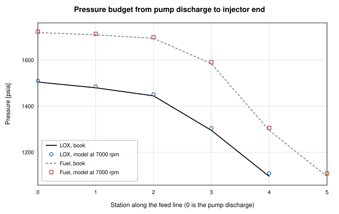
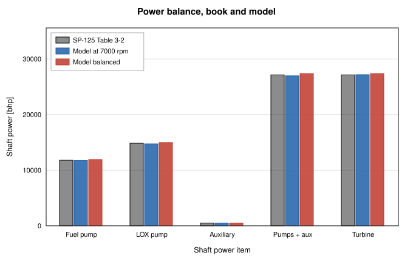

# A-1 Stage Engine Balance, NASA SP-125 Design Example

**A nested pump and turbine power balance with pressure budgets for a 750 klbf LOX/RP-1 gas-generator-cycle engine, compared with the printed design values of NASA SP-125**

Generated by `scripts/engine-balance-report.ts`. All numbers and figures
come from live solves of the current solver. The comparison choices were fixed
before the first run in [`engine-balance-protocol.md`](engine-balance-protocol.md).
The CI gate is `src/validation/__tests__/a1Engine.test.ts`.

## Abstract

This report builds a basic balance of the A-1 stage engine of Huzel and Huang
(NASA SP-125, Table 3-2) from components that OpenFLUME has today and compares
every published balance number with the model. The engine is a hypothetical
750 klbf LOX/RP-1 gas-generator-cycle engine, so the reference is a published
design example and not a measured engine. The network has LOX and RP-1 feed
lines with one square-law restriction per printed pressure drop, two pumps with
a head-flow shape through the design point, a reacting junction chamber with a
choked throat, the two gas-generator feed lines and the turbine as a choked
orifice with the book's gas state. The turbine power, the pump powers and the
balance residual are post-processed, because OpenFLUME has no turbine component
and no shaft speed unknown. The balance is closed by a script-level outer
iteration on the common shaft speed, with an inner root find on the gas
generator pressure. It is a nested balance, not a simultaneous solve.

At the book hardware and 7000 rpm the model turbine power is 27186 bhp
against 26977 bhp for the pumps and the auxiliary drive, a
residual of 209 bhp (0.77 percent of the turbine power). The
outer iteration closes it to 1.8e-9 of the turbine power at a shaft speed
of 7033 rpm, +0.47 percent from the book's 7000. The nozzle
stagnation pressure is 1012.2 psia against 1000 (+1.22 percent) and c* is
5782 ft/s against 5660 (+2.16 percent), which is the CEA table value
(+2.17 percent above the book's implied ideal c*) times the 0.975 efficiency. At 7000 rpm 1 compared quantity is outside the tolerance set in the protocol (injector end (both sides)). At the balanced shaft speed 10 are outside it (lox pump discharge, lox after line, lox after main valve, lox after torus dome, fuel pump discharge, fuel after line, fuel after main valve, fuel after calibration orifice, fuel after jacket and manifold, injector end (both sides)). They are discussed below and nothing was adjusted.
Because the effective area of every restriction is sized from the book's own
flow and drop, the flows and station pressures are reproduced largely by
construction, and the report marks them so. The independent content of the
case is the CEA chamber, the pump curve shift, the turbine power from the
solved state and the shaft speed that closes the balance. This is a code-to-code
check against a design example. It is not a validation against measurement.

## System

The A-1 engine of SP-125 is a single-start fixed-thrust gas-generator-cycle
engine. A direct-drive turbopump has a fuel pump and a LOX pump on one shaft
at 7000 rpm with a two-wheel turbine. An uncooled gas generator burns the same
propellants at O/F 0.408 and the turbine exhaust is discharged separately at
27 psia. The thrust chamber is regeneratively cooled by the fuel. Table 3-2
(printed page 65) lists the flows, the pressure drop of every element, the pump
and turbine data and the gas generator data, and Table 6-4 (page 197) and
Sample Calculation 6-5 (page 199) give the turbine gas properties. The data are
tabulated with page citations in the protocol. The book's budgets close in psi.
The main LOX side is 1505 - 25 - 35 - 150 - 200 = 1095 psia and the fuel side is
1720 - 10 - 15 - 110 - 290 - 200 = 1095 psia. The gas generator budgets give
710 and 710 psia.

## Protocol

The data, the imposed inputs, the unknowns, the free parameter and the
expected tolerances were committed before any run (no solver call of any kind
had been made for this case at that commit). The points that matter for
reading the results are the following.

- The effective area of every liquid restriction is sized from the book's
  flow and drop with the book's density, so the network passes the printed
  flow at the printed drop. The turbine effective area is sized to pass
  92 lb/s at 640 psia and 1860 R with the printed gas constant.
- The pump head-flow shape is h = 1.2 - 0.2 q squared through the design
  point, which is a stated choice and not a book number. The affinity laws
  scale it with speed and the efficiency is the printed constant.
- The gas generator gas state is imposed from the book, because the CEA tables
  start at O/F 1 and NASA CEA gives 1727 F against the book's 1400 F at
  O/F 0.408. No CEA is used for the gas generator.
- The free parameter of the outer balance is the common shaft speed. The
  cross-check closure uses the common scale of the two gas generator control
  orifice areas at 7000 rpm.
- The balance closes when the residual is below 1e-6 of the turbine power.

## Model

The network has 26 nodes and 24 branches. The LOX line is the pump, then
the line, main valve, torus dome and injector, each an orifice branch, ending
on the chamber node. The fuel line is the pump, line, main valve, calibration
orifice, jacket and manifold, and injector. A flow source takes the printed
3 lb/s heat exchanger flow from the LOX pump discharge. The two gas generator
lines start at the pump discharge nodes and pass the entrance loss, line,
control orifice, valve and injector before they reach two liquid boundary nodes
at the gas generator injector end pressure. The tanks are boundary nodes at the
printed pump inlet pressures of 55 and 45 psia.

The chamber node is a reacting junction on the `lox-rp1` CEA table with an
enthalpy efficiency of 0.975 squared. The throat is a choked orifice to an
ambient boundary with the throat area of 487 square inches and a discharge
coefficient of 1000/1095, which carries the book's stagnation pressure loss of
the chamber. The node pressure is therefore the injector end pressure and the
model Pc is the node pressure over 1.095. The turbine inlet is a gas boundary
node at the gas generator pressure minus the printed 70 psi combustor drop and
1860 R, and the turbine is a choked orifice to a boundary at 27 psia.

The inner loop is a secant iteration on the gas generator pressure until the
liquid flow into the gas generator equals the turbine flow (5 solves at
the baseline, residual 7.1e-15 kg/s). The turbine power is
cp T0 (1 - (1/PR)^((gamma-1)/gamma)) times the solved flow times 0.582 by
equations 6-18 and 6-19. The pump power is the volumetric flow times the solved
rise over the printed efficiency. The balance residual is the turbine power
minus the two pump powers and the 500 bhp auxiliary drive.

## Results

At 7000 rpm 1 compared quantity is outside the tolerance set in the protocol (injector end (both sides)). At the balanced shaft speed 10 are outside it (lox pump discharge, lox after line, lox after main valve, lox after torus dome, fuel pump discharge, fuel after line, fuel after main valve, fuel after calibration orifice, fuel after jacket and manifold, injector end (both sides)). They are discussed below and nothing was adjusted.

### Book consistency before any model run

These are arithmetic checks of the printed values. They set the floor below
which a model difference cannot be told apart from the book's own rounding.

| Check | Value | Printed | Difference % |
| --- | --- | --- | --- |
| LOX pump head from the printed pressures [ft] | 2925 | 2930 | -0.16 |
| Fuel pump head from the printed pressures [ft] | 4781 | 4790 | -0.19 |
| LOX pump power from flow, rise and efficiency [bhp] | 14827 | 14850 | -0.15 |
| Fuel pump power from flow, rise and efficiency [bhp] | 11784 | 11790 | -0.05 |
| Turbine power from equations 6-18 and 6-19 [bhp] | 27123 | 27140 | -0.06 |
| Turbine power from torque and speed [bhp] | 27162 | 27140 | +0.08 |
| Pump powers plus auxiliary drive [bhp] | 27140 | 27140 | 0.00 |
| Chamber plus gas generator oxidizer plus heat exchanger [lb/s] | 1970.7 | 1971 | -0.02 |
| Chamber plus gas generator fuel [lb/s] | 892.3 | 892 | +0.03 |
| Gas generator O/F from the two flows | 0.409 | 0.408 | +0.22 |
| cp from the printed R and gamma [Btu/lb F] | 0.624 | 0.653 | -4.39 |
| R from the printed cp and gamma [ft lbf/lb R] | 56.1 | 53.6 | +4.59 |

### Flows

Basis marks how the number is obtained. A sized quantity is reproduced at the
design point by the choice of effective area and moves only through the solve.

| Quantity | Unit | Book | At 7000 rpm | % | Balanced | % | Expected tolerance % | Within | Basis |
| --- | --- | --- | --- | --- | --- | --- | --- | --- | --- |
| Chamber oxidizer flow | lb/s | 1941.0 | 1922.2 | -0.97 | 1934.8 | -0.32 | 2 | yes | solved |
| Chamber fuel flow | lb/s | 827.0 | 820.9 | -0.74 | 825.9 | -0.13 | 2 | yes | solved |
| Chamber O/F |  | 2.350 | 2.342 | -0.36 | 2.343 | -0.31 | 2 | yes | solved |
| Gas generator oxidizer flow | lb/s | 26.70 | 26.77 | +0.27 | 26.92 | +0.83 | 2 | yes | sized, shifted by the solve |
| Gas generator fuel flow | lb/s | 65.30 | 65.40 | +0.15 | 65.76 | +0.70 | 2 | yes | sized, shifted by the solve |
| Gas generator O/F |  | 0.408 | 0.409 | +0.34 | 0.409 | +0.34 | 2 | yes | sized, shifted by the solve |
| Turbine flow | lb/s | 92.00 | 92.17 | +0.18 | 92.68 | +0.74 | 2 | yes | sized, shifted by the solve |
| LOX pump flow | lb/s | 1971.0 | 1951.9 | -0.97 | 1964.7 | -0.32 | 2 | yes | solved |
| Fuel pump flow | lb/s | 892.0 | 886.3 | -0.64 | 891.7 | -0.04 | 2 | yes | solved |

### Station pressures

| Quantity | Unit | Book | At 7000 rpm | % | Balanced | % | Expected tolerance % | Within | Basis |
| --- | --- | --- | --- | --- | --- | --- | --- | --- | --- |
| LOX pump discharge | psia | 1505.0 | 1510.5 | +0.36 | 1523.0 | +1.20 | 1 | no | solved |
| LOX after line | psia | 1480.0 | 1486.0 | +0.40 | 1498.1 | +1.23 | 1 | no | solved |
| LOX after main valve | psia | 1445.0 | 1451.6 | +0.46 | 1463.4 | +1.27 | 1 | no | solved |
| LOX after torus dome | psia | 1295.0 | 1304.5 | +0.74 | 1314.3 | +1.49 | 1 | no | solved |
| Fuel pump discharge | psia | 1720.0 | 1724.2 | +0.24 | 1738.9 | +1.10 | 1 | no | solved |
| Fuel after line | psia | 1710.0 | 1714.3 | +0.25 | 1729.0 | +1.11 | 1 | no | solved |
| Fuel after main valve | psia | 1695.0 | 1699.6 | +0.27 | 1714.0 | +1.12 | 1 | no | solved |
| Fuel after calibration orifice | psia | 1585.0 | 1591.2 | +0.39 | 1604.3 | +1.22 | 1 | no | solved |
| Fuel after jacket and manifold | psia | 1295.0 | 1305.4 | +0.81 | 1315.1 | +1.55 | 1 | no | solved |
| Injector end (both sides) | psia | 1095.0 | 1108.4 | +1.22 | 1115.6 | +1.88 | 1 | no | solved |
| Gas generator injector end | psia | 710.0 | 711.2 | +0.17 | 714.7 | +0.67 | 1 | yes | solved |
| Turbine inlet | psia | 640.0 | 641.2 | +0.18 | 644.7 | +0.74 | 1 | yes | solved |

*Figure 1. Pressure at each station of the main LOX and fuel feed lines. The lines are the book budget and the markers are the model at 7000 rpm. The LOX stations are the pump discharge, line, main valve, torus dome and injector end. The fuel stations are the pump discharge, line, main valve, calibration orifice, jacket and manifold, and injector end.*

### Chamber, turbine pressure ratio and pump heads

| Quantity | Unit | Book | At 7000 rpm | % | Balanced | % | Expected tolerance % | Within | Basis |
| --- | --- | --- | --- | --- | --- | --- | --- | --- | --- |
| Nozzle stagnation pressure Pc | psia | 1000.0 | 1012.2 | +1.22 | 1018.8 | +1.88 | 3 | yes | solved (CEA table) |
| c* | ft/s | 5660 | 5782 | +2.16 | 5782 | +2.16 | 3 | yes | solved (CEA table) |
| Turbine pressure ratio |  | 23.70 | 23.75 | +0.20 | 23.88 | +0.75 | 2 | yes | post-processed |
| LOX pump head | ft | 2930 | 2936 | +0.21 | 2961 | +1.07 | 3 | yes | post-processed |
| Fuel pump head | ft | 4790 | 4793 | +0.06 | 4835 | +0.94 | 3 | yes | post-processed |

The CEA table c* at the solved state is 5931 ft/s before the efficiency
and the book's implied ideal c* is 5805 ft/s. The throat area times the
book Pc over the book flow gives 5661 ft/s, which is the book's own
definition of c*. The CEA frozen gamma at the solved state is 1.147 and the
chamber temperature from the table is 3603 K before the efficiency.

### Power balance

| Quantity | Unit | Book | At 7000 rpm | % | Balanced | % | Expected tolerance % | Within | Basis |
| --- | --- | --- | --- | --- | --- | --- | --- | --- | --- |
| LOX pump power | bhp | 14850 | 14739 | -0.75 | 14963 | +0.76 | 3 | yes | post-processed |
| Fuel pump power | bhp | 11790 | 11738 | -0.44 | 11913 | +1.04 | 3 | yes | post-processed |
| Auxiliary drive | bhp | 500 | 500 | +0.00 | 500 | +0.00 | 3 | yes | imposed |
| Turbine power | bhp | 27140 | 27186 | +0.17 | 27376 | +0.87 | 5 | yes | post-processed |
| Turbine torque | ft lbf | 20380 | 20398 | +0.09 | 20445 | +0.32 | 5 | yes | post-processed |
| Shaft speed | rpm | 7000 | 7000 | +0.00 | 7033 | +0.47 | 3 | yes | free parameter, solved by the outer balance |

*Figure 2. Shaft power of each pump, the auxiliary drive, their sum and the turbine. The book sums to 27140 bhp on both sides. The model at 7000 rpm leaves a residual and the balanced model closes it by shaft speed.*

## Balance closure

The balance residual is the turbine power minus the two pump powers and the
auxiliary drive. At the book hardware and 7000 rpm it is an output. It is
209.0 bhp or 0.77 percent of the turbine power. The turbine
power is +0.17 percent from the book and the two pump powers sum to
-0.61 percent from the book. The pump flows are low by 0.97 and
0.64 percent (LOX and fuel) and the turbine flow is +0.18 percent. A likely
cause is the chamber pressure, which is +1.22 percent high through the CEA c*, because
it takes part of the injector drop of the main lines and lowers their flow and so the pump
power, while the gas generator branches are fed from the same discharge pressures through
large control drops and their flow is almost unchanged.

The outer iteration on the common shaft speed (secant, 5 evaluations,
24 network solves in all) gives the following history.

| Iteration | Speed over design | Residual [bhp] |
| --- | --- | --- |
| 0 | 1.000000 | 208.991 |
| 1 | 1.020000 | -715.844 |
| 2 | 1.004520 | 6.212 |
| 3 | 1.004653 | 0.182 |
| 4 | 1.004657 | -0.000 |

The closed solution has a shaft speed of 7032.6 rpm (+0.47 percent
from 7000), a turbine power of 27376 bhp (+0.87 percent from the book)
and a residual of -4.9e-5 bhp. The residual at convergence is the solved
equation and is not an independent check. The independent outputs of the closure
are the shaft speed and the shifts of the flows and pressures that follow from
it. Because the pump power rises as the cube of the speed and the turbine power
only through the flow, the balance has one root and the secant iteration
reaches it in 5 evaluations.

### Cross-check on the gas generator orifice scale

The second way the book sets the turbine power is the size of the gas generator
control orifices. Holding the shaft at 7000 rpm and scaling the two control
orifice areas by a common factor closes the same residual.

| Iteration | Orifice scale | Residual [bhp] |
| --- | --- | --- |
| 0 | 1.000000 | 208.991 |
| 1 | 1.020000 | 598.086 |
| 2 | 0.989258 | -3.226 |
| 3 | 0.989422 | 0.049 |
| 4 | 0.989420 | 0.000 |

The closed scale is 0.98942. The turbine power is 26974 bhp, the
gas generator flow is 91.60 lb/s, the gas generator pressure is 707.2 psia and
Pc is 1012.3 psia. The two closures give turbine powers that differ by 403 bhp and Pc
values that differ by 6.5 psia. The two closures are different
operating points, because the shaft speed moves every flow and the orifice
scale moves only the gas generator.

## Sensitivities

These are reported and not scored. The residual column is the output at 7000
rpm for the same case.

| Case | Shaft speed [rpm] | Turbine power [bhp] | Pc [psia] | Residual at 7000 rpm [bhp] |
| --- | --- | --- | --- | --- |
| Baseline (shut-off ratio 1.2) | 7033 | 27376 | 1018.8 | 209.0 |
| Pump shut-off ratio 1.1 | 7037 | 27380 | 1018.8 | 244.8 |
| Pump shut-off ratio 1.3 | 7029 | 27373 | 1018.8 | 180.5 |
| Turbine R from cp and gamma (56.0 against the printed 53.6) | 7033 | 27376 | 1018.8 | 209.0 |
| Combustor drop scaled with the gas generator flow squared | 7031 | 27352 | 1018.4 | 206.0 |

The pump curve shape moves the solved shaft speed by at most
4.4 rpm because the pumps run near the design point and the shape
matters only through its slope. The gas constant does not change the result, as
expected, because the turbine area is sized with the same value so it cancels in
the choked flow. The balance does not depend on the 4.5 percent
inconsistency in the book's gas table, because the power equation uses cp and
gamma only.

## Disagreements and likely causes

At 7000 rpm 1 compared quantity is outside the tolerance set in the protocol (injector end (both sides)). At the balanced shaft speed 10 are outside it (lox pump discharge, lox after line, lox after main valve, lox after torus dome, fuel pump discharge, fuel after line, fuel after main valve, fuel after calibration orifice, fuel after jacket and manifold, injector end (both sides)). They are discussed below and nothing was adjusted.

- **c* and Pc.** The CEA table c* with the 0.975 efficiency convention is 5782 ft/s
  against the book's 5660, +2.16 percent. The book's ideal c* implied by its
  efficiency is 5805 ft/s and the CEA frozen value is 5931 ft/s. A likely cause
  is a difference between the thermochemistry behind the book's design value and the
  current CEA equilibrium data. This report does not test that. The flow is set by the feed
  system, so a higher c* shows up as a higher Pc, +1.22 percent. The injector end
  pressure at the junction is 1108.4 psia against 1095 (+1.22 percent) and the excess
  decays upstream to +0.36 percent at the LOX pump discharge, because the pump
  curve falls with flow.
- **Station pressures after balancing.** The protocol expected 1.0 percent. The balanced shaft
  speed is +0.47 percent from 7000 and the pump rise scales with its square, so
  every station moves up by about 0.93 percent on top of the chamber effect. The
  tolerance of the protocol was too tight for the balanced point and it is kept as written.
- **Main flows.** The chamber flows are low by 0.97 percent
  (LOX) at 7000 rpm because of the higher chamber pressure. The mixture ratio is 2.342
  against 2.35.
- **Turbine power.** The turbine power is +0.17 percent from the book at 7000
  rpm. The gas generator pressure is +0.17 percent from 710 psia and the choked turbine flow
  follows it. The turbine power also rests on the book's efficiency, which the book
  itself back-calculated from the same equations, so its agreement is not an
  independent check of the turbine.
- **Pump powers.** The pump powers differ from the book by -0.75 and -0.44 percent
  (LOX and fuel), which follows the shift in pump flow and discharge
  pressure. The book's own printed power differs from its pressures and flows by
  -0.15 and -0.05 percent.

## Limitations

- The case reproduces a design example of a hypothetical engine. It is not a
  measurement and it carries the book's rounding and inconsistencies.
- Flows and station pressures at the design point come from sizing effective
  areas with the book's own values, so their agreement is a bookkeeping check
  of the network. They are not a prediction.
- There is no turbine component. The turbine is a choked orifice and its power
  is post-processed from ideal-gas isentropic enthalpy drop times the book's
  efficiency. The turbine efficiency has no dependence on blade speed ratio or
  pressure ratio, and there is no turbine map.
- There is no shaft speed unknown and no component that couples turbine power
  to pump power. The balance is a script-level secant iteration on the speed
  with an inner root find on the gas generator pressure. A shaft unknown and a
  turbine component would put both loops inside the single Newton solve and
  would remove the post-processing.
- The pump is a Q to dP table. The head-flow shape is a stated quadratic with a
  shut-off ratio of 1.2 and the efficiency is constant. There is no pump map,
  no efficiency curve, no suction performance and no stall.
- The gas generator gas state is imposed. The CEA tables cover O/F 1 to 5 and
  the gas generator runs at 0.408, so no thermochemistry is computed for it.
  NASA CEA gives 1727 F against the book's 1400 F, which the book treats as a
  design value. A fuel-rich gas generator model with its own thermochemistry
  would change the turbine gas properties and the turbine flow with the mixture
  ratio, which here is fixed.
- A node cannot join two unlike fluids outside a reacting junction, so the gas
  generator liquid lines end on boundary nodes and the gas generator pressure is
  closed by the inner loop. A multi-fluid mixing node or a reacting junction with
  a user thermochemistry would make this part of the simultaneous solve.
- The chamber is one node with the book's stagnation loss imposed as a ratio of
  1000/1095 on the throat coefficient, and the CEA table is read at the node
  pressure and not at the nozzle stagnation pressure. The chamber gas is frozen
  downstream of the junction, and the reactants are taken at standard injection
  temperatures by the table. Reactant inlet enthalpy is not a model input.
  Thrust and specific impulse are not compared, because the nozzle has no
  expansion.
- Every restriction is square-law with a constant area. The combustor drop is a
  fixed 70 psi (a scaled drop is in the sensitivities), the jacket is a
  square-law orifice and the heat exchanger is an imposed 3 lb/s.
- The book's gas table is not self-consistent (R and cp differ by
  -4.4 percent), and the torque unit of Table 3-2 is printed in-lb
  while the sample calculation uses ft-lb.
- The auxiliary drive is held at 500 bhp at all speeds.

## Conclusions

A basic balance of the SP-125 A-1 engine runs in the OpenFLUME steady solver
in about 24 network solves with a reacting junction chamber, pump
curves, square-law feed lines, a choked throat and a choked turbine orifice with
the book's gas state. The solved pressures and flows reproduce the printed design
point (see the tolerance columns for the items outside the protocol band), and the chamber Pc and c* differ from the book by +1.22 and
+2.16 percent through the CEA table. The power balance closes at a shaft
speed of 7033 rpm (+0.47 percent from 7000) by a nested
iteration. What is verified is that the network carries the book's pressure
budgets and that the post-processed power balance of the book's own data is
reproduced to the accuracy shown. What is not verified is any turbomachinery
physics, any measured engine behavior, the gas generator thermochemistry or a
simultaneous pump and turbine solve. A total of 357 network solves went into this report.

## References

1. Huzel, D. K. and Huang, D. H., *Design of Liquid-Propellant Rocket
   Engines*, NASA SP-125, second edition, 1971 (NTRS 19710019929).
