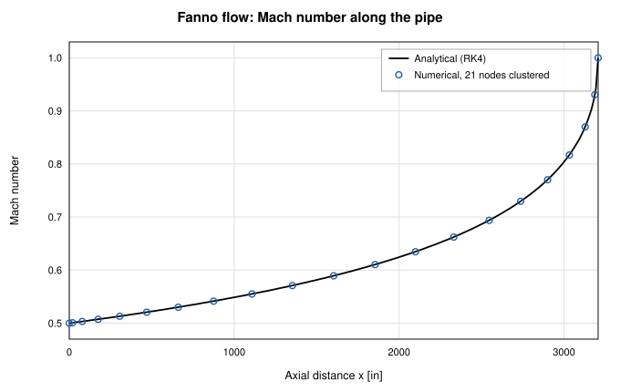
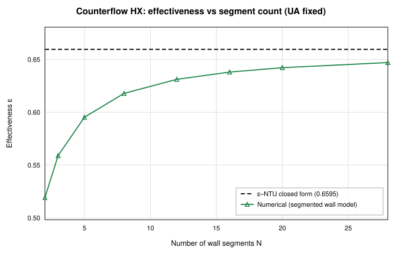
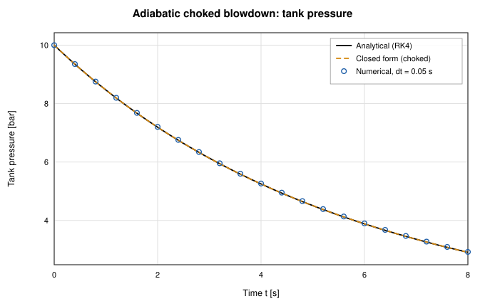

# Verification and validation

OpenFLUME is Alpha software. It was written by one engineer with heavy AI
assistance (see "How This Was Built" in the
[README](../../README.md#how-this-was-built)), so it has to be checked, not
trusted. This page is the index to that evidence: what kind of evidence each
result is, how the reports are produced, how often the checks run, and where
the evidence stops.

The authoritative record is
[§8 of the user's manual](../user-manual.md#_8-verification-and-validation).
Before using a result to support a decision, read
[§1.7 Scope Boundaries](../user-manual.md#_1-7-scope-boundaries) as well.

## Three classes of evidence

The manual (§8.1) separates three kinds of evidence. They mean different
things, and a result should be cited with its class:

| Class | Compared against | What a disagreement means |
| ----- | ---------------- | ------------------------- |
| **Analytic verification** | A closed-form solution, or an independent reference (e.g. RK4 integration of the exact ODE) converged far below the solver's own tolerance | A code defect, or discretization error that should shrink as the grid or time step is refined |
| **Code-to-code benchmarking** | Published output of another established program (NASA GFSSP, SINDA/FLUINT sample decks, COMSOL results in papers) | Supports the implementation, but inherits the other code's assumptions |
| **Validation against experiment** | Measured data, digitized with cited provenance | Could be the model, the closure correlation, the discretization, or the experiment |

Where a correlation has research status or has not been validated, the manual
says so and gives no agreement figure for it
([§8.5](../user-manual.md#_8-5-correlation-status)).

## How the reports are generated

Each of the twelve reports below is written by a script in
[`scripts/`](../../scripts/), which builds the cases, runs the current
solver, computes the reference solutions, and writes the Markdown and SVG
figures. None of the numbers are typed in by hand.

| Report | Generator | CI gate tests named in the report |
| ------ | --------- | --------------------------------- |
| [Compressible flow](compressible-report.md) | `scripts/compressible-validation-report.ts` | `src/core/__tests__/compressibleDuctFlow.test.ts` |
| [Incompressible hydraulics](incompressible-hydraulics-report.md) | `scripts/hydraulics-validation-report.ts` | `solver.test.ts`, `benchmarks.test.ts` |
| [Thermal network](thermal-network-report.md) | `scripts/thermal-validation-report.ts` | `thermal.test.ts`, `solidThermalTransient.test.ts`, `src/validation/__tests__/schumann.test.ts`, `src/validation/__tests__/schumannConjugate.test.ts` |
| [Fluid transient](fluid-transient-report.md) | `scripts/fluid-transient-validation-report.ts` | `fluidTransient.test.ts` |
| [Tank transient](tank-transient-report.md) | `scripts/tank-transient-validation-report.ts` | `transient.test.ts`, `benchmarks.test.ts` |
| [Combustion](combustion-report.md) | `scripts/combustion-validation-report.ts` | `reactingJunction.test.ts` and the examples suite |
| [Microfluidics](microfluidics-report.md) | `scripts/microfluidics-validation-report.ts` | `src/validation/__tests__/microfluidics.test.ts`, plus `rectChannel`, `capillaryChannel` and `flowScaledTolerance` tests |
| [Cryogenic chilldown](chilldown-report.md) | `scripts/chilldown-validation-report.ts` | `src/ui/tests/chilldownBaseline.test.ts` (slow tier), `nbsTraceCorpus.test.ts`, `traceBaseline.test.ts` |
| [Choked flow and cavitation](choked-flow-report.md) | `scripts/choked-flow-validation-report.ts` | `src/validation/__tests__/chokedFlow.test.ts`, `cavitationHord.test.ts`, `experimentalData.test.ts` |
| [Tank self-pressurization](tank-self-pressurization-report.md) | `scripts/tank-pressurization-validation-report.ts` | `src/validation/__tests__/tankSelfPressurization.test.ts` |
| [Shuttle Modular Radiator System](mrs-report.md): LTV T169-28, NASA CR-140269 | 2 measured test points (TP1A and TP54, 16 panel outlets), a high-level system test of the thermal network | Measured panel outlet temperatures; the 1973 model's tabulated predictions; an independent first-principles hand calculation | Panel outlet error against the test, N = 8 segments per tube, over 16 outlets: RMS 5.21 F, max 7.71 F, bias +4.97 F (1973 model RMS 3.77 F, hand calculation 3.47 F). Agreement with the hand calculation 2.61 F RMS at N = 8, with a first-order discretization error removed by extrapolation. A 5 % change of the absorbed flux moves the TP1A outlets by about 5 F, the size of the offset to the test. Thermal network only, flows imposed, no hydraulic claim |
| [Code-to-code benchmarks](benchmarks-report.md) | `scripts/benchmarks-report.ts` | `src/ui/tests/gfssp-benchmarks.test.ts`, `leeMartin.test.ts`, `lh2StorageTank.test.ts`, `nureth.test.ts` |

To regenerate a report from a clone:

```bash
npx tsx scripts/compressible-validation-report.ts
```

The scripts are run by hand. CI does not rewrite the reports. A report
therefore shows the solver as it was when the report was last regenerated,
while the gate tests named in its header recheck the same physics in CI (the
slow suites on pushes to `main` and weekly).

## CI cadence

From [`.github/workflows/ci.yml`](../../.github/workflows/ci.yml):

- **Every pull request and every push to `main`:** lint, format check, the
  fast test tier (`npm test`), and a production build. A
  `scientific-validation` job runs every Vitest file (`npm run test:all`) and
  the fluid-catalogue drift check.
- **Push to `main`, weekly schedule (Mondays 03:17 UTC), and manual dispatch:**
  the same `scientific-validation` job runs with `RUN_SLOW=1`, which turns on
  the expensive opt-in sweeps and convergence studies. On pull requests these
  slow blocks are skipped.
- **Python package:** the wheel is built and the installed wheel is tested on
  Linux, macOS, and Windows.
- **End-to-end:** the Playwright suite runs in four shards against the
  production build.

The test tiers are described in
[§8.6](../user-manual.md#_8-6-test-tiers) and
[`testing-slow.md`](../testing-slow.md).

## The twelve reports

The headline figures below are copied from each report's abstract or summary
table. Each report gives the definitions, normalizations, and excluded
stations behind its figures. Read those before quoting a number.

| Report | Cases | Reference | Headline agreement |
| ------ | ----- | --------- | ------------------ |
| [Compressible flow](compressible-report.md): recreation of the NASA GFSSP TFAWS-2007 study | 5 cases (Fanno, Rayleigh, combined, two nozzles), 7 grid configurations | RK4 of the generalized 1-D ODE, cross-checked with Fanno/Rayleigh closed forms | With `central` momentum faces: mass flow within 0.18 %, worst profile error 2.5 % (Rayleigh ΔP/P and ΔM/M). With the default `upwind` faces: mass flow 0.36–3.48 %, max ΔM/M 4.0 %. The original study reports agreement within 5 % for its Rayleigh case |
| [Incompressible hydraulics](incompressible-hydraulics-report.md) | 6 cases, 51 compared quantities | Closed forms (Hagen–Poiseuille, Darcy–Weisbach, hydrostatics) and independently converged references (Hardy-Cross network, pump operating point) | All 51 within 9.98e-10 % (a relative error of 1e-11), below the relative Newton tolerance of 10⁻⁹. The friction closure and the reference are the same expression, so this verifies the network solve, not the friction law |
| [Thermal network](thermal-network-report.md) | 6 cases | Series resistance, radiation–convection balance, lumped capacitance, heated-pipe exponential, ε–NTU, Anzelius–Schumann transient chilldown | Composite wall 6.9e-14 %. Lumped cooldown within 0.18 % of span at dt = τ/100 (error ratio 4.01 for a 4× step refinement). 20-segment heat exchanger: effectiveness within 2.62 %, outlets within 1.730 K. The error shrinks as segmentation is refined. Anzelius–Schumann chilldown of a tube (wall temperature at three stations, N × Δt study): 3.0e-3 and 1.0e-2 of the initial wall–inlet difference at N = 40, Δt = 0.03125 s for b = 0.94 and 4 1/m, with first-order convergence (observed order 0.94 to 0.99) |
| [Fluid transient](fluid-transient-report.md) | 4 cases | Exact tanh/hyperbolic rigid-column laws, RK4 gas-spring oscillator, polytropic law | Startup/decay within 0.05 % RMS at the refined step. Oscillator period within 0.2 % (linearized) and 0.1 % (RK4). Method-of-characteristics water hammer is explicitly out of scope |
| [Tank transient](tank-transient-report.md) | 5 cases (including a 4-level dt study) | RK4 of the lumped ODEs, choked blowdown closed form, equalization equilibrium, fill-heating limit | Every pressure and temperature trace within 1.5 % at dt = 0.05 s; the scheduled-valve flow trace within 5.6 % of its peak. Mass conserved to 0.001 % or better. First-order convergence in dt confirmed |
| [Combustion](combustion-report.md): CEA reacting junction and LOX/RP-1 thruster | 5 groups of checks | CEA identities, choked-flow/orifice closed forms, RK4 quasi-1-D nozzle ODE, exact wall-resistance network | Local nozzle profile error 3.16 % (subsonic) and 4.87 % (supersonic). Mass flow biased 3.01 % by the sonic cell. Wall temperatures 3.4e-13 K. Startup ramp vs. quasi-static reference 7.8e-5 % |
| [Microfluidics](microfluidics-report.md) | 5 closed-form cases (Part A) + 6 published networks (Part B) | Shah & London, Washburn, Jurin; papers' COMSOL values, design values and measurements | Duct friction constant 0.002 %. Serial diluter inlet pressure 85.1 Pa vs. 85.2 Pa (COMSOL). Capillaric valve pressures within 1.3 %. Siphon flow 2.87 µL/s at nominal diameter vs. 3.63 ± 0.07 µL/s measured. The measurement lies inside the ±27 % flow band set by the stated diameter uncertainty |
| [Cryogenic chilldown](chilldown-report.md): NBS Report 9264 | All 18 Table-6 cases (LN₂ and LH₂, saturated and subcooled; 14 trusted, 4 diagnostic by record QC), four-case refinement N = 3–30 and time-step study, 7 trusted trace runs | Measured chilldown times and digitized wall traces; GFSSP's published predictions | Mean absolute error over the 18 rows 19.3 % (N = 3; signed mean +6.3 %, 6 late) against 7.6 % for GFSSP (+7.3 %, 16 late); correlation of errors −0.07. Without the 3 flagged (unconverged) rows 19.7 %, and without the subcooled LN₂ rows as well 10.1 % over 11 rows (GFSSP 8.7 %). Subset at N = 30 (GFSSP's resolution): 13.5 % over the 3 cases that reach the knee against 4.6 %; saturated LN₂ +8.1 % (GFSSP +7.7 %). Subcooled LN₂ (+29 % to +57 % at N = 3) depends on the outlet pressure and on GFSSP's unpublished exit restriction (not quoted). Trace RMSE 23–72 K (N = 6); the modeled front is 3–4 times broader than measured |
| [Choked flow and cavitation](choked-flow-report.md): NASA TP-1484, TM X-71760, CR-2054 | 326 nozzle and 26 orifice points (N₂, CH₄), 32 LH₂ venturi cavities | Measured maximum mass flux; measured cavity pressures; HEM as a reference model | Subcooled-liquid nozzle inlets: median +4.5 % (−3.4 % to +17.1 %). Gas: −5.6 % to +4.7 %. Near-saturated liquid under-predicted (down to 0.15×); supercritical over-predicted (median +30 %) by the frozen-κ expansibility closure. Sharp-edged orifice at measured back pressure, C_d = 0.61: −6.1 % to +1.3 % (subcooled). Venturi leading-edge cavity pressure 6–55 % below P_v(T₀) |
| [Tank self-pressurization](tank-self-pressurization-report.md): NASA TM-103804 | 3 heat fluxes, 4.89 m³ LH₂ tank | Measured rise rates; the paper's homogeneous model; analytic homogeneous reference | Lumped tank equals the analytic homogeneous rate to 0.15 % and the paper's model to −3.9 % to +5.6 %. Measured rise 1.07, 2.47 and 3.05 times faster (stratification, not represented) |
| [Code-to-code benchmarks](benchmarks-report.md): GFSSP and SINDA/FLUINT problems | 6 benchmarks (manual §8.3) | GFSSP output, SINDA/FLUINT output, analytic (fin solution, ε-NTU), independent RK4 | Achieved errors against each reference, with the gate alongside; see the table below |

Most of these reports are analytic verification. The compressible report
recreates a code-to-code study case for case, but its references are
analytic. The chilldown, choked-flow, tank self-pressurization, and
Shuttle radiator reports are validation against experiment; each reports its
disagreements as findings. The Shuttle radiator report is a deliberately small
system-level check of two measured traces and not a campaign. The benchmarks report states the reference type of every row: two
of its benchmarks are gated wholly or partly against analytic references,
and the SINDA/FLUINT sample problem is reproduced only through a logic-rule
emulation. Part B of the microfluidics report mixes classes: COMSOL values are
code-to-code, while the siphon, dilution-ratio, and bead-trap outcomes are
compared with measurements.



_Fanno flow, Mach number along the duct, from the
[compressible-flow report](compressible-report.md)._



_Counterflow heat-exchanger segmentation study, from the
[thermal-network report](thermal-network-report.md). The ε–NTU discrepancy
shrinks as the wall is refined._



_Choked adiabatic blowdown, tank pressure, from the
[tank-transient report](tank-transient-report.md)._

## Code-to-code benchmarks

The manual's §8.3 lists six benchmarks, each gated by a test. The
[benchmarks report](benchmarks-report.md) gives the achieved values; the
gates are pass bands, not agreement:

| Benchmark | Reference type | Achieved (gate) |
| --------- | -------------- | --------------- |
| GFSSP Example 13, conduction rod with convection | Analytic fin solution (analytic verification) | Solid temperatures within 2.59 K (3.0 K); end heat flows −4.4 % and −5.6 % (7 %); energy balance 0.31 % (0.5 %) |
| N₂–N₂ counterflow heat exchanger (JANNAF 2024, Majumdar & LeClair) | Duty: ε-NTU (analytic); outlets: GFSSP output | Duty −0.84 % (5 %); outlets −0.38 K and +0.33 K (2.5 K) |
| GFSSP Example 5, water-water heat exchanger | GFSSP output | Hot outlet +0.44 K of 295.67 K (1.0 K); cold outlet +0.19 K of 290.94 K (0.5 K); duty −2.8 % (3 %) |
| Lee & Martin entrapped air (GFSSP Figure 10) | GFSSP output; independent RK4 rigid column | First peak −11 % of ≈1.90 MPa (15 %); against RK4 at refined step −6.1 % peak, +0.1 % time, 0.0 % period (8 %) |
| SINDA/FLUINT Sample Problem F, LH₂ no-vent fill | SINDA/FLUINT output; emulated with logic rules | At 15 min: fill −0.8 %, pressure −0.3 %, vapor temperature +0.8 %, liquid temperature +2.1 %, vent flow −1.9 % (±5 %; ±0.5 % pressure) |
| NURETH-16 gas-cooled reactor loop | Published trends only; geometry is representative | Qualitative |

See [OpenFLUME vs. GFSSP](../compare/gfssp.md) and
[OpenFLUME vs. SINDA/FLUINT](../compare/sinda-fluint.md) for what these
benchmarks do and do not show.

## Experimental corpora and trust levels

From [§8.4](../user-manual.md#_8-4-validation-against-experiment):

- **NBS Report 9264 cryogenic chilldown** (Brennan et al., 1966). Table 6 of
  the GFSSP Version 6 paper (AIAA 2015-3850) tabulates eighteen chilldown
  times from the report for saturated and subcooled LH₂ and LN₂. Eleven digitized oscillograph figures provide forty-four station traces
  (10 195 samples), rebuilt from source CSVs by `npm run gen:trace-corpus`.
  - **Trust levels come from the experimental record alone**, not from the
    model's error. Four subcooled hydrogen runs (Figs. 3, 4, 6, 7) are
    **diagnostic only**: their cold tails overlap so that they cannot be
    assigned to stations, or the valve opened before the chart's zero time.
    The other seven runs (twenty-eight traces, saturated and subcooled) are
    **trusted**; per-trace QC flags restrict which features may be compared.
    Every Table-6 row is solved and reported (fourteen trusted, four
    diagnostic only).
  - **One knee definition and a measured start.** Model and digitized
    trace share the threshold T_sat(P_local) + 15 K, and each solve starts from
    the run's measured initial wall temperature (271–307 K). The line follows
    GFSSP's layout (30 segments, 31 fluid nodes at N = 30).
  - **Subcooled LN₂ depends on an unpublished input.** Its knee waits on the
    outlet node turning liquid, which depends on the outlet pressure and on
    GFSSP's exit restriction (coefficient not published); at the documented
    12.05 psia the outlet node stays two-phase and the 61.74 psia knee moves
    from +49 % to +102 % (N = 3). Three subcooled solves at N = 3 accepted
    unconverged steps and are flagged and excluded from the statistics.
  - **CI baseline:** computed chilldown time at the instrumented station must
    stay within a factor of 1.6 of experiment, with mean absolute error under
    25 % across the four-case slow suite. Two-phase chilldown energy and
    enthalpy balances close within 10 % and 12 %.
  - Single-phase chilldown surrogates match the plateau-then-plunge shape only.
    They are not comparable on absolute times and are asserted as trends.

A factor-of-1.6 band is a regression guard, not a precision claim. Cryogenic
chilldown is the least mature area of the code.

Three further experimental comparisons have their own reports (above):
critical flow of nitrogen and methane through nozzles and a sharp-edged
orifice (NASA TP-1484, TM X-71760), Hord's liquid-hydrogen venturi
cavitation (NASA CR-2054), and the self-pressurization of a liquid-hydrogen
tank (NASA TM-103804). Their datasets are transcribed into
`src/validation/generated/experimentalData.ts` by
`npm run gen:experimental-data`, with a source hash checked in CI.

The repository carries further digitized datasets under
[`validation/data/digitized/`](../../validation/data/digitized/) that no
report uses yet: Hord's hydrofoil and ogive cavitation series, the other
NASA tank tests (no-vent fill, pressurant injection, vent systems), further
chilldown studies, and two-phase boiling pressure-drop data. The choked-flow
and tank reports state why the ones in their directories were left out.
Treat them as available reference data, not as validation claims.

## Correlation status

Closure correlations are where network codes most often go wrong.
[§8.5](../user-manual.md#_8-5-correlation-status) records the status of each
one. Swamee–Jain and Dittus–Boelter are standard. Miropolskii film boiling is
used as GFSSP uses it for chilldown. Darr–Hartwig is verified structurally
against its published equations, inside an LH₂ / vertical-upflow / 1 g
envelope. TT-WF is **research status, not validated**. A custom expression is
the user's responsibility.

## Result provenance

Every run hashes the configuration that produced it. If the model is edited
after a run, that result is marked **stale**. Exports and sweep CSVs carry
the model name, a solver-settings summary, and the config hash
([§8.7](../user-manual.md#_8-7-result-provenance)).

## Reporting a disagreement

If OpenFLUME disagrees with a reference you trust,
[open an issue](https://github.com/OpenFLUME/OpenFLUME/issues/new/choose).
The project treats a well-documented disagreement as one of the most useful
contributions it can receive. The bug-report template asks for:

- the reference value and its source (analytical, published benchmark, or
  experiment);
- the tolerance you consider acceptable;
- units and assumptions;
- the model, as an attached `.fn` file or a pasted JSON config.

New validation cases are welcome too. See
[CONTRIBUTING.md](../../CONTRIBUTING.md). Numerical claims must state their
reference, tolerance, and units. Do not relax tolerances without physical or
numerical justification. Do not submit export-controlled material.
