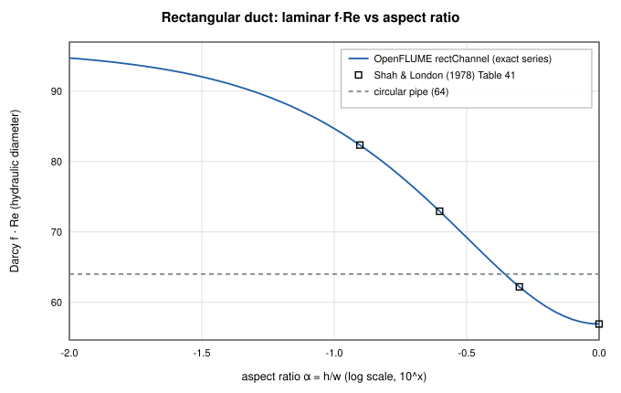
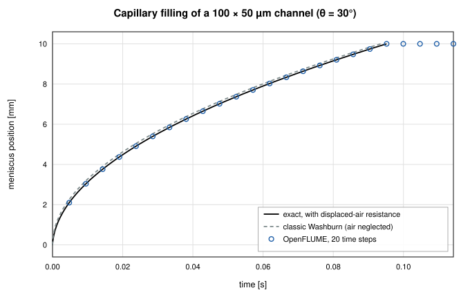
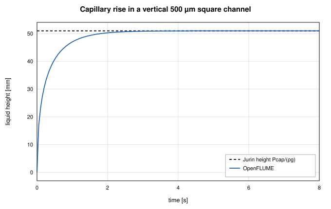
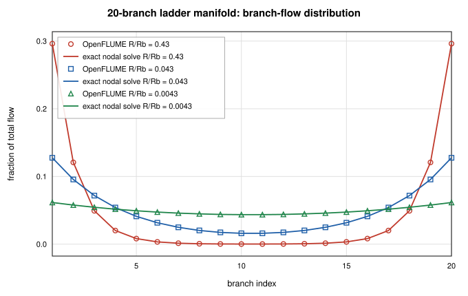
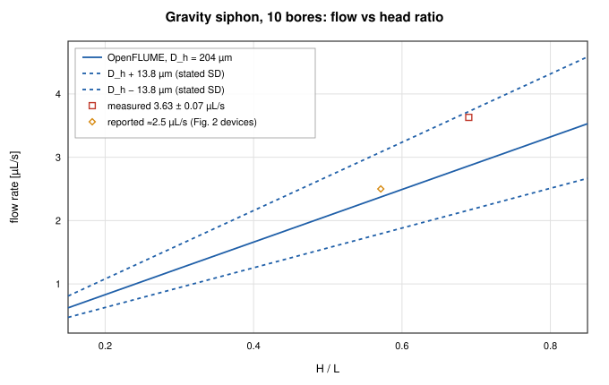
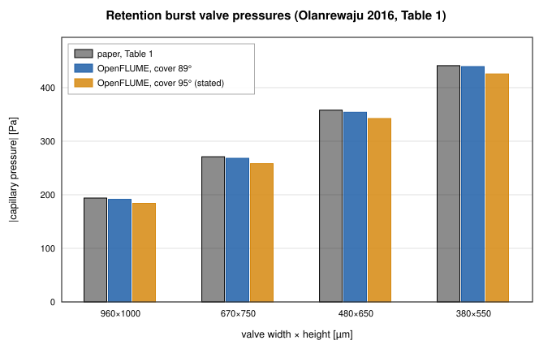
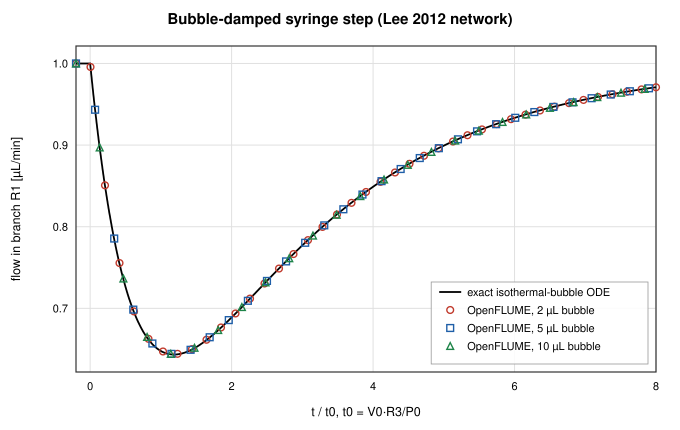

# Microfluidic Network Validation of OpenFLUME

**A validation report for OpenFLUME's microfluidic capability: the rectangular-channel laminar law, capillary-driven filling with displaced-gas resistance, capillary pumps and valves, and published microfluidic networks rebuilt from their papers — a serial-dilution cell, a hydrodynamic bead trap, a parallel manifold, a gravity siphon, a capillaric circuit's valve design and a bubble-damped syringe network.**

Generated by `scripts/microfluidics-validation-report.ts` — all numbers and
figures come from live solves of the current solver. The published cases are
defined once in `src/validation/microfluidics.ts` and gated in CI by
`src/validation/__tests__/microfluidics.test.ts`; the closed-form cases
mirror `src/core/__tests__/rectChannel.test.ts`,
`capillaryChannel.test.ts` and `flowScaledTolerance.test.ts`.

## Abstract

Microfluidic networks run at flows of nanolitres to microlitres per minute
through rectangular channels tens of micrometres deep, and are often driven by
capillarity rather than pumps. This report checks OpenFLUME in that regime in
two parts. Part A compares the `rectChannel` and `capillaryChannel`
components with exact solutions: the rectangular-duct friction constant
matches Shah & London to 0.002 %, capillary filling follows the
Washburn law with air resistance to 1.49e-8 of the fill
time at any step size, the Jurin rise is reached to 8.17e-16,
and syringe-driven and resistance-coupled filling are exact to
1.08e-13. Part B rebuilds six published microfluidic
networks from the parameters printed in their open-access papers. OpenFLUME
reproduces the authors' COMSOL inlet pressure (85.1 vs 85.2 Pa)
and design dilution ratio of a serial diluter, both trap flow ratios and the
trapping outcome of a bead-trap array, the flow distribution of a 20-branch
manifold, the measured flow of a gravity siphon within its stated diameter
uncertainty, the tabulated capillary pressures of a capillaric circuit's
valves to 1.3 %, and the exact dynamics of a bubble-damped
syringe network to 9.47e-4 — including the paper's
finding that responses for different bubble sizes collapse when time is
scaled by V·R/P. That last case exposed, and now pins, a solver defect: the
absolute Newton tolerance judged mass imbalances in kg/s, so microfluidic
compliance transients stopped iterating and froze. The stopping test now
weights mass-flow rows by the network's flow scale.

## 1. Model Summary

**Rectangular channel** (`rectChannel`, user manual §4.3.18). Fully
developed laminar resistance from the exact Fourier-series solution,
R = 12μL / (a³bF), F = 1 − (192a/π⁵b) Σₙ odd tanh(nπb/2a)/n⁵, with a smooth
blend to Swamee–Jain on D_h above Re 2300.

**Capillary channel** (`capillaryChannel`, §4.3.19). A rectangular channel
holding liquid over length s and gas over the rest:
P_from − P_to = R_liq(s)·Q + R_gas(L−s)·Q − σ·P_cap + ρgΔz·s/L, with the
Young–Laplace pressure P_cap = γ[(cos θ_top + cos θ_bottom)/h + 2cos θ_sides/w].
Fronts are integrated against a Thevenin equivalent of the surrounding
network; stop valves use the Cho et al. (2007) burst pressure; node wetting
drives trigger valves and air-trap detection.

**Flow-scaled Newton tolerance.** The Newton residual mixes mass rows [kg/s]
with momentum rows [Pa]. With an absolute bar `tol`, a microfluidic mass
imbalance (~10⁻¹³ kg/s) always passes, so a storage-driven step was accepted
at its warm start. Below 10⁻³ kg/s the mass-flow rows (nodal balances and
imposed-flow branches) are now weighted by 10⁻³ kg/s ÷ F, F the largest
warm-start flow (weight ≤ 10⁹), in both the stopping test and the
line-search merit. At or above 10⁻³ kg/s the weight is 1 and the solver is
bit-identical to before; of the 14 shipped examples only *Entrapped-air line*
changes, by 10⁻⁷ relative, during its at-rest phase.

## Part A — Closed-Form Verification

### A1. Rectangular-duct laminar law

| Aspect ratio α | Shah & London f·Re | OpenFLUME f·Re | error |
| -------------- | ------------------ | -------------- | ----- |
| 1 | 56.908 | 56.908 | 0.001 % |
| 0.5 | 62.192 | 62.192 | 0.000 % |
| 0.25 | 72.932 | 72.931 | 0.001 % |
| 0.125 | 82.34 | 82.339 | 0.002 % |

The parallel-plate limit is 96. A circular pipe sized to the hydraulic
diameter of a 100 × 50 µm channel would predict
32 % less flow than the
rectangle carries — the reason the dedicated component exists.

*Figure 1. Laminar f·Re of a rectangular duct against Shah & London's tabulated values.*

### A2. Washburn filling with displaced-air resistance

A 100 × 50 µm channel, 10 mm long, θ = 30°,
γ = 0.072 N/m, fills from a reservoir to a vent at equal pressure. With air
viscosity included, the exact front law is
r_l s²/2 + r_g(Ls − s²/2) = P_cap·t / A (r per unit length), filling in
0.0952 s.

| Time steps per fill | max \|t − t_exact(s)\| / t_fill | arrival-event time [s] |
| ------------------- | ------------------------------- | ---------------------- |
| 5 | 1.49e-8 | 0.0952 |
| 50 | 1.49e-8 | 0.0952 |
| 500 | 1.31e-8 | 0.0952 |

The meniscus ODE is integrated across each step against the network's
Thevenin equivalent, so the stiff early phase (velocity ∝ 1/s) costs nothing
in accuracy even at 5 steps per fill.

*Figure 2. Front position against the exact law with displaced-air resistance and the classic (air-free) Washburn law; markers are a 20-step OpenFLUME run.*

### A3. Jurin rise

A vertical 500 µm square channel, 100 mm tall, θ = 30°.
Equilibrium height P_cap/(ρg) = 50.969 mm; OpenFLUME
settles at 50.969 mm (error 8.17e-16),
monotonically and without overshoot: yes.

*Figure 3. Capillary rise approaching the Jurin height.*

### A4. Flow-driven and resistance-coupled filling

* **Syringe pump**, 1 µL/min into a hydrophobic (θ = 100°) channel: the fill
  follows s = Qt/A to 2.40e-14 of the channel volume, including the
  pinned entrance that the pump forces open.
* **Reservoir behind a resistive feed**, ΔP = 500 Pa through a
  50 × 20 µm, 20 mm feed channel: exact law
  (R_u + r_g L)s + (r_l − r_g)s²/2 = (ΔP + P_cap)t/A, matched to
  1.08e-13 of the fill time with 25 steps.

### A5. Sequential capillary circuit

The shipped example *Capillary circuit (stop + trigger valve)* produces the
designed event sequence (pinning at the inlet in the first step is gas
back-pressure from the faster branch):

| t [s] | event | channel | node |
| ----- | ----- | ------- | ---- |
| 0.0000 | pinned | A | inlet |
| 0.0262 | nodeWetted | B1 | bend |
| 0.0542 | pinned | A | J |
| 0.0984 | nodeWetted | B2 | J |
| 0.0984 | triggered | A | J |
| 0.1441 | nodeWetted | out | pumpIn |

## Part B — Published Microfluidic Networks

Every parameter below is printed in the cited open-access paper; the
location is given in `src/validation/microfluidics.ts`. Each paper's own
result type is respected: a measurement with its error bar, the authors'
model value, or a statement in the text.

### B1. Pressure- and flow-balanced serial-dilution cell (Vasilakis et al. 2019)

Five rectangular channels, 64 µm deep, from Table 1 ("COMSOL optimisation"),
two syringe inlets at 0.4 µL/min, outlets at 0 Pa.

| Quantity | OpenFLUME | Published |
| -------- | --------- | --------- |
| Inlet A pressure | 85.1 Pa | 85.2 Pa (COMSOL) |
| Inlet B pressure | 85.0 Pa | 85.2 Pa (COMSOL) |
| Dilution ratio DR | 0.670 | 0.67 design; measured 0.65 ± 0.02 (0.2 µL/min), 0.70 ± 0.01 (0.4 µL/min) |

The model reproduces the design, as the authors' own optimisation did. The
measurements were judged against the glucose meter's ±10 % accuracy, within
which both agree; by its own standard deviation the 0.4 µL/min measurement
sits about 3 σ above the design value.

### B2. Hydrodynamic bead trap (Tan & Takeuchi 2007)

A trap constriction (path 1) in parallel with a loop (path 2); beads are
trapped only if Q₁/Q₂ > 1. Dimensions from Table 1.

| Device | W₁/L₁/W₂/L₂/H [µm] | Q₁/Q₂ OpenFLUME | Q₁/Q₂ paper | Trapping predicted | Experiment |
| ------ | ------------------ | --------------- | ----------- | ------------------ | ---------- |
| A | 6/5.5/25/163/28 | 0.755 | 0.76 | no | no bead trapped |
| B | 7.5/4.5/20/172.5/18 | 3.949 | 3.95 | yes | every bead trapped |

Like the paper's model, the constriction is taken as a fully developed duct
of its own short length (L₁ < W₁), so entrance losses are ignored; the
trapping outcome is nevertheless predicted correctly for both devices.

### B3. Parallel manifold flow distribution (Guermonprez et al. 2015)

A 20-branch ladder with inlet and outlet at opposite corners; only the
resistance ratio R/R_b of a manifold segment to a branch matters.

| R/R_b | first two + last two branches | spread (max − min)/Q | Paper (§IV A) |
| ----- | ----------------------------- | -------------------- | ------------- |
| 0.43 | 83.4 % | 29.60 % | ≈ 85 % |
| 0.043 | 44.6 % | 11.16 % | ≈ 46 % |
| 0.0043 | 23.8 % | 1.79 % | spread ≤ 2 % |

Every branch flow also matches an independent dense nodal solve to
2.16e-15.
The paper quotes its percentages to two figures and does not state how the
manifold's end segments are counted, which this comparison cannot resolve;
the remaining 1–2 point difference is within that.

*Figure 4. Branch-flow fractions of the 20-branch ladder for three resistance ratios.*

### B4. Gravity-driven microcapillary siphon (Reis et al. 2021)

Ten parallel bores of mean hydraulic diameter 204 ± 13.8 µm under a
hydrostatic head H over length L (water, μ = 1.002 mPa·s, ρ = 998.2 kg/m³).

| Quantity | OpenFLUME | Published |
| -------- | --------- | --------- |
| Q at H/L = 0.69, D_h = 204 µm | 2.87 µL/s | 3.63 ± 0.07 µL/s measured |
| Q at H/L = 0.69, D_h = 204 ∓ 13.8 µm | 2.17 – 3.72 µL/s | (measurement inside band) |
| Q for H = 40 mm, L = 70 mm | 2.37 µL/s | ≈ 2.5 µL/s |

The solver equals Hagen–Poiseuille to 2.51e-13. Flow scales
with D⁴, so the stated ±6.8 % diameter spread is a ±27 % flow band; a mean
diameter of 216 µm (within the SD) reproduces the measurement.

*Figure 5. Siphon flow against head ratio with the diameter-uncertainty band and the two reported measurements.*

### B5. Capillaric-circuit valve and pump pressures (Olanrewaju et al. 2016)

Retention burst valves in PDMS with a hydrophobic cover; per-wall
Young–Laplace with the receding angles printed in the paper (walls 31°,
γ = 72 mN/m).

| Valve w × h [µm] | Table 1 [Pa] | OpenFLUME, cover 89° | error | OpenFLUME, cover 95° | error |
| ---------------- | ------------ | -------------------- | ----- | -------------------- | ----- |
| 960 × 1000 | -194 | -192 | 1.3 % | -184 | 5.1 % |
| 670 × 750 | -271 | -268 | 1.0 % | -258 | 4.7 % |
| 480 × 650 | -358 | -354 | 1.1 % | -342 | 4.3 % |
| 380 × 550 | -441 | -439 | 0.4 % | -426 | 3.5 % |
| pump 200 × 100 (advancing 114°/45°) | −736 | -725 | 1.4 % | — | — |

The paper's RBV section states a 95° receding angle for the cover, but its
Table 1 is reproduced by the 89° given in its Conclusions; 95° under-predicts
every valve by 3–6 %. The full circuit's drainage sequence is not modelled:
it needs receding-meniscus draining of reservoirs, which OpenFLUME does not
yet represent, and the paper omits connector lengths.

*Figure 6. Retention burst valve pressures: paper Table 1 against OpenFLUME with both stated cover angles.*

### B6. Bubble-damped syringe network (Lee et al. 2012)

Two syringe pumps, each holding an air bubble of V₀ = 2, 5 or 10 µL at 1 atm,
feed resistances R₁ = 0.14 and R₂ = 0.20 psi·min/µL into a junction draining
through R₃ = 0.25 psi·min/µL; Q_s1 = 1 µL/min while Q_s2 steps from 1 to
2.5 µL/min. Bubbles are isothermal (P·V = P₀V₀), as in the paper. The
reference is the network's exact ODE, integrated independently.

| Bubble | tolerance | max error vs exact ODE |
| ------ | --------- | ---------------------- |
| 2 µL | 10⁻⁹ | 9.47e-4 |
| 5 µL | 10⁻⁹ | 9.47e-4 |
| 10 µL | 10⁻⁹ | 9.47e-4 |
| 5 µL | 10⁻⁶ (UI default) | 9.68e-4 |

The remaining error is backward-Euler time integration: at 100 / 200 / 800
steps per t₀ it is 1.93e-3 / 9.68e-4 / 2.43e-4 — first order. The paper
reports that responses for all bubble sizes collapse when time is scaled by
t₀ ∼ V₀R₃/P₀; in OpenFLUME the 2 µL and 10 µL responses coincide in t/t₀ to
1.71e-12.

Measured on the previous solver (absolute tolerance), the same 5 µL case
reached a maximum error of 1.2 % at tol = 10⁻⁹ — the flow froze at
0.959 µL/min while the exact solution continues to 0.971 µL/min, once the
remaining mass imbalance fell below 10⁻⁹ kg/s — and 37 % at the UI default
10⁻⁶, where the syringe step never propagated to branch R1 at all.
`flowScaledTolerance.test.ts` fails on the previous solver.

*Figure 7. Flow from syringe 1 (branch R₁) after the syringe step, in scaled time: three bubble volumes on one exact curve.*

## Conclusions

OpenFLUME's microfluidic closures reproduce their exact solutions to solver
precision, and its network solver reproduces six published microfluidic
designs from their printed parameters — matching the authors' COMSOL and
design values, their trapping and distribution outcomes, and their
measurements within the uncertainties they state. Two limits are visible in
the published cases and documented: receding-meniscus draining (needed for
the full retention-burst-valve drainage sequence of capillaric circuits) and
entrance effects of constrictions shorter than they are wide. The cases also
exposed one solver defect in the micro-flow regime — absolute mass-row
tolerance — which is fixed and regression-tested.

## References

1. Shah, R. K., London, A. L., *Laminar Flow Forced Convection in Ducts*,
   Academic Press, 1978.
2. Bruus, H., *Theoretical Microfluidics*, Oxford University Press, 2008.
3. Washburn, E. W., "The dynamics of capillary flow," *Physical Review* 17,
   273 (1921).
4. Cho, H., Kim, H.-Y., Kang, J. Y., Kim, T. S., "How the capillary burst
   microvalve works," *J. Colloid Interface Sci.* 306, 379–385 (2007).
5. Vasilakis, N., Papadimitriou, K. I., Morgan, H., Prodromakis, T. (2019). Modular pressure and flow rate-balanced microfluidic serial dilution networks for miniaturised point-of-care diagnostic platforms. Sensors 19(4):911. doi:10.3390/s19040911
6. Tan, W.-H., Takeuchi, S. (2007). A trap-and-release integrated microfluidic system for dynamic microarray applications. PNAS 104(4):1146–1151. doi:10.1073/pnas.0606625104
7. Guermonprez, C., Michelin, S., Baroud, C. N. (2015). Flow distribution in parallel microfluidic networks and its effect on concentration gradient. Biomicrofluidics 9(5):054119. doi:10.1063/1.4932305
8. Reis, N. M. et al. (2021). Gravity-driven microfluidic siphons: fluidic characterization and application to quantitative immunoassays. ACS Sensors 6(12):4338–4348. doi:10.1021/acssensors.1c01524
9. Olanrewaju, A. O., Robillard, A., Dagher, M., Juncker, D. (2016). Autonomous microfluidic capillaric circuits replicated from 3D-printed molds. Lab Chip 16:3804–3814. doi:10.1039/c6lc00764c
10. Lee, J., Rahman, F., Laoui, T., Karnik, R. (2012). Bubble-induced damping in displacement-driven microfluidic flows. Phys. Rev. E 86:026301. doi:10.1103/PhysRevE.86.026301

## Nomenclature

| Symbol | Meaning |
| ------ | ------- |
| A | channel cross-section w·h |
| D_h | hydraulic diameter 2wh/(w+h) |
| f·Re | Darcy friction factor × Reynolds number (laminar constant) |
| h, w, L | channel height, width, length |
| P_cap | capillary (Young–Laplace) pressure |
| Q | volumetric flow |
| R, R_b | hydraulic resistance (manifold segment, branch) |
| r_l, r_g | liquid / gas resistance per unit length |
| s | meniscus position (liquid length) |
| t₀ | bubble time scale V₀R₃/P₀ |
| γ | surface tension |
| θ | contact angle |
| μ, ρ | viscosity, density |
