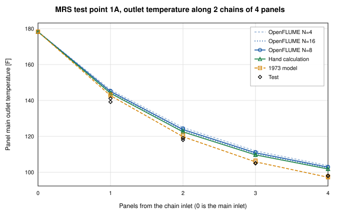
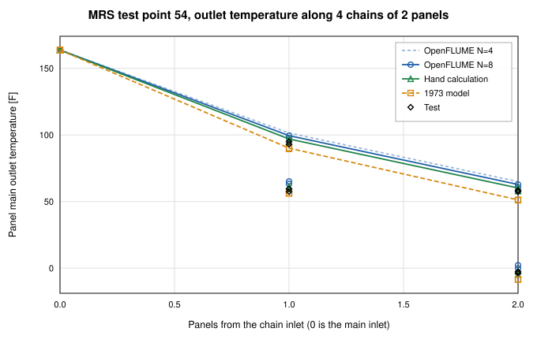

# Shuttle Modular Radiator System Thermal-Vacuum Test, System-Level Validation of OpenFLUME

**A high-level thermal-network check against two measured panel traces of the 1973 Modular Radiator System test**

Generated by `scripts/mrs-validation-report.ts`. All numbers and figures
come from live solves of the current solver. The comparison choices were fixed
before the first run in [`mrs-protocol.md`](mrs-protocol.md). The CI gates are
`src/validation/__tests__/mrsRadiator.test.ts` and
`src/core/__tests__/externalTransport.test.ts`.

## Abstract

This report recreates two measured traces of the Shuttle Modular Radiator
System (MRS) thermal-vacuum test of 1973 with a model built before the run and
never tuned. The traces are the panel outlet temperatures of test points 1A
and 54, each a series chain of panels in which the coolant (Freon-21) cools
from about 178.3 F and 163.7 F toward the cold end. The model is a
resolved network of the extruded tubes, the sheet fins, radiation to a -280 F
sink and imposed leg flows, solved panel by panel with the OpenFLUME steady
solver. Over the 16 panel outlets of the two points the OpenFLUME
error against the test is RMS 5.21, max 7.71, bias +4.97 F at the baseline resolution of 8
segments per tube, against RMS 3.77, max 7.40, bias -1.66 F for the 1973 model and
RMS 3.47, max 4.97, bias +2.69 F for the independent hand calculation. The OpenFLUME
panel temperatures differ from the hand calculation by 2.61 F RMS
(max 4.58 F) at N = 8 and by 0.51 F RMS (max 0.84 F)
after the first-order discretization error is removed by extrapolation from
4 and 8 segments. The model is warmer than the test by +4.97 F on average
(+3.12 F extrapolated) and the hand calculation, which does not use
OpenFLUME, has the same sign (+2.69 F). The offset to the test therefore
comes from the physical inputs fixed in advance and not from the solver.
All panel solves converged. The heat balance of
every panel closes to 3.4e-4 and the mass balance to 4.0e-16.
The case checks the thermal network (conduction, radiation, convection to a
fluid with externally supplied transport properties, series and parallel
bookkeeping of imposed flows). It does not check hydraulics.

## System and test

The MRS test article has eight flat panels of 6 ft by 12 ft. Each panel has
twelve extruded aluminum tubes in a U pattern, one prime tube and eleven main
tubes of length 3, 5, and so on to 23 ft, with an inside diameter of
0.125 in. The tubes are welded to a 0.020 in
aluminum sheet on 6.0 in centres. The panels were tested in a thermal-vacuum
chamber with the plumbing set for each test point and the flows imposed by a
ground cart. The report of the test is Phillips, LTV T169-28 (NASA CR-140269,
NTRS 19740026229), with the test description in NASA CR-140268. The two traces
are the following.

| Point | Configuration | Chains (panel order) | Sides | Inlet [F] | Main flow [lb/hr] | Absorbed flux [Btu/hr-ft2] |
| --- | --- | --- | --- | --- | --- | --- |
| TP1A | alpha | 1-3-4-2, 5-7-8-6 | 1 | 178.3 | 1094 | 133.6 to 136.6 |
| TP54 | gamma | 1-3, 2-4, 5-7, 6-8 | 2 | 163.7 | 1950 | 10.6 to 130.2 |

Both points are in the primary comparison set of the protocol and have the
fewest panels of that set with a series chain of at least two panels. TP1A is a
one-sided hot case with two chains of four panels, so the temperature falls
over four panels. TP54 is a two-sided skewed case with four chains of two
panels and a large temperature drop with a strong flux difference between the
panels of a chain.

## Protocol

The comparison set, exclusions, modeling choices, and metrics were committed with
the data before any OpenFLUME run. The two points above were selected later, on
cost alone, after an earlier campaign had run the model on the primary points. The
choices below are used unchanged.

- Main bank only. The prime tube is not modeled and each panel outlet is the
  main outlet, as in the 1973 model. The mixed main outlet is the flow-weighted
  enthalpy mixture of the chain end temperatures.
- Flows are imposed. Each chain carries the printed total main flow times its
  leg fraction, split equally over the eleven main tubes of every panel.
- Aluminum 6063 with a constant conductivity of 201 W/m-K in the tube wall
  and fins, emissivity 0.9 on every radiating surface, a sink
  of -280 F, and the Table 2 absorbed flux applied uniformly per
  unit panel area. A two-sided panel has a total effective radiating area of
  1.67 times the panel area, as in the 1973 model.
- Laminar Nusselt number 3.66 to Re 2300, Gnielinski from Re 4000, and a
  linear blend between.
- R21 density, specific heat and enthalpy from CoolProp at 1.5 MPa. R21 has no
  viscosity or thermal conductivity in CoolProp. These two come from the
  REFPROP R21 transport model of Huber (2010) evaluated once into a table, with a
  stated uncertainty of 5 percent, and are carried in the convection
  expression (see the data README).
- Comparators are the 1973 model as tabulated on the correlation maps and the
  independent first-principles hand calculation of
  `scripts/reference/mrs_hand_calc.py`, which shares the choices above and does
  not use OpenFLUME.
- Metrics are the panel outlet error calculated minus test, the mixed main
  outlet error and the bank heat error. The bank heat is computed from leg end
  temperatures and the leg flows with the same CoolProp enthalpy function for
  the model, the test and the 1973 model.

## Model

Each panel is one OpenFLUME network. A tube is a chain of N segments. Each
segment has one fluid node, two tube wall nodes and five fin nodes across the half
fin, with conduction along and across the fin and the wall and radiation of
the crown and fins to a sink node. The absorbed flux enters as node heat input.
The eleven tubes discharge into a mixing node. The fluid is R21 declared with
`params.transport = "external"`, which is the opt-in added for this case. It
lets a real fluid that has no built-in viscosity or conductivity be used while
validation rejects any component that would read them. The wall-fluid heat
transfer coefficient is a custom convection expression that carries the R21
transport fits. At N = 8 a panel network has 616 solid temperature
unknowns and 89 fluid nodes. A chain of four panels is four such networks
solved in sequence, so the unknown count is 2464 solid temperatures and
356 fluid nodes for a leg of TP1A and 1232 and 178 for a leg of TP54.
The flow is imposed, nothing flows upstream, and the mixed outlet state of one panel is
exactly the inlet state of the next. A network whose branches are all imposed
flows leaves the node pressures undetermined, so only the first branch of every
tube imposes the flow and the other branches are small resistances that anchor
the pressure to the loop pressure of 1.5 MPa (maximum offset 23.0 Pa).
No parameter was adjusted after seeing a result.

## Results

### Test point 1A

| Chain | Panel | Inlet (OpenFLUME) | Test | 1973 model | Hand calc | OpenFLUME N=8 | 1973 - test | Hand - test | OpenFLUME - test | OpenFLUME - hand |
| --- | --- | --- | --- | --- | --- | --- | --- | --- | --- | --- |
| 1-3-4-2 | 1 | 178.3 | 139.2 | 142.7 | 144.0 | 145.1 | +3.5 | +4.8 | +5.9 | +1.1 |
| 1-3-4-2 | 3 | 145.1 | 118.0 | 119.8 | 122.5 | 123.8 | +1.8 | +4.5 | +5.8 | +1.3 |
| 1-3-4-2 | 4 | 123.8 | 105.0 | 105.8 | 109.7 | 110.9 | +0.8 | +4.7 | +5.9 | +1.2 |
| 1-3-4-2 | 2 | 110.9 | 98.0 | 97.2 | 101.8 | 102.8 | -0.8 | +3.8 | +4.8 | +1.0 |
| 5-7-8-6 | 5 | 178.3 | 141.1 | 143.3 | 144.3 | 145.3 | +2.2 | +3.2 | +4.2 | +1.1 |
| 5-7-8-6 | 7 | 145.3 | 119.0 | 120.8 | 123.1 | 124.4 | +1.8 | +4.1 | +5.4 | +1.3 |
| 5-7-8-6 | 8 | 124.4 | 105.0 | 106.5 | 110.0 | 111.2 | +1.5 | +5.0 | +6.2 | +1.2 |
| 5-7-8-6 | 6 | 111.2 | 98.0 | 97.7 | 102.0 | 103.0 | -0.3 | +4.0 | +5.0 | +1.0 |
| RMS |  |  |  |  |  |  | 1.84 | 4.29 | 5.45 | 1.16 |
| Max abs |  |  |  |  |  |  | 3.50 | 4.97 | 6.19 | 1.33 |
| Bias |  |  |  |  |  |  | +1.31 | +4.26 | +5.41 | +1.16 |

Temperatures in F. The inlet column is the OpenFLUME chain inlet. The test
values are read from the printed correlation maps to the printed precision, which is
0.1 F, and the flow in the test legs differs from the printed total by a few
percent, as the protocol notes.

_TP1A panel outlet temperature along the series chain. Both chains are shown,
the second as markers. The light dashed lines are OpenFLUME at 4 and 16 segments
per tube and give the discretization spread._

### Test point 54

| Chain | Panel | Inlet (OpenFLUME) | Test | 1973 model | Hand calc | OpenFLUME N=8 | 1973 - test | Hand - test | OpenFLUME - test | OpenFLUME - hand |
| --- | --- | --- | --- | --- | --- | --- | --- | --- | --- | --- |
| 1-3 | 1 | 163.7 | 93.0 | 90.1 | 96.9 | 99.4 | -2.9 | +3.9 | +6.4 | +2.5 |
| 1-3 | 3 | 99.4 | 57.4 | 51.3 | 60.1 | 62.8 | -6.1 | +2.7 | +5.4 | +2.7 |
| 2-4 | 2 | 163.7 | 95.0 | 89.5 | 94.8 | 97.4 | -5.5 | -0.2 | +2.4 | +2.6 |
| 2-4 | 4 | 97.4 | 58.4 | 51.0 | 57.8 | 60.6 | -7.4 | -0.6 | +2.2 | +2.8 |
| 5-7 | 5 | 163.7 | 59.5 | 56.1 | 59.4 | 63.3 | -3.4 | -0.1 | +3.8 | +3.9 |
| 5-7 | 7 | 63.3 | -2.6 | -8.5 | -4.8 | -0.2 | -5.9 | -2.2 | +2.4 | +4.6 |
| 6-8 | 6 | 163.7 | 57.4 | 56.3 | 61.3 | 65.1 | -1.1 | +3.9 | +7.7 | +3.8 |
| 6-8 | 8 | 65.1 | -3.7 | -8.4 | -2.3 | 2.2 | -4.7 | +1.5 | +5.9 | +4.5 |
| RMS |  |  |  |  |  |  | 5.00 | 2.39 | 4.95 | 3.51 |
| Max abs |  |  |  |  |  |  | 7.40 | 3.94 | 7.71 | 4.58 |
| Bias |  |  |  |  |  |  | -4.63 | +1.12 | +4.54 | +3.41 |

_TP54 panel outlet temperature along the four chains of two panels._

### Mixed outlet, bank heat, closure and runtime

| Point | Printed test main outlet [F] | 1973 error [F] | Hand error [F] | OpenFLUME error [F] | Mixture of test leg ends [F] | Test bank heat [Btu/hr] | 1973 heat error [%] | Hand heat error [%] | OpenFLUME heat error [%] |
| --- | --- | --- | --- | --- | --- | --- | --- | --- | --- |
| TP1A | 97.0 | +0.4 | +4.9 | +5.9 | 98.0 | 23048.7 | +0.7 | -4.7 | -6.0 |
| TP54 | 27.9 | -6.2 | +0.5 | +4.1 | 28.0 | 67287.5 | +4.2 | -0.3 | -2.8 |

The 1973 and hand calculation columns are scored the same way as OpenFLUME.
The mixed main outlet error is against the temperature printed on the map.
The heat error is against the bank heat recomputed from the measured chain end
temperatures. The printed heat tables of the test are not used because they
disagree with the enthalpy balance through the leg flow inconsistency.

| Point | Panel solves | All converged | Max energy imbalance of a panel | Heat rejected less absorbed [W] | Fluid enthalpy drop [W] | Max mass imbalance | Max pressure offset [Pa] | Solve time [s] |
| --- | --- | --- | --- | --- | --- | --- | --- | --- |
| TP1A | 8 | yes | 3.4e-4 | 6350.0 | 6351.7 | 4.0e-16 | 23.0 | 64.5 |
| TP54 | 8 | yes | 1.4e-4 | 19171.3 | 19173.0 | 2.3e-16 | 18.4 | 78.3 |

Heat rejected less absorbed is the sum of the radiation conductor heat rates
less the absorbed flux over the panels of the point. The fluid enthalpy drop is
the imposed flow times the CoolProp enthalpy change between panel inlet and
outlet. The ratio is the energy closure. The 16 panel solves of the
baseline took 142.8 s of solver time in total on one core.

### Pooled over the 16 panel outlets

| Comparison | RMS [F] | Max abs [F] | Bias [F] |
| --- | --- | --- | --- |
| 1973 model - test | 3.77 | 7.40 | -1.66 |
| Hand calculation - test | 3.47 | 4.97 | +2.69 |
| OpenFLUME N=8 - test | 5.21 | 7.71 | +4.97 |
| OpenFLUME N=8 extrapolated - test | 3.72 | 5.17 | +3.12 |
| OpenFLUME N=8 - hand calculation | 2.61 | 4.58 | +2.28 |

The extrapolated row uses 2 T(8) - T(4) along each chain and is shown only as a
discretization diagnostic. It is not the baseline.

## Discretization check

The cell-outlet scheme for the fluid energy equation is first order in the
number of segments, so the N = 8 baseline is not converged. Each panel
network was also solved at 4 segments for both points and at 16 segments for
TP1A. The extrapolated columns apply 2 T(2N) - T(N) to each chain.

### TP1A

| Panel | Hand calc | N=4 | N=8 | N=16 | Extrapolated 4 and 8 | Extrapolated 8 and 16 | N=8 - hand | N=16 - hand |
| --- | --- | --- | --- | --- | --- | --- | --- | --- |
| 1 | 144.00 | 145.94 | 145.08 | 144.59 | 144.21 | 144.11 | +1.08 | +0.59 |
| 3 | 122.49 | 124.91 | 123.82 | 123.22 | 122.72 | 122.62 | +1.33 | +0.73 |
| 4 | 109.66 | 111.90 | 110.88 | 110.32 | 109.85 | 109.77 | +1.22 | +0.66 |
| 2 | 101.82 | 103.70 | 102.84 | 102.38 | 101.98 | 101.92 | +1.02 | +0.56 |
| 5 | 144.27 | 146.21 | 145.34 | 144.86 | 144.48 | 144.38 | +1.07 | +0.59 |
| 7 | 123.14 | 125.53 | 124.45 | 123.86 | 123.37 | 123.27 | +1.31 | +0.72 |
| 8 | 109.97 | 112.21 | 111.19 | 110.64 | 110.17 | 110.08 | +1.22 | +0.67 |
| 6 | 101.99 | 103.87 | 103.00 | 102.54 | 102.14 | 102.08 | +1.01 | +0.55 |

### TP54

| Panel | Hand calc | N=4 | N=8 | Extrapolated 4 and 8 | N=8 - hand |
| --- | --- | --- | --- | --- | --- |
| 1 | 96.92 | 101.43 | 99.44 | 97.46 | +2.52 |
| 3 | 60.13 | 65.02 | 62.82 | 60.63 | +2.69 |
| 2 | 94.80 | 99.51 | 97.43 | 95.35 | +2.63 |
| 4 | 57.80 | 62.81 | 60.56 | 58.31 | +2.76 |
| 5 | 59.40 | 66.34 | 63.27 | 60.20 | +3.87 |
| 7 | -4.76 | 3.55 | -0.18 | -3.92 | +4.58 |
| 6 | 61.34 | 68.09 | 65.11 | 62.13 | +3.77 |
| 8 | -2.25 | 5.88 | 2.23 | -1.42 | +4.48 |

On TP1A the N = 8 temperatures are 1.16 F on average above the hand
calculation (max 1.33 F) and the N = 16 temperatures are 0.63 F on
average above it (max 0.73 F). The extrapolation from 4 and 8 segments
leaves 0.23 F at most and the extrapolation from 8 and 16 leaves 0.13 F.
On TP54 the N = 8 difference to the hand calculation is +3.41 F on average (max
4.58 F) and the extrapolation from 4 and 8 segments leaves 0.84 F
at most. The N = 8 grid is therefore not discretization converged. TP54 has
steeper axial gradients (a coolant drop of 101 to 164 F over two panels against 75 F over four for TP1A) and
its N = 8 difference is 3.0 times that of TP1A. The difference between OpenFLUME
and the hand calculation shrinks under refinement, as expected for a first
order scheme, and the hand calculation marches explicitly from below and has a
discretization error of its own, which was 0.3 F on one tube at 24 segments.
The N = 16 solves were accepted at a solver tolerance of 3.0e-10 with a worst panel energy imbalance of 8.4e-4, after the tighter default of 1e-10 did not converge, so their solve time is not comparable with the N = 8 time of the closure table. The protocol baseline of 8 segments is kept as the primary result and the
extrapolated values are given as a diagnostic.

## Sensitivity of TP1A

The cheapest point was repeated at 4 segments with one input changed at a time,
using the ranges stated in the protocol. Entries are the change from the 4
segment baseline. The baseline RMS error against the test at N = 4 is 6.41 F.

| Change | Panel 1 [F] | Chain end, mean [F] | Max over 8 outlets [F] | Mixed outlet [F] | Bank heat [%] | RMS error vs test [F] |
| --- | --- | --- | --- | --- | --- | --- |
| viscosity +25 % | +0.16 | +0.17 | 0.20 | +0.17 | -0.22 | 6.59 |
| viscosity -25 % | -0.16 | -0.17 | 0.21 | -0.17 | +0.22 | 6.22 |
| fluid conductivity +15 % | -0.11 | -0.11 | 0.13 | -0.11 | +0.14 | 6.29 |
| fluid conductivity -15 % | +0.13 | +0.14 | 0.17 | +0.14 | -0.18 | 6.56 |
| absorbed flux +5 % | +1.93 | +4.90 | 4.91 | +4.90 | -6.42 | 10.04 |
| absorbed flux -5 % | -1.94 | -4.99 | 5.00 | -4.99 | +6.51 | 3.02 |
| emissivity 0.92 | -1.27 | -2.63 | 2.63 | -2.63 | +3.43 | 4.37 |
| emissivity 0.88 | +1.29 | +2.69 | 2.69 | +2.69 | -3.52 | 8.53 |

Absorbed flux -5 % has the largest effect, 5.00 F at most.
A 5 percent change of the absorbed flux moves the chain end by 4.99 F
and a change of 0.02 in emissivity by 2.69 F. This is the same order as the bias of
+5.0 F against the test over both points, and lowering the flux by 5 percent
reduces the N = 4 RMS error on TP1A from 6.41 F to 3.02 F. Viscosity
(+0.17 F and -0.17 F at the chain end for plus and minus 25
percent) and fluid conductivity (-0.11 F and +0.14 F for
plus and minus 15 percent) act only through the fluid-side coefficient, which is
a small part of the thermal resistance, so the uncertainty of the R21 transport
source is small against the offset to the test. The absorbed flux is derived
by the test laboratory with no stated uncertainty, so an offset of this size cannot be ruled out as input uncertainty. These changes are a sensitivity statement and
not a calibration, and no input of the baseline was changed after seeing a result.

## Limitations

- This is a thermal-network case. Panel pressure drop in the test is dominated by
  unpublished per-tube orifices, so hydraulics and flow split are neither
  modeled nor compared. The flows are imposed.
- Only two of the eleven primary points of the protocol are run, and the low
  load frozen-tube regime is outside the scope. The statistics are over
  16 outlets of two points and say little about the whole test.
- R21 viscosity and conductivity come from a published transport model with a
  stated 5 percent uncertainty and not from a measured table. A cross-check
  with a NASA Tech Brief puts the conductivity 8 percent higher.
- The absorbed flux is derived by the test laboratory and carries an
  uncertainty that the report does not state. The two-sided area factor of 1.67
  comes from analysis only.
- The aluminum conductivity and the emissivity are engineering choices fixed in
  the protocol and not measured values for these panels.
- The 1973 model uses a fin effectiveness of 0.90 and a tube bank of one
  representative tube. OpenFLUME resolves the fin, so the comparison is between
  two modeling approaches. The tabulated 1973 predictions for TP1A and TP54 were
  computed at inlet temperatures and flows that differ slightly from the test.
- The test temperatures are read from printed maps. Data defects found in the
  report (missing flows, a misprinted leg flow, an environment row that repeats
  another) are handled by the decisions recorded in the protocol.
- The prime tube is not modeled, as in the 1973 model.
- Panels are solved one network at a time. The case does not exercise a single
  solve with the whole eight-panel plumbing.

## Conclusions

A resolved, a-priori network of one radiator panel, chained in series, runs in
the OpenFLUME steady solver with an R21 fluid whose transport comes from outside the
fluid library. It agrees with an independent hand calculation of the same physics
to 2.61 F RMS at the baseline resolution of 8 segments and to 0.51 F RMS
after extrapolation, and it closes its energy and mass balances. Against the
measured outlet temperatures of two test points the error is RMS 5.21, max 7.71, bias +4.97 F,
to be compared with RMS 3.77, max 7.40, bias -1.66 F for the 1973 model and RMS 3.47, max 4.97, bias +2.69 F for the
hand calculation. The case verifies the thermal network and the series and
parallel bookkeeping of imposed flows. It is not a validation of hydraulics.
The agreement with the test is limited by physical inputs that were fixed in
advance and not tuned, chiefly the laboratory-derived absorbed flux and the
emissivity.

## References

1. Phillips, M. A., *Shuttle Active Thermal Control System Development
   Testing, Volume III, Modular Radiator System Test Data Correlation with
   Thermal Model*, LTV Aerospace Report T169-28, NASA CR-140269,
   18 December 1973 (NTRS 19740026229).
2. Scheps, Howell, and Voss, *Shuttle Active Thermal Control System
   Development Testing, Volume II, Modular Radiator System Test Description*,
   NASA CR-140268, 23 October 1973 (NTRS 19740026228).
3. Huber, M. L., Laesecke, A., and Perkins, R. A., "Model for the Viscosity
   and Thermal Conductivity of Refrigerants, Including a New Correlation for
   the Viscosity of R134a," *Industrial and Engineering Chemistry Research*,
   Vol. 42, 2003, pp. 3163-3178 (extended corresponding states model used by
   the REFPROP R21 transport block).
4. Gnielinski, V., "Ein neues Berechnungsverfahren fuer die Waermeuebertragung
   im Uebergangsbereich zwischen laminarer und turbulenter Rohrstroemung,"
   *Forschung im Ingenieurwesen*, Vol. 61, 1995, pp. 240-248.
