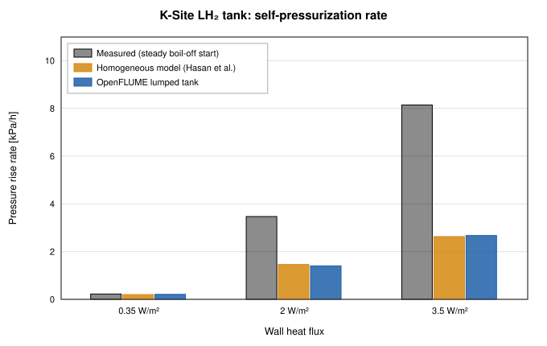

# Liquid-Hydrogen Tank Self-Pressurization Validation of OpenFLUME

**Validation against experiment: pressure rise of a 4.89 m³ liquid-hydrogen tank under a uniform wall heat flux (Hasan, Lin & Van Dresar, NASA TM-103804, 1991)**

Generated by `scripts/tank-pressurization-validation-report.ts`. All model
numbers and the figure come from live solves of the current solver. The case
is defined in `src/validation/tankSelfPressurization.ts`; the CI gate is
`src/validation/__tests__/tankSelfPressurization.test.ts` (scientific tier,
`npm run test:all`).

## Abstract

A closed cryogenic tank pressurizes as heat leaks in. In the lumped,
homogeneous limit the whole contents stay at one saturation state, and the
rise rate follows from energy conservation at fixed density. OpenFLUME
represents a tank as one internal node with volume, which is exactly that
limit. Against the three heat fluxes of Hasan et al. (0.35, 2.0 and
3.5 W/m²) the lumped tank reproduces an independent analytic homogeneous
calculation to 0.15 % and the paper's own homogeneous model to
−3.9 % to +5.6 %. The measured rise is faster than OpenFLUME's by a
factor of 1.07, 2.47, 3.05, increasing with heat flux, as expected of a
thermally stratified tank in which heat is absorbed near the liquid surface
while the bulk stays cold. A single-node tank cannot represent
stratification; in these data it is the lower envelope of the measured
rise.

## Experiment

Hasan, Lin and Van Dresar heated the K-Site flightweight liquid-hydrogen
tank (a 2219 aluminum oblate spheroid of 4.89 m³, major diameter
2.2 m and axis ratio 1.2, insulated with two 17-layer blankets) 83–84 %
full, in normal gravity, at three uniform wall heat fluxes. Table 1 of the
report (`validation/data/digitized/tank_pressurization/hasan1991_tm103804_pressure_rise_rates.csv`)
gives the quasi-steady pressure rise rate after the initial transient for
two initial conditions (steady boil-off and isothermal liquid), the pressure
range over which it applies, and the rate of the authors' homogeneous model.

The other tank datasets in the same directory are not used, because a
lumped equilibrium model would not test the physics that governs them:

- no-vent fill (Moran et al. 1990; Moran 1992; Chato 1993) and the
  charge-hold-vent chilldown of Chato and Sanabria (1991): the pressure is
  set by spray or jet condensation at the liquid surface and by the
  chilldown of receiver walls, and the digitized tables lack the wall mass
  of most receivers;
- pressurized expulsion with gas injectors (DeWitt et al. 1966) and with
  submerged helium injection (Johnson 1967): the first depends on ullage
  stratification and gas-to-wall heat transfer, the second on a
  helium–hydrogen mixture with interphase mass transfer, which OpenFLUME's
  single-component two-phase model does not represent;
- the multilayer-insulation heat-leak tests (Martin & Hastings 2001) and the
  spray-bar thermodynamic vent system tests (Hastings et al. 2003): the
  first measures a heat leak, which a network model takes as an input, and
  the second is governed by active mixing and Joule–Thomson vent cycling.

## Model

One internal node holds the tank volume, initially saturated para-hydrogen
at the lower end of the stated pressure range with liquid filling
83.5 % of the volume. Heat enters at q·S, where S = 14.02 m² is the
area of the stated spheroid (a = 1.1 m, c = a/1.2) scaled uniformly by
1.0172 to the stated volume (the stated dimensions give 4.65 m³).
A closed valve joins the node to a boundary node because a network needs one
boundary; the largest flow through it after t = 0 is 1.6e-6 kg/s.
Transients use backward Euler with 60 fixed steps across the stated pressure
range, and the model rate is that range divided by the time to traverse it.
All three solves converged.

The analytic reference integrates m du/dt = q·S at fixed density
ρ = m/V and reads the pressure from CoolProp's (ρ, u) state, the
homogeneous model evaluated without the network solver.

## Results

Rates in kPa/h; "ratio" is measured (steady boil-off start) over OpenFLUME.

| q [W/m²] | P range [kPa] | Measured, boil-off start | Measured, isothermal start | Homogeneous (Hasan et al.) | Homogeneous (analytic) | OpenFLUME | Ratio |
| -------- | ------------- | ------------------------ | -------------------------- | -------------------------- | ---------------------- | --------- | ----- |
| 0.35 | 121–128 | 0.223 | — | 0.198 | 0.209 | 0.209 | 1.07 |
| 2 | 159–172 | 3.470 | 3.630 | 1.460 | 1.403 | 1.403 | 2.47 |
| 3.5 | 186–200 | 8.140 | 8.270 | 2.630 | 2.673 | 2.672 | 3.05 |

OpenFLUME agrees with the analytic homogeneous rate within
0.15 %, which verifies the lumped real-fluid tank (two-phase
storage, heat input, the closed-valve boundary) on this problem. It agrees
with the paper's homogeneous model within −3.9 % to +5.6 %; the
difference is consistent with the uncertainty in the wall area and fill
level used here and with differences between modern para-hydrogen
properties and those of 1991.

Against measurement, the lumped tank under-predicts the rise rate by a
factor of 1.07, 2.47, 3.05 at 0.35, 2.0 and 3.5 W/m² (Figure 1). At the lowest
heat flux the tank stays close to homogeneous; at the higher fluxes heat
deposited near the liquid surface warms a thin layer, the ullage pressure
follows the surface temperature, and the bulk liquid lags behind. This is a
model limitation, not a discretization error: refining time steps does not
change a single-node result. Representing stratification would need a
multi-node tank (vapor, interface layer and bulk liquid as separate nodes
with interfacial heat and mass transfer), which OpenFLUME does not provide.

*Figure 1. Quasi-steady self-pressurization rate of the K-Site tank: measurement (steady boil-off initial condition), the homogeneous model of Hasan et al., and OpenFLUME's lumped tank.*

## Trust Levels

| Comparison | Evidence class | Trust level |
| ---------- | -------------- | ----------- |
| OpenFLUME vs analytic homogeneous rate | Analytic verification | Verified to 0.15 % |
| OpenFLUME vs homogeneous model of Hasan et al. | Code-to-code (published model) | Agreement within the input uncertainty |
| OpenFLUME vs measured rise rate | Validation against experiment | Documented disagreement: under-predicts by 1.07, 2.47, 3.05× |

## Conclusions

A lumped OpenFLUME tank is a correct homogeneous-equilibrium tank and
should be read as one. For the closed, heated K-Site tank in normal
gravity the measured rise was 1.07 to 3.05 times the homogeneous
prediction over 0.35 to 3.5 W/m². Analyses that depend on the pressurization rate of a stratified
tank (lock-up time, vent cycling) need a stratification model that
OpenFLUME does not have.

## References

1. Hasan, M. M., Lin, C. S., and Van Dresar, N. T., "Self-Pressurization of a
   Flightweight Liquid Hydrogen Storage Tank Subjected to Low Heat Flux,"
   NASA TM-103804, 1991.
2. Bell, I. H., Wronski, J., Quoilin, S., and Lemort, V., "Pure and
   Pseudo-pure Fluid Thermophysical Property Evaluation and the Open-Source
   Thermophysical Property Library CoolProp," *Industrial & Engineering
   Chemistry Research* 53(6), 2014, pp. 2498–2508.

## Nomenclature

| Symbol | Meaning |
| ------ | ------- |
| a, c | equatorial and polar semi-axes of the spheroid |
| m | mass of tank contents |
| P | tank pressure |
| q | wall heat flux |
| S | tank wall area |
| u | specific internal energy |
| V | tank volume |
| ρ | mean density of tank contents |
